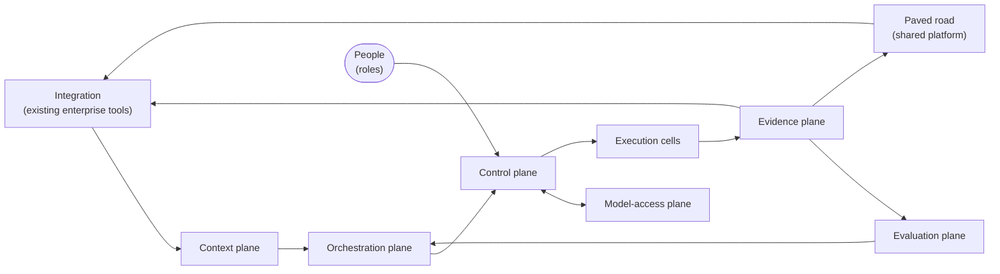

# Authority and independent checks stay outside the agents

*Ratchet: closed-loop security validation for AI-assisted engineering. Part 4 of 4. Edition 5.1.2, Thesis 1.4.2, 2026-10-30, build 13fabeae+local.*

Part 1, *The strategy, carried forward from the brief and the six-pager*, explains each of the four rules and its exceptions with the invoice example. This part is the reference architecture: planes and trust zones, a core platform with pluggable modules, how controls fail, the key diagrams, and the AWS mapping in brief. The controls it describes enforce the rules' separations outside the agents.

The architecture is written as the design model that part 1 introduces: parts, the relationships between them, and **contracts**, the typed records each relationship may carry. Tools compile the design model and check it, and an organization changes it through patches, its recorded design changes. Below, a design check is one of those checks, and the build is the run that compiles and checks the design model.

## The architecture keeps control outside the agents and lets every other part be swapped

The full design combines Ratchet, Jig and their shared agreements. Jig is the sibling design that checks code as it is written. Together they have 135 parts, 28 of them from Jig, in 9 planes, and 15 roles that people hold. A **plane** groups parts with one job. A **trust zone** groups parts by what they may reach and who controls them. The diagrams show both. Every part names a technology class with open-source examples, offered as illustrations only. The full list is in reference R2.

| Plane | What it does | Parts | Swap points | Existing tool first |
|---|---|---|---|---|
| **Context** | Facts, intent, consequence and snapshots the reasoning side may read. | 9 | 0 | 4 |
| **Orchestration** | Requests, durable workflow, dispatch and test-drafting agents. Proposes; never executes. | 14 | 6 | 2 |
| **Model access** | The single path to models, with data gates and route qualification. | 6 | 3 | 3 |
| **Control** | Exact-action authorization, grants, credentials, audit, gate failure policy, keys, privileged access, policy release and the model-boundary gates. | 17 | 5 | 8 |
| **Execution** | Isolated cells where granted actions run. | 8 | 1 | 1 |
| **Evidence** | Intake, independent verification, disposition, ledger and evidence stores. | 21 | 0 | 8 |
| **Evaluation** | Cohorts, matched evaluation, promotion and cost telemetry. | 15 | 1 | 5 |
| **Paved road** | The shared platform paved road engineers build on (portal templates, base images, libraries, gateway policies, secure defaults). | 2 | 2 | 1 |
| **Integration** | Adapters to the organization's tracker, CI/CD, IAM, change management, SIEM, and external systems. | 43 | 29 | 37 |

*The planes. Control is held apart from orchestration and execution, and the two gates on the model path sit in the control plane with their own deployment and administrators, so no agent-facing part can grant itself permission or switch off the gate that guards it. Roles are counted separately. Swap points are parts whose product can be replaced behind a stable contract; existing tool first counts the parts an organization starts with a tool it already runs.*

The **control plane** holds the permission checks and protected evidence. Its administrators are separate from those who run the agents and testing platform. The gate on outgoing model requests decides first by eligibility: which sources and data classes a task may send to which model route. Detecting content such as secrets and personal data is a second layer behind it, because detectors recognize those far better than source code, designs or business logic, which make up most of an engineering estate's non-public data. That gate is one of three controls on the way out, with the quarantine that keeps outsider text away from producers (the agents and tools that produce tests) and the route registry that admits only eligible endpoints.

No model sits in the orchestrator. The workflow engine, the request dispatcher, the dispatch queue and the workflow state decide what runs next, lease and retry tasks and hold each run's state, and none of them calls a model or sits on the model path. A model's output reaches them only as a typed record, passed on by a part outside the model path. An agent's reply therefore cannot rewrite the workflow's state or its plan, and the build refuses a design that adds a model call to any part marked as orchestrating.

### An organization adopts a core of 90 parts and plugs in modules when evidence supports them

Ratchet is a core platform: the loop, its four rules and the record. 90 of the 135 parts form it. The other 45 sit in 5 pluggable modules, each switched on only when its entry evidence exists:

- **Production effects**: 1 part
- **Consequence-informed gates beyond tiers**: 2 parts
- **Paved road**: 5 parts
- **Existing security tools as leads**: 9 parts
- **Secure creation (Jig)**: 28 parts

Each module plugs into the loop at one of four places. Signals in feed the loop and help choose what to test: the organization's existing security tools, read as leads. Stakes weigh consequence: consequence-informed gates. Reach sets where tests may act: production effects. Prevention out carries proven results to where code is written: the paved road, and secure creation, the loop where developers and their coding agents write code.

Most organizations already run some version of several modules, disconnected from each other: scanners whose output nobody reproduces, a business impact analysis, a paved road the platform team owns, guardrails around coding agents. A module is mainly how Ratchet wires that existing practice in, and it is built only where nothing exists. So every module declares, in one place, its category, its interface points (what crosses, in which contract, over which relationships), the test that switches it on, how it keeps each of the four rules, the ownership separations it needs and the practice it wires in. The design checks refuse a module that leaves any of these out.

Wiring an existing practice is mostly interface work, and the interface comes first, because existing systems are rarely to standard. Each connection improves in three steps. **Connected** means data crosses through whatever the existing system allows. **Conformant** means the data matches the agreed contract. **Aligned** means the practice keeps the four rules and required separation of owners, or carries a recorded exception. 

The declaration states each point's target from day one, and the organization records where each point stands today. The profile check reports every point below aligned as a warning. It refuses a point that has stayed below aligned longer than the organization's limit unless an exception covers it; with no limit set, the limit is the longest an exception may last. It also refuses a point that is only connected where it reaches a part an agent can reach (a coding agent, the context builder or a test-drafting agent), because until what crosses matches the contract, nothing keeps untrusted text or a proof condition out of the agent's sight.

### A module's boundary is a seam, and a crossing the seam does not declare is refused

The design model declares each module's boundary as a **seam**: the relationships that cross it and the contracts each one may carry. The authors write a module's interface points once, and the build derives the seam from them as it compiles the design model. One rule judges every seam. A relationship whose two ends sit on opposite sides of a seam, and that the seam does not declare, is refused, unless every contract it carries is of no concern to any check; such a relationship is only listed. A relationship carrying no contract at all is refused.

Whether a contract concerns a check is a mark the checks work out on every run, so a crossing an organization adds is judged at once. A contract is marked when, for example, it reaches a part an agent can reach, rides untrusted content, or is measured feedback to a person who decides. A person may raise a contract's mark, with a reason, and may never lower it. Every crossing endpoint also declares whether an agent can reach it, with its other exposure marks. A missing declaration fails the build, because silence would otherwise read as "not exposed". When a patch removes a part or a relationship, it also takes that item out of every seam that names it.

Security, the engineer who owns the code and an agent develop the fix and its local regression test in one pull request. The owning team reviews the change and owns the test in its suite. Coding agents can see that test and its results. Nobody quietly changes the pull request to address a newly found variant. The variant enters the normal loop as a new finding.

Security separately checks whether weaknesses combine into a complete attack path. This is **aggregate validation**, the independent layer. Its proof conditions state what would establish or refute a weakness. Those conditions, connected attack steps and expected outcomes stay with the independent security reviewer. The protected regression stage carries these checks. It can find a remaining path even when the team's visible test passes. Ratchet has no separate set of hidden variant tests. Security owns tests for whole weakness classes in shared defaults and guardrails. Coding agents see checks derived from those tests.

Security's **kept-test mirror** automatically inventories every kept test. It reads the team suite and metadata about the independent checks. It records test versions, code revisions, configuration, dependencies and observed runs. It reports removed, skipped or failing tests as findings. Missing, old or mismatched observations mean protection is unknown. A risk reviewer needs a recent passing run matching the revision and scope under review. A local pass never substitutes for aggregate validation. The mirror cannot write code, pull requests, tests or their status.

A seam also lists the contracts that never cross it, and no exception covers one. Between Ratchet and Jig these include proof conditions, protected aggregate regressions, failure classes (the full internal class records, with their member findings, services and highest tier reached), the full assurance record for shared secure defaults, the full class-test result and aggregate replay results. The team's separate local regression is visible in its repository. A strictness exception (part 3) covers the rest: it flags a crossing instead of refusing it, and only while its acceptor and its end hold.

### Ratchet and Jig share one layer, and each side answers only for its own end

Ratchet and Jig are two designs with two editions, and what both reference lives in a third place, the **shared layer**. It holds every crossing between them, written whole, and the contracts both read or write. It also holds the engineering system both depend on with its premises and an owner role, the capabilities Jig's work units wait on, the systems and zones both place parts in, and each seam's declared exposure and never-cross list. Neither design's model references the other's parts. Ratchet's release alone pins the Jig edition by hash. The layer has a version of its own and ships byte for byte in both editions, and a change to it needs a new version and a section in the changelog entry of each edition that ships it.

Ratchet pins the Jig edition it ships with, by the hash of that edition's record, and its release refuses unless that Jig edition is released with that hash and shipped the same shared layer. Jig pins nothing, so Jig ships first. The checks run on four compositions: both designs with the shared layer, each design alone with it, and Ratchet's core without any module. A design alone judges each crossing at its own edge, reading the far side's declared exposure from the shared layer, so a lone Ratchet still judges every feed into Jig's agent-reachable parts. An organization's tools read one composed model.

Each side answers only for its own end. A failure scenario that spans the seam is filed under exactly one responsible agreement, never a person: one design's obligation, a shared premise or a shared contract. A shared contract or premise carries scenarios that test whether the agreement is adequate, which is a different question from whether either side kept its end. A change to a shared contract or premise needs the acceptance of the owners of the sides of that agreement, recorded on the patch that proposes it and checked by the build. For the engineering system's premises, its owner counts as a side.

### Every contract is held to its listed readers, and a widened audience needs an exception on record

Each contract lists who may receive it, and the design checks refuse a relationship that delivers a contract to a part its list does not name. The shipped design meets this in every composition. Where a list was stale, it was corrected. Where a connection delivered more than the part should read, the connection was cut back: a limit recorded on it, the contract dropped from it, a narrower status record carried instead, or a new record that holds only what the receiver needs. The same check applies to what an organization's patches add, and an organization that wants another reader for a contract lists it in the contract with its own patch.

A restricted contract needs more. Its audience widens only through an audience exception in force in the organization's own file, with the contracts, a risk acceptor, an end and a reason, in the shape seam exceptions use. The exception turns only the check failure that the widening causes into a warning that names the acceptance. No rule gets a warning stage of its own. The shipped default sends issue and review text to the quarantined reader alone, and an organization that tailors it files the exception.

### Records a coding agent can read carry limits, and four gaps remain

A coding agent, and the model provider behind its route, reads whatever Ratchet sends to Jig's agent-reachable parts, so each of those records carries a limit. These are producer duties and review criteria; the design checks do not mechanically enforce the free-text content bounds. A derived check holds a general pattern for its weakness class. It never exposes the protected aggregate test's input, test data or expected behavior. This restriction is separate from the team's visible local regression test. 

What crosses instead is a **proven class**, a restricted projection of a failure class that has at least one independently reproduced member. A proven class shows its existence, its definition and the rule that fixes it, and its definition names no service, component, path or file of the organization's own. While any member finding is open, the class shows no member count, no services or components spanned and no highest consequence tier, and a class in a third-party component names the component without its versions until a fix exists. 

For each version of a paved-road entry, the road's assurance record gives only current or not current. It gives no per-class outcomes and no reason for a status change, including a failed vetting or a withdrawal after a leak. Its vetted scope and known limits use API and configuration identifiers and named pattern classes, never an input shape or sequence. The check suite and Jig's measurement plane receive pass or fail for each rule version, and per-class totals go to the policy-owning team: people, never an agent.

Four gaps remain and are listed as known issues. A class definition has no send-time check against the estate's inventory, so free text can still name a service. Nothing mechanical bounds the free text in a derived check or in road scope. Fixing briefs and the history of versions and derived checks can support inference about a class. And a reader who joins a status change, a class-version change and a dropped road claim over time can infer a leak. The authors accept that last one as a risk. An organization that wants less of it can batch status changes and changes to the projected class records on a fixed schedule and keep a neutral "not answering" claim in place of a dropped one.

### Earned autonomy is a grant record, and every finding carries how it was validated

**Promotion review**, the decision that approves a model or route for use, holds each **autonomy grant**: the kind of judgment it covers, the business risk owner who granted it, the security risk owner who concurred, its expiry, and the honesty and correctness records it rests on. A sampling frame, the defined set from which samples are drawn, checks findings validated under a grant by a different means, and the grant lapses when either record slips. Every accepted finding records how it was validated, by independent reproduction or under a named grant, so each measure can be reported with and without the findings the system validated itself. A grant lets a judgment of its kind stand without independent reproduction, which changes what Ratchet may learn from; it authorizes no action on any system. Each grant sits inside the design limit for its kind of judgment, and promotion review refuses one that reaches past it.

What the system learns from its validations sits in a **learning store** that only disposition review, the review that records each finding's outcome, writes. Each item records who confirmed it, or the grant it was validated under, and any outsider label on its inputs with the record of who cleared it. The store checks that provenance again before an item reaches an agent's context, withholds an item with no provenance, an uncleared label or a lapsed grant, and reports each quarter the share of withheld retrievals that trace to items stored without provenance, a share that should fall. Memory an agent keeps between runs is held to the same rule. A vector store or scratch memory that an agent writes and that is read back into an agent's context is marked as a learning store, so only disposition review writes it. The one exception is an agent that writes it only in fields the store's schema check constrains.

The outsider label is carried on the records at run time and checked where they are used. Each record holds its labels field by field. The part that assembles an agent's context and the gate on every model request compute them, outside the agent, and the agent never declares its own. Evidence carries the labels on, and the verifier clears only the fields its checks constrain, such as a verdict, a status class or a hash. The steps an agent wrote and the target's responses keep theirs. 

The learning store recomputes an item's labels from its inputs when the item is written and again when it is read, and withholds any item whose recorded labels miss one. It reports each mismatch. 

A fixing agent, and the part that drafts each fix, receive a weakness only as a **fix brief**. A person writes it, or a builder with no model in it derives it from constrained fields and a reference to the stored reproduction. A brief that needs free text goes to a person. 

Clearing labeled text is itself an approval, measured like the others: a work-in-progress limit for each person who clears, seeded requests carrying a planted instruction, drift in how often each person clears, and the time to decide.

Clearing a label means only that a field can no longer carry instructions. A check with no model in it can show that a field holds one of a fixed set of classes; it cannot show that the class is right. A class a model chose after reading a crafted bug bounty report carries no instructions and is still the outsider's choice, so a cleared field may order work, and nothing authorizes on it.

### The design limits what each agent can touch, and authority gates are tiered by consequence

The **dial register** lists adjustable settings, their allowed bounds and who may change them. For each agent route and each kind of judgment, it holds a **design limit**: the highest consequence tier it may touch, the environments and the action classes. The security risk owner sets every limit. The business risk owner sets a **consequence line**, at or above which a person approves every action whatever the limits say. The policy decision point, the control part that works out what approval each action needs, reads both, and the current tier of each asset, before anything runs. An action inside its limit and below the line may run on a standing permission or batch approval once the trust gate holds, and only through the authorization service; any other action needs a person's approval of that exact action.

An organization that declares no limits keeps the approvals it had before limits existed: kept regression tests replay on their reviewed batch approvals and standing permissions along the cadence ladder (how often a kept test replays: with the periodic assessment, on a schedule under a batch approval, or continuously under a standing permission), and every other action goes to a person. Limits take effect once the consequence line is set too. From then on, those replay permissions are grants like any other and sit inside their producer's limit, and an agent route with no limit sends every action to a person.

The approval service never issues a standing permission wider than the limit, and promotion review never grants autonomy past it, so a clean record can widen what an agent may do up to its limit and never past it; widening a limit is a recorded change by the security risk owner. 

When a limit narrows, the line drops or an asset's tier rises, the register issues a new limit version, every outstanding standing permission, batch approval, earned-autonomy grant and dial is checked against it, and any that is wider lapses at once. 

Design checks confirm that every part granting authority without a per-action approval reads its limit from the control zone. They also confirm that only the two risk owners, or a control-zone part that grants no authority itself, ever send a limit or the line. The profile check refuses a standing permission, grant or dial wider than its limit unless an exception covers it, and refuses a limit or line recorded as set by anyone else. 

Changing action limits does not waive acceptance checks. The separate autonomy grant described above can waive independent reproduction. The two human closure acceptances remain required.

The policy decision point and the approval service read limits, the line and current tiers from signed copies that carry a version number and a lease. The register pushes a narrowing to them at once, they never accept an older version than the one they hold, and a copy whose lease lapses unrenewed sends every action that would run on a grant alone to a person. A register outage therefore stops no decision, and a stale copy never widens one.

Phase 2 tests what predicts the cost of an agent's errors. Before each action it records two predictors: the route's trailing accuracy over a window the organization names, and the tier its limit allows with the action's class. Accuracy comes from the independent check, or from the sampled check for actions that ran on a grant alone. Each wrong action's cost is measured apart from both: time to recover and the incident severity the defensive side sets. The limits restrict the range of the second predictor, so the comparison holds only inside them. Wrong actions should be few, so "sample too small to decide" is a likely result; the decision owner then keeps the limits as they are.

### Only the deploy gate can hold up a release, and its outage behavior is decided in advance

For the teams that ship through Ratchet, availability matters most in one place: the regression gate in their deploy path, the only part of Ratchet that can hold up a release. The other two paths that matter, approving and running a test and recording evidence, make security work wait when they are down and never block a team's release.

Each part has a **quality tier**, a reliability class kept apart from the consequence tiers of assets, with default targets that a profile can override. The control tier favors safety over availability: when a control is down, nothing new starts. The cell holds a signed restore and its credential, and starts restore at the injection time limit without calling the control plane. The current design does not establish that the restore's authority lasts until it completes, or that the restore finishes by expiry; part 3 records this as the restore gap. 

A path is only as available as every part it waits on, so the table also gives the **availability** of the three paths that matter, worked out from their parts. These path figures are the design defaults multiplied along each path; nobody has measured them yet. Running an approved test comes to 99.75% against a 99.90% target, about 108 minutes of downtime a month. Recording and verifying evidence comes to 99.00% against 99.50%. Both fall short of their targets, and both fail safe: a request waits, or evidence queues locally in an outbox, so nothing unsafe runs and no evidence is lost. 

An outage on these two paths cannot cause an unapproved effect, but it delays verification and fixes, which keeps a known weakness open longer; queue age per team shows that cost.

The fix-cap gate is the exception to waiting. While it is down, findings that would pass it anyway go straight to their owning team: those already exploited, those reaching an asset at or above the consequence line, and those with an external disclosure deadline. The gate logs each one for review when it returns. Every other finding waits. Ratchet states the figures as they are and spends nothing on redundancy to reach the target.

The regression gate in the deploy path is the one path that holds up other teams. It answers from the execution cell alone, using permissions signed before each deploy window. Counting the cell's four co-deployed parts as one unit, it reaches 99.90% against the 99.90% owed to service teams, about 43 minutes a month when deploys wait or follow the agreed outage policy. If the four fail independently, the same path comes to 99.60%, about 172 minutes. The figures model two failure assumptions. Phase 2 measures the running path before an organization publishes its availability. Neither figure counts the staging target the replay runs against: a target that is down gives an unknown verdict, and the agreed outage policy applies.

The shipped default is under ten minutes of security test time at every delivery stage, including pull request, merge and deploy. The organization can change it in its profile, and the measures report time at each stage. This is a design default, not a measured result. The total security test time at each stage shows whether an organization meets that default.

| Tier | Intent | When a dependency fails | Default availability |
|---|---|---|---|
| **Control safety** | Authorization, grants, credentials, audit and live prerequisite checks. Wrong answers are worse than no answer. | fail closed | 99.9% monthly (unavailability blocks actions, never permits them) |
| **Evidence integrity** | Intake, verification, disposition, ledger, evidence and closure. Losing or altering evidence is the failure that matters. | queue and retry | 99.5% monthly |
| **Orchestration** | Requests, workflow, dispatch, test-drafting agents, context build and model access. Delays are acceptable; duplicate or phantom effects are not. | queue and retry | 99.5% monthly |
| **Best effort and analytics** | Evaluation, telemetry, sampling and dashboards. Gaps reduce what can be claimed; they never change what can be done. | continue without | 99% monthly |

| Critical path | What must answer | When a part is down | Availability (design estimate) |
|---|---|---|---|
| **Approve and run one test** | 10 parts must answer, 2 co-deployed units | nothing runs; the request waits | 99.75% against a 99.90% target (about 108 minutes a month); 99.05% if the co-deployed parts fail independently |
| **Record and verify evidence** | 2 parts must answer | evidence waits in the outbox; nothing is lost | 99.00% against a 99.50% target (about 431 minutes a month) |
| **Regression gate in the deploy path, blocking mode** | 4 parts must answer, one co-deployed unit; given the pipeline reached the stage | the stage applies its pre-decided posture | 99.90% against a 99.90% target; 99.60% if the co-deployed parts fail independently |

*Quality tiers per part, and the critical paths worked out from them. Defaults are starting points that each organization overrides in its profile. Each path figure multiplies those defaults along the path and counts parts deployed together as one unit; where a path has such parts, the table also gives the figure if they fail independently. Both are estimates from the design that nobody has measured.*

A blocking regression test sits in every owning team's deploy path, so its outage behavior matters to everyone. Ratchet sets that behavior when a finding is accepted, from what the protected path reaches. A **crown jewel** is an asset whose compromise would be most damaging, recorded with a consequence tier drafted by the testing team and confirmed by the line-of-business owner. By default, a gate protecting a path to a crown jewel or critical asset holds affected deploys when it is down, and a gate on a standard asset lets them through with a record. Only deploys that touch the regression's declared dependencies are held. 

Kept tests can also leave the blocking path, each in a recorded way. One leaves it once a cheaper kept check covers its weakness class and itself fails against the test's reverted fix. A quiet one, a test that has gone its set quiet period without failing, moves only its extra time-based runs to a slower lane and still blocks deploys that touch its declared dependencies. A flaky one is quarantined as an exception under a cap. And each is re-proved on a schedule against its fix reverted, leaving the blocking path on a "no longer fails" result only once the verifier confirms it. 

Shipping through a held gate needs an expiring acceptance from the business risk owner with the security risk owner's agreement, and a replay runs when the gate recovers. Priority comes from consequence, demonstrated paths and attacker-side signals. An agent's opinion about exploitability never sets it.

Delivery health is watched with the five delivery metrics: change lead time, deployment frequency, failed deployment recovery time, change fail rate, deployment rework rate. Security's own measures sit beside them: the **escape rate** (security weaknesses reaching production per deployment, with the same denominator as change fail rate, by weakness class, against the organization's measured starting point, from the finding ledger and deploy records), **time to remediate** (an analogue of failed deployment recovery time: from a reproduced finding to a fix verified in the deployed system, from the finding ledger, the tracker and deploy records), the **remediation change fail rate** (change fail rate counted on security fixes alone) and the **cost per validated novel finding**. The escape rate is compared with change fail rate only once both are collected the same way over enough deployments. 

These are outcome measures. The evaluation plane holds the efficiency measure: phase 3's matched comparison of Ratchet against today's process and a no-agent baseline, which shows whether an agent beats a script per finding. Neither answers the other's question. A finding is novel when no earlier record in the finding ledger has the same path key: its weakness class plus a defined path, made of the service and entry point the demonstrated path starts from, the identity or role it acts as, and the asset or action it reaches.

Each escape carries a record in the finding ledger. The record names the source and role that detected the escape, the deployment it is attributed to from the machine deployment record, whether detection fell within the organization's window after that deployment, and the role that confirmed it by reproducing it through the running system, which differs from every detecting role. Its cost travels with it: the consequence tier of each asset its path reached and the services affected, the time to recover from detection to a fix verified in the running system, and whether the closure removed the weakness class (constraint enforced) or one instance (path broken). The escape rate counts only confirmed escapes detected within the window. Late and unconfirmed escapes are listed apart, and from phase 2 on the report shows consequences beside every count.

Each finding has a **finding kind**, and the kind decides how the finding closes. The design model holds a registry of kinds. Each kind declares its closure check (what is checked, which part judges it with no model, and the outcome it must record), the kept gate that stops its return, its recovery measure, and what never closes it. The design checks refuse a kind whose closure check a model would judge. A finding with no kind is a **path** finding and closes as described above. An organization adds a kind of its own by patch to the registry, and the same checks judge it. The edition ships two more kinds.

An **exposed secret** is a credential found in code, history, logs or tickets, and deleting the string leaves the credential working for anyone who copied it. Every scanner hit, and every credential a person reports, goes to the exposed-secret intake, a part in the control zone that replaces the value with a fingerprint before anything stores it. It seals the value under the owning team's key only when a check needs the value, and the value is destroyed after that check. 

The owning team revokes and rotates the credential through its fix path. No agent revokes, rotates or holds it. Revocation is proven per credential type, by a recipe kept in the regression catalog. The issuer's status, looked up by the credential's identifier, comes first and needs no value. 

Where the issuer offers no status lookup, a status probe tries the old credential: announced to the detection side beforehand, sent from a fixed address, and repeated over the issuer's stated propagation time. A response counts as refused only when it carries a code the recipe maps to revoked. 

Sessions and tokens derived from the credential are named and recorded as ended. A credential type with no recipe closes on the owning team's attestation, labeled as attested. 

Before closure, the detection side reviews how the credential was used from its earliest exposure to its failure, and unexplained use opens an incident and keeps the finding open. Issuer logs often reach back only months, so a stretch no log covers is recorded as not verifiable, with its dates, and the finding then closes only when the security risk owner accepts the risk of that stretch, by name and date. Revocation is still proven. 

The kept test is the scan rule that blocks the same secret's return. The time from detection to the credential failing is the finding's **time to revoke**, reported in place of time to remediate. When the secret had reached production, the escape record reports it as the time to recover.

An **infrastructure misconfiguration** is live configuration that differs from its declared intent, such as an identity policy, a network rule or a storage setting. It is the worked example for infrastructure flaws. It closes only when the release-state correlator, the part that compares deployed state with declared intent, reads the live configuration through the estate's own interfaces, with no model, and finds it matching the intent. A closed ticket or a merged change to the infrastructure code never closes it. Its kept gate is a policy check on the infrastructure code or drift detection on the live state, and its recovery measure is **time to conform**, from detection to the first matching read. The edition ships no kind per platform: flaws in an organization's own cloud or data centers fit this kind, or a kind the organization declares.

### Ratchet's own control plane is built, tested and administered like the systems it protects

The control plane's guarantees are only as good as the code and models it runs. Ratchet's own software and runner images are built on a hosted, isolated build platform that signs [SLSA Build Level 3](https://slsa.dev/spec/v1.0/levels) provenance, follow the organization's secure development requirements, and reach a cell only through the release pipeline. The enforcement point inside each cell starts nothing whose signature, provenance or digest fails to verify. 

Self-hosted model weights are ingested on the same build platform and released by digest with a signed attestation. The route registry pins that digest only after the attestation verifies against a key reference that key management sends to the registry directly, the same way the enforcement point verifies software before it starts. The model gateway serves a route only when the loaded weights match its pin, so new weights are a new route version that serves nothing until it is qualified again.

Release admission refuses replay. Each cell keeps a durable high-water mark, the newest release it has accepted, and accepts an older release only under a signed, single-use rollback. Withdrawal is per cell, so another cell can still admit a release withdrawn elsewhere. Fleet withdrawal, taking a release out of service across all cells, needs a separate protocol. Two known issues remain: provisioning state has no contract of its own, and a cell restored from backup is not detected. The parts-and-contracts reference gives the admission protocol.

The loop cannot independently test the parts that judge it. A team outside the program, reporting to neither the assurance unit nor the team that runs the agents, runs a recurring exercise against the control and evidence planes under scope the security risk owner approves, and its findings enter the record and are reproduced, dispositioned and fixed like any other. A phase 3 unit proves the first exercise ran.

Every person who approves, decides or sets a limit hears how those decisions turned out, from the part that knows. Approvers, the people who clear outsider text, proof-condition holders and deciders receive their own seeded catch rate. The other roles receive the measure their decisions are graded on: an owning team its time to remediate, for instance, and the security risk owner the wrong-action rate under each design limit it set. The build fails the shipped design if a person who issues a control or authorization action receives no such measure. A role the organization adds is held to the same rule, and its gap fails the build too. A seeded catch rate is restricted to the people its contract lists, so the build flags any relationship that carries it to anyone else, and a gate role the organization adds is listed before it receives its rate.

Three properties are checked by the build on every part, so a part added later cannot slip past them: every part in the control zone is administered only through a broker under dual control, either the shipped privileged access broker or a privileged access tool the organization declares as a broker, and a control zone with no broker fails the build. Every store states its partition keys or why it holds no evidence content, and a store giving that reason receives evidence records only as ids or references. And every part is named by a failure scenario with its runbook. 

Evidence custody is checked the same way: every kind of evidence record that a part produces lands in at least one store partitioned by keys, and every evidence relationship into a store names the records it carries. What the independent verifier and the intake validator observe is its own record, kept only in the protected evidence store, so removing that store without a partitioned replacement is flagged. Every part that steers a coding agent declares whether it is a coding harness, so a harness drawn without its parity declaration (part 3: whether it has a stop gate, exports telemetry, pins its version and has hooks that can block) is caught before anyone relies on it. 

A fourth check fails the build when a part that fails closed waits on an input that recovers more slowly than it does. Learned items, fix briefs and revocation records are signed, so a record changed after it was written no longer verifies. A closure or escape attribution that rests on deployment provenance below SLSA Build Level 2 is labeled self-attested, because below that level the team that ships a fix also writes the record that says it shipped.

Administrative requests and approvals are auditable even when no session opens. Before acting on either input, the privileged access broker appends its authenticated sender, request reference, payload hash, scope, receipt time and decision with any refusal reason to protected audit. Neither requester nor approver can alter that record. If audit cannot append, the broker refuses the input and opens no session. Retries append attempts under the original reference. The two new audit closure rules remain proposed until independent review.

The design is also threat modeled from itself. A generator in the pipeline reads the compiled design and emits a STRIDE cell for each letter on every relationship that crosses a trust-zone boundary, and a cell for each of the four ways, in STPA, that every control action can cause a loss: not given, given when unsafe, given too early, too late or out of order, or stopped too soon or applied too long. It closes a cell only where a contract field states the guarantee, and records that field. Every other cell is a lead: independent security staff judge the cells with known-real and known-false ones seeded among them, and each accepted threat becomes a design check, a failure scenario, a kept test, a profile field or a Jig rule. A rule that closes a cell (a closure rule) carries a reviewer's mark only after a person independent of its author has reviewed it, and the rules that an independent attack broke or left unsettled ship without one, so their cells stay proposed. [Annex A6](A6-threat-model.md#a6) describes the method, which stays a proposal until its recall against the record is graded.

### The edition includes runnable tools for checking and tailoring the design

Each edition includes **ratchet-tools**, a code bundle that needs Bun and no npm packages. It provides tools to combine the design files (the composer), apply an organization's reviewed design changes (the patch applier), run the design checks, show what a change affects (the impact report), generate the threat grid, check the work-unit plan (the unit graph), move to a new edition (the upgrade tool) and check a profile (the profile checker). They do not implement the operational testing platform. Readiness checks, status reports and figures still need their own proved tools.

Every bundle file has a hash in the edition manifest. Before release, every bundled tool must pass all the test cases for its edition from a copied edition. The specifications and fixtures remain the design documents from which the tools are built. An organization can build its own tools, but Ratchet makes no compatibility promise for them. The optional blind-build check tests a build from the documents alone. It no longer blocks release.

### Two diagrams show that effects pass through authority outside the agent

FIG-PLANES: the planes and the main flows between them. Reference R2 lists every contract that crosses between planes.

FIG-CONTROL-BOUNDARY, the control boundary: agents and the model gateway sit in the reasoning zone. The model-boundary gates, authorization, privileged access and keys, audit and evidence sit in the control zone. Only an approval or a pre-authorized replay class produces a grant into the execution cell.

<figure class="diagram figure-svg" id="fig-control-boundary"><svg xmlns="http://www.w3.org/2000/svg" viewBox="0 0 720 396" role="img" aria-label="The control boundary in three columns. The test-drafting agent, in the reasoning zone, proposes an exact action to the authorization service in the control zone. A person approves it. Authorization grants it to the runner in the execution cell, which runs it and records its receipt in the evidence ledger and protected audit. There is no path from the agent to the execution cell." style="display:block;width:100%;min-width:520px;max-width:720px;height:auto;margin:0 auto;font-family:var(--f-body,Georgia,serif)" font-family="Georgia, serif"><defs><marker id="cb-a" viewBox="0 0 10 10" refX="9" refY="5" markerWidth="7" markerHeight="7" orient="auto-start-reverse"><path d="M0,0 L10,5 L0,10 z" fill="#2C4A6B" style="fill:var(--azul,#2C4A6B)"/></marker><marker id="cb-t" viewBox="0 0 10 10" refX="9" refY="5" markerWidth="7" markerHeight="7" orient="auto-start-reverse"><path d="M0,0 L10,5 L0,10 z" fill="#A04A2C" style="fill:var(--tierra,#A04A2C)"/></marker><marker id="cb-i" viewBox="0 0 10 10" refX="9" refY="5" markerWidth="7" markerHeight="7" orient="auto-start-reverse"><path d="M0,0 L10,5 L0,10 z" fill="#5A5047" style="fill:var(--ink-2,#5A5047)"/></marker></defs><rect x="8" y="70" width="186" height="316" rx="6" stroke="#DCD2C2" fill="#E4EAF0" stroke-width="1" fill-opacity="0.35" style="stroke:var(--rule,#DCD2C2);fill:var(--tint,#E4EAF0)"/><text x="101" y="376" font-size="11" fill="#5A5047" style="fill:var(--ink-2,#5A5047)" text-anchor="middle" font-weight="700" letter-spacing="1.2">REASONING ZONE</text><rect x="250" y="70" width="220" height="316" rx="6" stroke="#DCD2C2" fill="#E4EAF0" stroke-width="1" fill-opacity="0.35" style="stroke:var(--rule,#DCD2C2);fill:var(--tint,#E4EAF0)"/><text x="360" y="376" font-size="11" fill="#5A5047" style="fill:var(--ink-2,#5A5047)" text-anchor="middle" font-weight="700" letter-spacing="1.2">CONTROL ZONE, NO MODEL</text><rect x="526" y="70" width="186" height="316" rx="6" stroke="#DCD2C2" fill="#E4EAF0" stroke-width="1" fill-opacity="0.35" style="stroke:var(--rule,#DCD2C2);fill:var(--tint,#E4EAF0)"/><text x="619" y="376" font-size="11" fill="#5A5047" style="fill:var(--ink-2,#5A5047)" text-anchor="middle" font-weight="700" letter-spacing="1.2">EXECUTION CELL</text><rect x="360" y="10" width="120" height="42" rx="21" stroke="#2C4A6B" fill="#FFFDF8" stroke-width="1.5" style="stroke:var(--azul,#2C4A6B);fill:var(--sheet,#FFFDF8)"/><text x="420" y="27" font-size="12" fill="#2A2520" style="fill:var(--ink,#2A2520)" text-anchor="middle" font-weight="700">Person<tspan x="420" dy="14">who approves</tspan></text><rect x="22" y="150" width="158" height="64" rx="4" stroke="#A04A2C" fill="#FFFDF8" stroke-width="1.5" style="stroke:var(--tierra,#A04A2C);fill:var(--sheet,#FFFDF8)"/><text x="101" y="177" font-size="12" fill="#2A2520" style="fill:var(--ink,#2A2520)" text-anchor="middle">Test-drafting agent<tspan x="101" dy="16">holds no authority</tspan></text><rect x="22" y="288" width="158" height="56" rx="4" stroke="#5A5047" fill="#FFFDF8" stroke-width="1" style="stroke:var(--ink-2,#5A5047);fill:var(--sheet,#FFFDF8)"/><text x="101" y="311" font-size="11.5" fill="#5A5047" style="fill:var(--ink-2,#5A5047)" text-anchor="middle">Model gateway<tspan x="101" dy="15">and route</tspan></text><rect x="268" y="150" width="184" height="64" rx="4" stroke="#2C4A6B" fill="#FFFDF8" stroke-width="1.5" style="stroke:var(--azul,#2C4A6B);fill:var(--sheet,#FFFDF8)"/><text x="360" y="170" font-size="12" fill="#2A2520" style="fill:var(--ink,#2A2520)" text-anchor="middle">Authorization service<tspan x="360" dy="15">checks the exact action,</tspan><tspan x="360" dy="15">then issues a grant</tspan></text><rect x="268" y="288" width="184" height="56" rx="4" stroke="#2C4A6B" fill="#FFFDF8" stroke-width="1.5" style="stroke:var(--azul,#2C4A6B);fill:var(--sheet,#FFFDF8)"/><text x="360" y="311" font-size="12" fill="#2A2520" style="fill:var(--ink,#2A2520)" text-anchor="middle">Evidence ledger<tspan x="360" dy="15">and protected audit</tspan></text><rect x="540" y="150" width="158" height="64" rx="4" stroke="#2C4A6B" fill="#FFFDF8" stroke-width="1.5" style="stroke:var(--azul,#2C4A6B);fill:var(--sheet,#FFFDF8)"/><text x="619" y="170" font-size="12" fill="#2A2520" style="fill:var(--ink,#2A2520)" text-anchor="middle">Runner<tspan x="619" dy="15">runs only the granted</tspan><tspan x="619" dy="15">action, isolated</tspan></text><polyline points="101,150 101,112 619,112 619,146" stroke="#A04A2C" fill="none" stroke-width="1.5" stroke-dasharray="5 4" style="stroke:var(--tierra,#A04A2C)" stroke-linejoin="round" marker-end="url(#cb-t)"/><path d="M488,102 L508,122 M508,102 L488,122" stroke="#A04A2C" fill="none" stroke-width="3" style="stroke:var(--tierra,#A04A2C)"/><text x="250" y="104" font-size="11.5" fill="#A04A2C" style="fill:var(--tierra,#A04A2C)" text-anchor="middle" font-style="italic">agent to cell: no path</text><polyline points="180,182 262,182" stroke="#2C4A6B" fill="none" stroke-width="3.5" style="stroke:var(--azul,#2C4A6B)" stroke-linejoin="round" marker-end="url(#cb-a)"/><text x="221" y="172" font-size="10.5" fill="#2A2520" style="fill:var(--ink,#2A2520)" text-anchor="middle" font-weight="700">1 proposes</text><polyline points="420,52 420,144" stroke="#2C4A6B" fill="none" stroke-width="3.5" style="stroke:var(--azul,#2C4A6B)" stroke-linejoin="round" marker-end="url(#cb-a)"/><text x="412" y="92" font-size="11" fill="#2A2520" style="fill:var(--ink,#2A2520)" text-anchor="end" font-weight="700">2 approves</text><polyline points="452,182 534,182" stroke="#2C4A6B" fill="none" stroke-width="3.5" style="stroke:var(--azul,#2C4A6B)" stroke-linejoin="round" marker-end="url(#cb-a)"/><text x="493" y="172" font-size="10.5" fill="#2A2520" style="fill:var(--ink,#2A2520)" text-anchor="middle" font-weight="700">3 grants</text><polyline points="619,214 619,316 458,316" stroke="#2C4A6B" fill="none" stroke-width="3.5" style="stroke:var(--azul,#2C4A6B)" stroke-linejoin="round" marker-end="url(#cb-a)"/><text x="627" y="262" font-size="11" fill="#2A2520" style="fill:var(--ink,#2A2520)" text-anchor="start" font-weight="700">4 runs</text><text x="540" y="336" font-size="11" fill="#2A2520" style="fill:var(--ink,#2A2520)" text-anchor="middle" font-weight="700">5 records the receipt</text><polyline points="101,214 101,284" stroke="#5A5047" fill="none" stroke-width="1" stroke-dasharray="3 3" style="stroke:var(--ink-2,#5A5047)" stroke-linejoin="round" marker-end="url(#cb-i)"/></svg><figcaption>FIG-CONTROL-BOUNDARY. The one path every effect takes: the agent proposes, a person approves, authorization grants, the cell runs, and the receipt is recorded. The agent has no path to the cell. Not drawn: the administrators of privileged access, keys and policy release reach each control part and the cell through approved sessions of their own; kept regression tests replay in the owning team's pipeline on permissions signed before each deploy window; context, evaluation and the owning teams' tools exchange records with evidence.</figcaption></figure>

The full part map, with each part's trust zone and quality tier, is in reference R2.

### On AWS, the account boundary carries the four rules

1. **The account boundary is the trust-zone boundary.** Control, evidence, execution, reasoning and evaluation each get their own accounts. A service control policy on the reasoning OU denies every agent identity any action on control and evidence accounts, so a misconfigured role inside the reasoning account cannot reach a gate. IAM policies inside a single account cannot hold this line on their own.
2. **Running a managed service does not hand AWS the rule.** Where AWS runs a rule-enforcing part, the organization keeps the policies, the key policies, the schemas and the right to change them, and grants that right only to the control-plane operator role. AWS supplies the engine; who may edit what the engine enforces stays with the organization.
3. **The organization's management account is above every rule.** Administrators of the AWS Organizations management account can change service control policies and so can undo every separation above. Treat that account as break-glass: two-person access, no standing users, alarms on any use, outside the reach of anyone who also proposes or judges tests.
4. **Residency is a configuration, and some defaults cross borders.** Bedrock global cross-Region inference can process a request in any commercial Region, and cross-Region replication copies evidence wherever it points. A profile that lists data residency must use in-Region or geographic inference profiles only and replicate evidence only to Regions it allows; the overlay checker lists every part that can do this.
5. **Hold the fallback model route outside the primary provider's failure domain.** If the frontier route runs on Bedrock and the self-hosted fallback runs on the same AWS Regions, one provider event can take out two rungs of the model degradation ladder. Either qualify a fallback outside AWS or record the shared failure domain as a concentration in the profile.
6. **Cost follows two shapes.** Per-request services (Verified Permissions, Lambda, Step Functions, Bedrock tokens, KMS calls) scale with test and deploy volume, which suits a loop that starts small. Standing services (MSK, Aurora, EKS, CloudHSM, Network Firewall endpoints) cost by the hour whether or not tests run. Regression gates in every pipeline turn deploy count into per-request cost; price that path first.
7. **Proprietary choices at swap points turn a swap into a rewrite.** Where the design marks a part as swappable behind a stable contract, an open choice (Kafka on MSK, PostgreSQL on Aurora, Cedar on Verified Permissions) keeps the swap cheap. A proprietary one (Step Functions definitions, DynamoDB data model, Bedrock Guardrails) makes leaving a rewrite. Both can be right, so the annex lists each proprietary swap point for the organization to choose on purpose.
8. **Quotas are part of the availability budget.** Per-account, per-Region quotas (Bedrock tokens per minute, Lambda concurrency, Verified Permissions request rate, KMS request rate) fail like an outage when hit. Raise them before load, alarm at a share of each, and treat a throttled control as down: it fails closed.

Reference R5 lists candidate services for every part and what the organization keeps under its own control.
