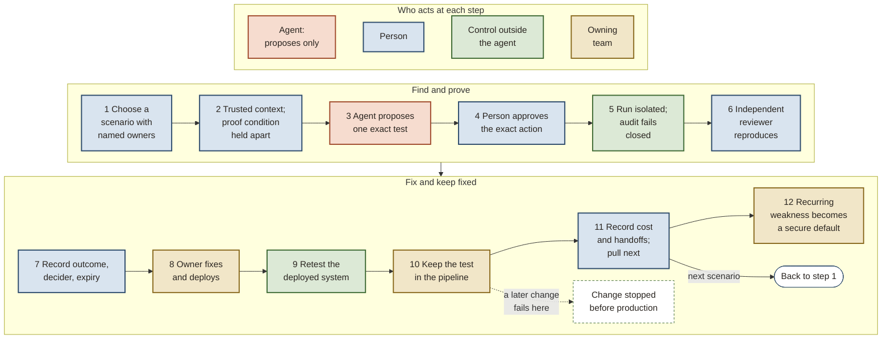
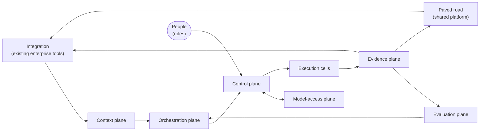
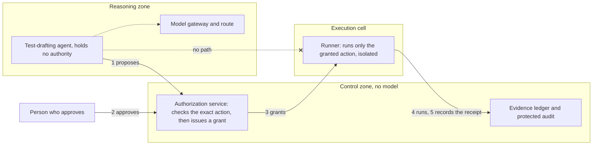
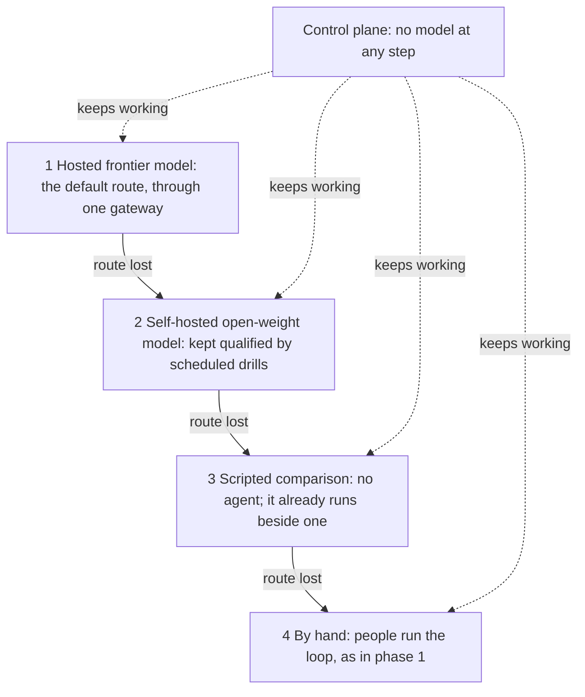
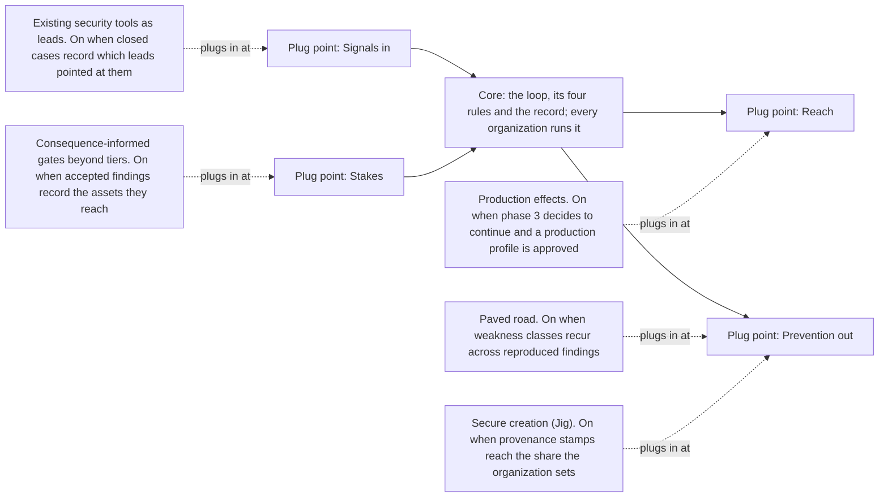
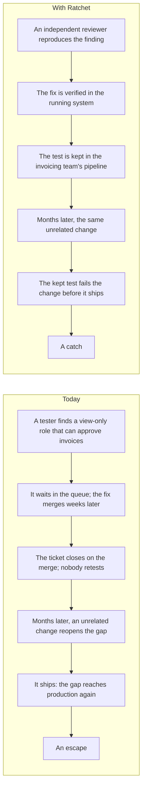

# Figure sources for agents

*Ratchet: closed-loop security validation for AI-assisted engineering. Figure sources. Edition 5.1.3, Thesis 1.4.3, 2026-10-31, build 694de224+local.*

Every figure in the edition has a stable id, and the text cites it by that id. This file gives each figure's source in a form an agent can read: the Mermaid itself for a figure drawn in Mermaid; for a figure drawn as SVG, a Mermaid equivalent with the same nodes and edges, which the build checks against the figure and, for a design figure, against the model; and where Mermaid cannot carry the shape, a structured description. Illustrative figures show the shape of the argument with no data behind them, and say so here as they do on their face. The five design figures are the output of the figure builder that the adopters' skill specifies: an organization runs it on its own compiled model and layer and gets the same figures under the same ids, its node ids the model's own.

## FIG-LOOP: The loop by actor

*Appears in 01-thesis.md; six-pager.md (diagram APX-1); strategy-brief.md (exhibit). Source: Mermaid, as drawn, built by the figure builder.*

## FIG-PLANES: The planes and their primary flows

*Appears in 04-architecture.md. Source: Mermaid, as drawn, built by the figure builder from the model and layer.*

## FIG-PART-MAP: Every part by plane, trust zone and quality tier

*Appears in R2-parts.md. Source: Mermaid, as drawn, built by the figure builder from the model and layer; the source is the block in reference R2.*

The Mermaid source is the block under "Every part by plane, trust zone and quality tier" in reference R2. At about 39 KB it is not repeated here.

## FIG-CONTROL-BOUNDARY: The control boundary

*Appears in 04-architecture.md; six-pager.md (diagram APX-3). Source: Mermaid equivalent of a generated SVG, built by the figure builder, its nodes named by model element ids and checked against the model.*

## FIG-PROVIDER-LADDER: Losing a model provider degrades the loop in steps

*Appears in six-pager.md (diagram APX-6). Source: Mermaid equivalent of a generated SVG, built by the figure builder, its steps named by the profile's rung values.*

## FIG-CORE-MODULES: The core and its four plug points

*Appears in 01-thesis.md; six-pager.md (diagram APX-4). Source: Mermaid equivalent of a generated SVG, its nodes named by the modules data's category and module ids and checked against the modules. Illustrative: the shape of the argument, with no data behind it.*

## FIG-ESCAPE-CATCH: Escape against catch, on the invoice timeline

*Appears in 01-thesis.md; six-pager.md (closing). Source: Mermaid equivalent of a generated SVG. Illustrative: the shape of the argument, with no data behind it.*

## FIG-SWEEP-LOOP: A sweep against the loop, across model releases

*Appears in 01-thesis.md; six-pager.md (regimes). Source: Structured description; Mermaid cannot carry a chart's shape. Illustrative: the shape of the argument, with no data behind it.*

Illustrative: the shape of the argument, with no data behind it. A line chart with no values on either axis: known open weaknesses (vertical) against time across model releases (horizontal), with three new model releases marked after a first sweep.

Series:
- **Backlog, left alone:** rises steadily across the whole period.
- **A sweep with each new model:** drops sharply at the first sweep, climbs back as later changes reintroduce weaknesses, and jumps at each new model release before the next sweep drops it again, so the line is a sawtooth that never stays down.
- **The sweep plus the loop:** the same first drop, then stays near the floor; each new model release adds a small tooth that the loop fixes and holds.

Relations:
- The first sweep lowers both sweep series by the same amount at the same time.
- Between releases, the sweep-only series rises and the loop series stays flat near the floor.
- At each release, the sweep-only series rises sharply and the loop series rises a little, then returns to the floor.
- The backlog series stays above both sweep series after the first sweep.
