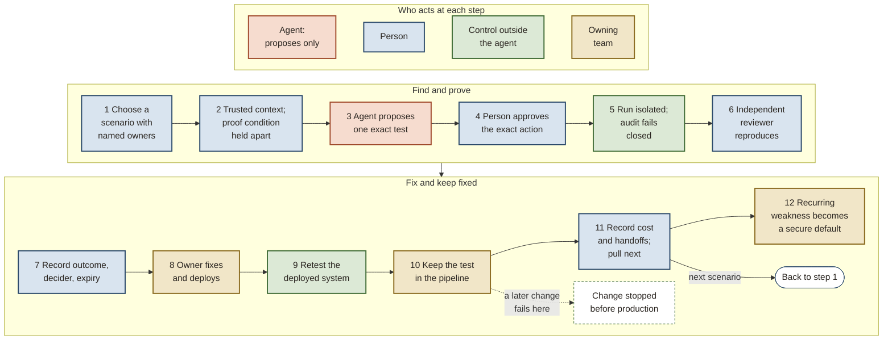

# Ratchet: security's contribution to high-quality delivery

*Ratchet: closed-loop security validation for AI-assisted engineering. Six-page narrative. Edition 5.1.3, Thesis 1.4.3, 2026-10-31, build 694de224+local.*

Security supports continuous delivery alongside reliability, availability, usability and safety. It helps fix weaknesses and owns shared prevention: secure templates and libraries (paved roads) and checks enforcing safe choices (guardrails). Product teams can focus on business logic. Ratchet finds a weakness, verifies its fix and keeps a test to catch its return. It covers dependencies and build inputs, outside services, development practices, running systems, and detection and recovery from surprises. The complete edition maps these five areas to SF², a published framework for software security.

*Fund phase 1: fix one weakness, have an independent reviewer verify the deployed fix, and keep a test that catches its return. Assign three working roles (the test operator, the service owner and an independent reviewer), set a review date and write stop conditions first. Run the same case through an AI agent and through a no-agent script, and compare them. Appendices hold design and evidence.*

*Part I: what is true.*

## A backlog or a fresh sweep puts the durability of fixes to the test

Every organization that builds software has security weaknesses: places where an attacker could read or do what they should not. For years most organizations also carried a backlog of them, one that discovery outran, and many still do. Teams work the criticals and highs, sometimes not even those, and the rest waits. Much of it is noise, and the engineers who own the code learned to treat security's tickets that way.

AI agents, models that run tools to probe code and systems, produce findings at a volume no human team can match, and AI is growing more capable of finding software weaknesses and, in controlled tests, of exploiting them, at an accelerating pace. In 2025, one model's own vendor reported a campaign that used the model in real intrusions (one vendor report; Appendix C grades the evidence for each claim strong, moderate, weak or none, and rates this one weak). In our reading, leaders now worry about the whole backlog at once, in a way they did not before. Many have acted on it, sweeping their code with a frontier model and pushing engineering to fix what it found. In our observation, those organizations now carry a known backlog smaller than they carried a year earlier.

Our working diagnosis is that whether an organization still carries a backlog or has just swept, its fixes stay vulnerable to later changes unless tests or secure defaults hold them. A sweep delivers fixes in a batch. **Sweep decay** means escapes, weaknesses in production that an attacker can reach through the running system, return after that sweep, through reintroduced weaknesses or classes of weakness a newer model finds. This is untested and needs later escapes to establish it. Phase 1, the first of five phases, maps what protects one fixed weakness and cannot show decay. Confirming, fixing, shipping and verifying still draw on teams with full queues. A fix reduces exposure when it holds in the running system. A tested compensating control can also hold a weakness while it remains open.

## In most organizations, a fixed weakness can return unnoticed

This illustration, assembled from the evidence we reviewed, describes no single organization's incident.

A tester reports that a user role meant only to view invoices can also approve them. The report waits in the security team's queue until an engineer reproduces it by hand and opens a ticket for the invoicing team. Their backlog is full, so the fix merges weeks later, the ticket closes on the merge, and the change ships in the next release. Nobody tests the running system again. Months afterward, an unrelated change reopens the same gap, and nothing notices, because no test was ever written to catch it. The weakness reached production twice; a regression test kept from the first fix would have stopped the second.

Every step was reasonable. The studies below document incomplete fixes, new weaknesses introduced by fixes and weak severity-based priority. They do not measure how often a fixed weakness returns. In monitored open-source projects, 20 to 30% of findings are never fixed, and work queues run at or above capacity (Appendix C, CL-18). Enterprise vendor data points the same way. In 82% of 53 JavaScript projects studied, static analysis identified a new weakness introduced by some fix for a known one (Appendix C, CL-11). In one study, severity-based patching reduced attack risk by a median of under 4%. Restricting that patching to vulnerabilities sold in exploit kits reduced it by over 60% (Appendix C, CL-14).

## AI agents raise the volume of findings, lower the trust each one deserves, and load the teams that fix them

The first change is volume: finding is becoming cheap, while everything after it costs what it always did, so the queue grows: steadily in an organization with a backlog, and in a fresh surge after every sweep in one without.

The second is trust. An agent's finding is usually valid locally and unproven end to end: it shows code is flawed without showing anyone can reach the flaw through the running system. In the one published study of an agent penetration tester on a live network, 9 of its 11 submitted findings were valid. Agents can also be manipulated. Prompt injection lets attacker text steer a model, nobody has a reliable defense against it today, and an agent that judged its own tests could be steered into doing harm and then reporting that all was well. We think an escape rate (escapes per deployment, defined in Part II) counted from unconfirmed findings at that volume is worse than none, because it looks precise and says nothing true about what reached production.

The third change would arrive even if every finding were real. A sudden flow of validated risk lands on the engineers who owe the business its next release. Unfixed weaknesses are security debt. Reliability, availability, usability, security and safety draw on the same finite engineering time. Our weak, untested bet is that validating more findings than a team can fix increases time lost to that debt without reducing exposure. Phase 3 tests it. So we think security must keep its debt from growing through the loop described in Part III, building the fix path hands-on with the owning teams. Where a backlog persists, we read the evidence as saying fix capacity limits the outcome more than finding does. Both are honest bets, claims we act on before the evidence settles them, and [Appendix C](#appendix-c) grades them; the loop's safety case rests on neither. Whether added discovery pays, and whether holding validation to a team's fix capacity helps, remains to be measured.

## Seven claims carry the design, with their evidence and bets visible

Gathered from the sections above and graded as [Appendix C](#appendix-c) grades them:

1. AI is growing more capable of finding software weaknesses and, in controlled tests, of exploiting them, at an accelerating pace. Evidence: moderate to strong.
2. An agent's finding is usually valid locally and unproven end to end. Evidence: moderate.
3. Defenses built into the model cannot be the primary control for an agent that reads hostile content, and authorization enforced outside the model prevents unauthorized effects even when the agent has been manipulated. Evidence: strong.
4. A fix must hold in the running system, and a fixed weakness can return unnoticed. A tested compensating control can hold a weakness while it remains open. Evidence: weak.
5. Approvers carry most of the safety load, and their attention erodes. Evidence: moderate.
6. Where a backlog persists, we read the evidence as saying fix capacity limits the outcome more than finding does. An honest bet; evidence: moderate.
7. Agents find real weaknesses at a cost worth paying once the effort spent checking their output is counted. An honest bet; evidence: weak.

The boundary in claim 3 limits what each component of Ratchet may do. It does not judge whether the application's own permissions are right: a view-only role that can approve invoices breaks no Ratchet boundary, and testing that role's intended permissions catches it.

Safety depends on approvers, reviewers, owners and pipelines working together. No study has measured that interaction for this kind of loop.

Independent acceptance keeps measurement honest. If it disappears without the separate honesty and correctness checks that an autonomy grant (Part III) requires, the escape rate can fall because nobody is measuring honestly.

The value case is a bet. Nothing like Ratchet has run end to end inside an enterprise. No published study shows agents earn their cost with output-checking effort counted, even as an estimate. No study has isolated how much a security test in the deploy pipeline slows delivery. Each bet names the phase whose data settles it inside the organization.

## Arguing against our own design exposed its blind spot: the people at the gates

Machine checks enforce one reconciled design model: the design written once, in machine-readable form.

We attacked the design from four directions. Its sharpest blind spot was trusting human approvers while suspecting agents, though approvers carry most of the safety load and their attention erodes. In Habituation at the Gate (2026, an open-source code-review preprint), 400 reviewers of AI pull requests raised approval rates from 30.1% to 36.8% over seven months, comparing early and late reviews. Their comments fell by about a fifth. We named this **asymmetric suspicion**. The design now checks the people at its approval points (its human gates) too, because their drift introduces error into every reported rate.

We also graded our evidence. Of 50 reviewed claims, 18 hold, 27 are honest bets, 4 were reworded and 1 was dropped. The reworded claims are retained: three graded weak, one moderate. Each retained claim records evidence, strength and what would prove it wrong. The authors graded them with AI research assistance and structured AI debates; no independent party has graded them ([Appendix C](#appendix-c)).

*Part II: what we want.*

## We aim to find and fix each weakness just in time, and two measures show whether we do

Whether an organization carries a backlog or has swept, we aim for the same North Star: find and fix each weakness just in time, close to the moment it is introduced. In a backlog organization, the aim is to stop the queue growing. Near zero, it is to keep the count there. We optimize the time from a weakness's introduction to a verified fix that stays fixed, catching it where code is written or at pull request review when we can, and having independent reviewers prove the rest through the running system in the approved environment.

Independent reviewers validate compensating controls in the approved environment. A finding can stay open while a compensating control holds it. The reviewer records it as held only after watching the control stop its path, and only with a current test that a team owns. The business risk owner accepts residual risk. Urgent escalation requires independent confirmation through running production; staging alone does not qualify. Missing or stale evidence leaves the finding unresolved.

People should need to approve fewer routine steps as the evidence earns that trust. The business risk owner sets the **consequence line**. At or above that level of potential harm, a person still approves every exact action, as it will run.

The unmeasured, adjustable target is under ten minutes of security tests per pull request, merge and deploy stage. Stage-time trends prompt review of which tests block. Gate timeouts and whether failures block stay unchanged. Exceeding the service owner's delivery tolerance (the delivery range the owning team set) stops phase 2 for a recorded decision.

Two measures track outcomes. DORA, the widely used software delivery metrics, counts **change fail rate**, the share of deployments that cause a failure in production. Security's counterpart is the **escape rate**: weaknesses that reach production per deployment, by weakness class, against the organization's own measured rate before Ratchet. An escape got past the early catches into production, where an attacker can reach it through the running system. One a test stops before it ships is a catch. [Appendix B](#escape-counting) says how an escape is counted. Beside the escape rate sits **time to remediate**, the analogue of DORA's failed deployment recovery time: from a reproduced finding to a fix verified in the running system. A falling escape rate cannot show that agents earn their cost. Phase 3's comparison against the same loop run with no agent answers that.

## As AI scales, finding and fixing may pass through three regimes, and the measures show which one an organization is in

The phases (Part III) mark what the evidence lets an organization claim; the regimes mark where it stands as AI scales. The regimes trace security debt: growing, paid as it accrues, then arising mostly from new changes.

Each statement here is a premise, our best guess, graded "none" in [Appendix C](#appendix-c) until data exists.

- **Backlog.** Discovery outruns verified fixes; many organizations may still be here. The lever is fixing whole weakness classes through secure defaults, and the fix cap each owning team sets with security, the most open findings it takes on at once, already governs it.
- **Balanced.** Verified fixes keep pace with arrivals, and discovery earns its keep by moving toward parts of the system that no kept test (a regression test kept from a fix) covers yet.
- **Near zero.** Novel findings become rare and costly, and AI discovery drifts toward noise. Remediation may become the main stream of security changes and the main source of new weaknesses. This regime approaches a floor, a low rate of novel findings. The floor resets for a weakness class whenever new technology brings new classes.

A sweep with a capable model can make an organization look near zero at once. We expect that state to decay toward a backlog unless a loop keeps each fix in place.

<figure class="diagram figure-svg" id="fig-sweep-versus-loop"><svg xmlns="http://www.w3.org/2000/svg" viewBox="0 0 720 336" role="img" aria-label="Illustrative chart with no values. Known open weaknesses over time, across model releases. A backlog left alone keeps rising. A sweep drops the count at once, then it climbs back as later changes reintroduce weaknesses, and each new model brings a fresh surge, so repeated sweeps make a sawtooth. The same sweep followed by the loop stays near the floor: each new model adds a small tooth that the loop fixes and holds." style="display:block;width:100%;min-width:520px;max-width:720px;height:auto;margin:0 auto;font-family:var(--f-body,Georgia,serif)" font-family="Georgia, serif"><defs><marker id="sw-i" viewBox="0 0 10 10" refX="9" refY="5" markerWidth="7" markerHeight="7" orient="auto-start-reverse"><path d="M0,0 L10,5 L0,10 z" fill="#5A5047" style="fill:var(--ink-2,#5A5047)"/></marker></defs><text x="70" y="22" font-size="11" fill="#5A5047" style="fill:var(--ink-2,#5A5047)" text-anchor="start" letter-spacing="1.2">ILLUSTRATIVE: THE SHAPE OF THE ARGUMENT, WITH NO DATA BEHIND IT</text><polyline points="70,38 70,270 530,270" stroke="#5A5047" fill="none" stroke-width="1.2" style="stroke:var(--ink-2,#5A5047)" stroke-linejoin="round"/><polyline points="524,266 530,270 524,274" stroke="#5A5047" fill="none" stroke-width="1.2" style="stroke:var(--ink-2,#5A5047)"/><text x="30" y="157" font-size="12" fill="#5A5047" style="fill:var(--ink-2,#5A5047)" text-anchor="middle" transform="rotate(-90 30 157)">Known open weaknesses</text><text x="295" y="318" font-size="12" fill="#5A5047" style="fill:var(--ink-2,#5A5047)" text-anchor="middle">Time, across model releases</text><polyline points="210,44 210,270" stroke="#DCD2C2" fill="none" stroke-width="1" stroke-dasharray="3 4" style="stroke:var(--rule,#DCD2C2)" stroke-linejoin="round"/><text x="210" y="288" font-size="11" fill="#5A5047" style="fill:var(--ink-2,#5A5047)" text-anchor="middle">new model</text><polyline points="320,44 320,270" stroke="#DCD2C2" fill="none" stroke-width="1" stroke-dasharray="3 4" style="stroke:var(--rule,#DCD2C2)" stroke-linejoin="round"/><text x="320" y="288" font-size="11" fill="#5A5047" style="fill:var(--ink-2,#5A5047)" text-anchor="middle">new model</text><polyline points="430,44 430,270" stroke="#DCD2C2" fill="none" stroke-width="1" stroke-dasharray="3 4" style="stroke:var(--rule,#DCD2C2)" stroke-linejoin="round"/><text x="430" y="288" font-size="11" fill="#5A5047" style="fill:var(--ink-2,#5A5047)" text-anchor="middle">new model</text><text x="116" y="288" font-size="11" fill="#5A5047" style="fill:var(--ink-2,#5A5047)" text-anchor="middle">first sweep</text><polyline points="70,150 520,62" stroke="#5A5047" fill="none" stroke-width="2" stroke-dasharray="6 5" style="stroke:var(--ink-2,#5A5047)" stroke-linejoin="round"/><polyline points="70,150 112,150 118,244 208,204 210,150 224,150 230,244 318,204 320,150 334,150 340,244 428,204 430,150 444,150 450,244 520,212" stroke="#A04A2C" fill="none" stroke-width="2.5" style="stroke:var(--tierra,#A04A2C)" stroke-linejoin="round"/><polyline points="70,150 112,150 118,248 210,248 212,230 222,230 224,239 234,239 236,248 320,248 322,230 332,230 334,239 344,239 346,248 430,248 432,230 442,230 444,239 454,239 456,248 520,248" stroke="#2C4A6B" fill="none" stroke-width="3" style="stroke:var(--azul,#2C4A6B)" stroke-linejoin="round"/><text x="532" y="66" font-size="12" fill="#5A5047" style="fill:var(--ink-2,#5A5047)" text-anchor="start">Backlog,<tspan x="532" dy="15">left alone</tspan></text><text x="532" y="196" font-size="12" fill="#A04A2C" style="fill:var(--tierra,#A04A2C)" text-anchor="start" font-weight="700">A sweep with each<tspan x="532" dy="15">new model: it climbs</tspan><tspan x="532" dy="15">back between sweeps</tspan></text><text x="532" y="252" font-size="12" fill="#2C4A6B" style="fill:var(--azul,#2C4A6B)" text-anchor="start" font-weight="700">The sweep plus the loop:<tspan x="532" dy="15">each fix held by a test</tspan></text></svg><figcaption>FIG-SWEEP-LOOP. Illustrative, with no values on either axis. A sweep drops the known count at once and then decays: later changes reintroduce weaknesses, and each new model finds classes the last one missed. The loop holds each fix with a test, so the count stays near the floor.</figcaption></figure>

Arrivals against verified fixes, per weakness class, tell backlog from balanced; the regular status report on each phase runs this check. Two measures beside DORA's mark the approach to near zero: the **remediation change fail rate** (change fail rate on security fixes alone) and the **cost per validated novel finding**. The organization sets every threshold.

*Part III: what we will do about it.*

## Ratchet is one loop, held by four rules

Each fix is held by a test, and authority stays outside the agent. The loop proves a weakness, fixes it or tests the control holding it, and keeps checking the result. We call it **Ratchet** because it turns one way: each kept test catches a returning weakness, and agents gain each step of authority only on evidence, never past limits the design sets.

The invoice illustration, through the loop ([diagram in Appendix A](#diagram-apx-1)):

1. The organization chooses the invoice scenario because approving payments matters, and names who owns its scope, its fix and its acceptance.
2. The scenario owner writes the test's **proof condition** before anything runs: what the running system must show for the weakness to count as real, and what would show it is not. The weakness is real if a view-only session can approve an invoice. The fix passes when that request is refused and the invoice stays unchanged.
3. An agent proposes one exact test: sign in as the view-only role and try to approve an invoice.
4. In phase 1 the service owner, the engineering team that owns the invoice service, approves that exact test before it runs, then sees the outcome.
5. The test runs in an isolated environment, and its record is written before it may do anything.
6. A reviewer from outside the invoicing team reproduces the result against the proof condition.
7. The finding is recorded with who confirmed it.
8. Security, the owning engineer and an agent co-create the invoice fix and its local regression test in one pull request. A variant of the weakness found along the way enters as a new finding. The team reviews and deploys normally.
9. The running system is retested: the view-only role is refused, and people allowed to approve invoices still can.
10. The invoicing team owns its visible regression test. It blocks relevant changes if the weakness returns. Security's **kept-test mirror**, an automatic read-only inventory of these tests, records removed, skipped or failing tests as findings.
11. Every handoff is recorded with how long the work waited, so the organization sees where its time went and chooses what to test next.
12. A weakness that keeps turning up across services becomes a reviewed default in the shared libraries and templates teams build on.

Four rules hold every step. The first keeps the loop safe; the other three keep its measurement honest:

1. **The agent cannot give itself permission to run a test.** It can suggest trying to approve an invoice as the view-only role. In phase 1 the service owner approves that exact action before it runs. A proposal is never permission. A separate authorization service checks the target, identity, action, environment and time window outside the agent ([diagram in Appendix A](#diagram-apx-3)). Evidence: strong; authorization enforced outside the model prevents unauthorized effects even when the agent has been manipulated.
2. **The testing agent cannot read the answer it will be judged against.** Proof conditions stay out of the testing agent's reach, so an agent can pass a test only by doing the work. The independent reviewer keeps the invoice proof condition apart from the agent's instructions. Evidence: weak.
3. **The agent's report alone cannot establish a finding.** The independent reviewer checks the report and reproduces whether the view-only role can approve in the approved environment, which can be isolated or staging. An agent reporting that a test "does not apply" leaves the case untested. Evidence: moderate.
4. **Acceptance is independent. The human test operator submitting the agent’s proposal cannot accept its result.** The person who proposes a test, the person who holds its proof condition and the person who decides the result are three different people, except in phase 1, where the independent reviewer both holds the proof condition and decides. A named person on the independent reviewer’s team accepts the review; another, distinct from the fix author, accepts the retest. Neither can be an agent or service account. Closure also needs a machine record of the deployment. Evidence: moderate.

In phase 1, a person approves every action. Later the access approver, who owns the authorization rules, can grant a reviewed test standing permission, to run without per-action approval, after clean runs. That permission stays below the consequence line and within design limits on environments, actions and consequence levels. People approve anything outside them. Approval decides whether an action should happen at all.

Phase 1 combines proof holding and deciding in its independent reviewer and makes no assurance claim. The exception ends at exit or the risk owner's review date, whichever comes first. Work then stops under it unless full separation or an accepted standard exception covers continuation.

**Asymmetric suspicion:** human approvers can drift toward approval. The design tests each human gate with seeded known-bad items to measure whether that gate still catches them. Evidence for approver drift is moderate. Whether seeded known-bad items measure gate health is weak and untested, to be settled in phase 3.

The loop guards against effects nobody approved, findings closed that are not fixed, weaknesses returning unseen, and testing that exceeds the owning team’s delivery tolerance.

Part 1 of the complete edition tabulates every kind of exception. One planned exception: once two checks hold, risk owners may let Ratchet confirm its own findings, one kind of judgment at a time.

- The honesty check compares what Ratchet's agent reported with what the control plane, the separate system that checks permissions and keeps evidence, recorded it doing.
- The correctness check tests verdicts by a different means, on samples it cannot predict.

The business and security risk owners issue and record the grant with its expiry. It lapses when either check's record slips, and stays inside the design limit for its judgment type. Each self-validated finding stays labeled, so every measure reports with and without it. This is the planned departure from [the rules that a report alone cannot establish a finding and that acceptance is independent](#four-rules). It conveys no authority to act and does not waive the two human closure acceptances.

## We considered other paths and rejected each for a named weakness

We will not grow discovery before closure, give agents their own authority, or widen before phases report. Doing nothing leaves today's queues as they are. Repeated sweeps still need something to keep their fixes in place between sweeps. Producing tickets faster adds no help with fixing. Agents that judge their own work let a manipulated model act and then grade itself. One central validation team can end up judging its own tests.

We chose shared rules with teams running their loops and independent checking. Each team agrees an open-finding cap with security, or uses the default of the decision owner, the executive sponsor who approves the program. Above-cap findings are logged and reviewed monthly. Security's intake checks whether a finding reaches the consequence line, carries a sourced report of exploitation or has an external disclosure deadline. Such findings bypass only the cap, keeping approval, proof and acceptance checks. The cap paces discovery to fixing. Whether that improves outcomes is an untested bet.

The coding agent can see the team's local test. Security's separate **aggregate validation** checks complete attack paths. Its proof conditions and connected attack steps stay hidden from the coding agent. A local pass can leave a wider path open. Appendix A explains this independent layer, the kept-test mirror and the guardrails security owns for whole weakness classes.

## Five phases widen on evidence. Phase 1 closes one weakness with three working roles

| | Phase 1 (decision today) | Phase 2 | Phase 3 | Phase 4 | Phase 5 | North Star |
|---|---|---|---|---|---|---|
| **What the organization can claim** | The loop closes once | The evidence can be trusted | Ratchet is measured against today's process and a no-agent baseline | A second team runs it | It works in production | Found and fixed where introduced, kept fixed |
| **Effort and review** | Organization estimates effort and sets a review date | Organization estimates effort and sets a review date | Organization estimates effort and sets a review date | Organization estimates effort and sets a review date | Organization estimates effort and sets a review date | |
| **How far the loop reaches** | One weakness, by hand; nothing injected past the pipeline | A second real path; a fixed weakness deliberately reintroduced into a deployed test environment, under a declared notice policy | Cases chosen before the first agent run | A second team | Production, under an approved production profile | |
| **Gate: the exit test, in brief** | Loop closed, fix verified independently, regression test held | An automated record check passes every condition on a second real path | Today's process, a no-agent script and the agent compared over cases chosen in advance | A second team closes the loop under the same approval and acceptance rules | Denied actions, a pause for system health and a failed cleanup cause no unapproved effect | |
| **The way out** | At the organization's review point, decide to continue, change or stop. Phase 1's exception to the rule that acceptance is independent ends at phase 1 exit or the risk owner's review date, whichever is first | Any condition fails: stop until the decision owner decides | Test fails: stop widening | Test fails: stop widening | Test fails: stop widening | |

*The five phases. Each gate is its phase's exit test in brief, and [the phase table in Appendix A](#diagram-apx-2) gives each in full.*

An organization first maps how it handles findings today. Ratchet's five **phases** each end on an exit test written in advance. The security practices an organization already runs keep running; [a table in Appendix A](#practices-by-phase) shows each one's role by phase.

At each organization-set review date, the decision owner records continue, change or stop and the next review date for continuing work. A review cannot stand in for a phase's exit outcome or extend an exception. Effort figures stay estimates.

Phase 1 reports case evidence and feasibility without assurance, scale or program risk-reduction claims. Appendix A defines what the sponsor can say. Later phases test scale. A no-agent script runs the same case beside the agent from day one. Whether phase 1's weakness comes from a practice target or a real finding decides what the agent may see, and a cheap phase 1 also checks whether the pipeline catches the weakness when it is put back (Appendix A).

Fixing one weakness this way shows where time goes. Past findings and incidents supply the starting escape rate. Before phase 2, the decision owner accepts the map and sets thresholds for stopping and for granting trust. Phase 2 builds the controls the map showed were needed.

### What backing phase 1 commits you to

- **People and effort.** Name the test operator, the service owner and an independent reviewer, plus the executive sponsor and the two risk owners. Estimate each role's time before starting and record it beside the review date. Appendix A maps every duty and existing-tool requirement.
- **What the decision owner writes first.** Record the exit outcome, expected waits and review date. Name someone other than the test operator to score the agent-against-script comparison. At review, record continue, change or stop and a next date.
- **The pass checks.** Phase 1 passes when three checks hold: the loop closed, an independent reviewer verified the fix, and the regression test held. Its map, the scripted test's results and a verdict for each case must also exist. A verdict against the agent does not fail it.
- **What you keep if it stops.** The scripted loop, the time record, kept regression tests and controls that use no model.

**The stop rule.** The work stops if any of these happens:

- At each organization-set phase review point, work pauses until the decision owner records continue, change or stop and a next review date for continuing work. If phase 1 has not closed, the report names the unmet cross-team commitment (such as scope, approval or fix capacity) and its owner. Its exception to the rule that acceptance is independent ends at phase 1 exit or the risk owner's review date, whichever is first.
- Phase 2's exit test fails any condition, including the owning team's delivery measures leaving the tolerance it set. The work then stops until the causes are written down and the decision owner decides whether to continue.
- After closed cases exceed the organization’s minimum (five by default, so at least six cases; under that default it cannot fire in phase 1’s single case), agents stop if slower and costlier than the script on every case and finding nothing it missed. The scripted loop becomes the plan.

Phase 1's comparison is descriptive; phase 3 tests full value. An organization fitting this design to itself starts with [Appendix E](#appendix-e).

## The second time the invoice gap opens, a test stops it before production

The invoice fix was verified in the running system and its test stayed in the invoicing team's pipeline. Months later, when an unrelated change reopens the gap, that test fails the change before it ships. The first time was an escape; the second is a catch.

<figure class="diagram figure-svg" id="fig-escape-versus-catch"><svg xmlns="http://www.w3.org/2000/svg" viewBox="0 0 720 350" role="img" aria-label="Illustrative timelines of one weakness, a view-only role that can approve invoices. Today: the report waits, the fix merges weeks later, the ticket closes with no retest, and months later an unrelated change reopens the gap, which ships and reaches production again: an escape. With Ratchet: the finding is reproduced independently, the fix is verified in the running system, the test is kept in the owning team's pipeline, and when the same unrelated change arrives, the kept test fails it before it ships: a catch." style="display:block;width:100%;min-width:520px;max-width:720px;height:auto;margin:0 auto;font-family:var(--f-body,Georgia,serif)" font-family="Georgia, serif"><defs><marker id="ev-i" viewBox="0 0 10 10" refX="9" refY="5" markerWidth="7" markerHeight="7" orient="auto-start-reverse"><path d="M0,0 L10,5 L0,10 z" fill="#5A5047" style="fill:var(--ink-2,#5A5047)"/></marker></defs><text x="14" y="16" font-size="11" fill="#5A5047" style="fill:var(--ink-2,#5A5047)" text-anchor="start" letter-spacing="1.2">ILLUSTRATIVE: THE SHAPE OF THE ARGUMENT, WITH NO DATA BEHIND IT</text><text x="14" y="52" font-size="14" fill="#A04A2C" style="fill:var(--tierra,#A04A2C)" text-anchor="start" font-weight="700">Today</text><polyline points="14,70 704,70" stroke="#5A5047" fill="none" stroke-width="1.2" style="stroke:var(--ink-2,#5A5047)" stroke-linejoin="round" marker-end="url(#ev-i)"/><circle cx="84" cy="70" r="5" stroke="none" fill="#5A5047" style="fill:var(--ink-2,#5A5047)"/><text x="84" y="96" font-size="11.5" fill="#2A2520" style="fill:var(--ink,#2A2520)" text-anchor="middle">A tester finds a<tspan x="84" dy="14">view-only role that</tspan><tspan x="84" dy="14">can approve</tspan><tspan x="84" dy="14">invoices</tspan></text><circle cx="218" cy="70" r="5" stroke="none" fill="#5A5047" style="fill:var(--ink-2,#5A5047)"/><text x="218" y="96" font-size="11.5" fill="#2A2520" style="fill:var(--ink,#2A2520)" text-anchor="middle">It waits in the<tspan x="218" dy="14">queue; the fix</tspan><tspan x="218" dy="14">merges weeks later</tspan></text><circle cx="352" cy="70" r="5" stroke="none" fill="#5A5047" style="fill:var(--ink-2,#5A5047)"/><text x="352" y="96" font-size="11.5" fill="#2A2520" style="fill:var(--ink,#2A2520)" text-anchor="middle">The ticket closes<tspan x="352" dy="14">on the merge;</tspan><tspan x="352" dy="14">nobody retests</tspan></text><circle cx="486" cy="70" r="5" stroke="none" fill="#5A5047" style="fill:var(--ink-2,#5A5047)"/><text x="486" y="96" font-size="11.5" fill="#2A2520" style="fill:var(--ink,#2A2520)" text-anchor="middle">Months later, an<tspan x="486" dy="14">unrelated change</tspan><tspan x="486" dy="14">reopens the gap</tspan></text><circle cx="626" cy="70" r="9" stroke="none" fill="#A04A2C" style="fill:var(--tierra,#A04A2C)"/><text x="626" y="96" font-size="11.5" fill="#A04A2C" style="fill:var(--tierra,#A04A2C)" text-anchor="middle" font-weight="700">It ships: the gap<tspan x="626" dy="14">reaches production</tspan><tspan x="626" dy="14">again</tspan></text><text x="626" y="142" font-size="13" fill="#A04A2C" style="fill:var(--tierra,#A04A2C)" text-anchor="middle" font-weight="700">An escape</text><text x="14" y="204" font-size="14" fill="#2C4A6B" style="fill:var(--azul,#2C4A6B)" text-anchor="start" font-weight="700">With Ratchet</text><polyline points="14,222 704,222" stroke="#5A5047" fill="none" stroke-width="1.2" style="stroke:var(--ink-2,#5A5047)" stroke-linejoin="round" marker-end="url(#ev-i)"/><circle cx="84" cy="222" r="5" stroke="none" fill="#5A5047" style="fill:var(--ink-2,#5A5047)"/><text x="84" y="248" font-size="11.5" fill="#2A2520" style="fill:var(--ink,#2A2520)" text-anchor="middle">An independent<tspan x="84" dy="14">reviewer reproduces</tspan><tspan x="84" dy="14">the finding</tspan></text><circle cx="218" cy="222" r="5" stroke="none" fill="#5A5047" style="fill:var(--ink-2,#5A5047)"/><text x="218" y="248" font-size="11.5" fill="#2A2520" style="fill:var(--ink,#2A2520)" text-anchor="middle">The fix is verified<tspan x="218" dy="14">in the running</tspan><tspan x="218" dy="14">system</tspan></text><circle cx="352" cy="222" r="5" stroke="none" fill="#5A5047" style="fill:var(--ink-2,#5A5047)"/><text x="352" y="248" font-size="11.5" fill="#2A2520" style="fill:var(--ink,#2A2520)" text-anchor="middle">The test is kept in<tspan x="352" dy="14">the invoicing</tspan><tspan x="352" dy="14">team's pipeline</tspan></text><circle cx="486" cy="222" r="5" stroke="none" fill="#5A5047" style="fill:var(--ink-2,#5A5047)"/><text x="486" y="248" font-size="11.5" fill="#2A2520" style="fill:var(--ink,#2A2520)" text-anchor="middle">Months later, the<tspan x="486" dy="14">same unrelated</tspan><tspan x="486" dy="14">change</tspan></text><circle cx="626" cy="222" r="9" stroke="none" fill="#2C4A6B" style="fill:var(--azul,#2C4A6B)"/><text x="626" y="248" font-size="11.5" fill="#2C4A6B" style="fill:var(--azul,#2C4A6B)" text-anchor="middle" font-weight="700">The kept test fails<tspan x="626" dy="14">the change before</tspan><tspan x="626" dy="14">it ships</tspan></text><text x="626" y="294" font-size="13" fill="#2C4A6B" style="fill:var(--azul,#2C4A6B)" text-anchor="middle" font-weight="700">A catch</text><text x="704" y="340" font-size="11" fill="#5A5047" style="fill:var(--ink-2,#5A5047)" text-anchor="end" font-style="italic">time</text></svg><figcaption>FIG-ESCAPE-CATCH. Illustrative: the invoice example on two timelines. Without a kept test, the reopened gap ships, and it counts as an escape. With one, the test fails the change before it ships, and it counts as a catch.</figcaption></figure>

## Each section goes deeper in one part of the complete edition

- Parts I and II: part 1 (the strategy), Annex A1 (background and evidence ledger) and Annex A2 (method).
- Part III: part 1's loop and rules, part 2 (the plan) and part 3 (the plan in practice).
- For builders: part 4 (the architecture), then the references for parts and contracts, quality and failures, rules and readiness, and the profile template.

---

## Appendix A: Diagrams and system design

### Tests stay owned where the code lives

Security automatically records which kept tests still run and pass. This read-only inventory is the **kept-test mirror**. It can report a removed, skipped or failing test as a new finding. It cannot change the team's code, pull request or tests. Missing, old or mismatched observations mean protection is unknown. Before a risk decision, the reviewer checks for a recent passing run at the code revision, configuration and set of dependencies being assessed. A pass from another version or environment does not establish protection here. A local pass alone cannot establish that the whole attack path is closed.

Security separately checks whether weaknesses can combine into a complete attack path. This is **aggregate validation**, the independent layer. Its proof conditions state what would establish or refute a weakness. Those conditions and the checks of connected attack steps never reach a coding agent. They can expose a remaining path even when the team's visible test passes. Ratchet has no separate set of hidden variant tests. A newly found variant enters the normal loop as a new finding. Nobody quietly changes the team's pull request. Security co-authors through the team's normal review; the mirror has read-only access. Security also owns tests for whole weakness classes in shared defaults and guardrails. Agents receive static or in-process checks derived from those tests. Their pattern is general to the weakness class and excludes the kept test’s inputs and fixtures (its test data and setup). They return pass or fail with a fixed message that states no expected boundary behavior or outcome. They carry no proof condition, expected-outcome hash or outsider text. Runtime replays, tests rerun against a running system, never yield a derived check; protected regression and connected-path checks stay on security's side. This restricted output keeps the proof condition hidden from the agent.

The mirror reports how many contributed local tests still run and pass, and how many contribute to an accepted guardrail for a whole weakness class. Each rate names the group of tests being followed and the observation period. It shows the count that qualifies, the total and any missing observations. These are measures to collect, with no claimed improvement or target.

### Name the people behind every phase 1 duty

The generic design names roles. Before starting, the sponsor records the named people holding them in the profile, the organization's record of its Ratchet settings, owners and choices, and in phase 1's written criteria. Three working roles carry the loop, which can require more than three people. The sponsor is additional. Name the risk duties, scorer and retest acceptor too. One person can hold several duties where separation permits. The role table in part 3 of the complete edition supplies these assignments.

| Phase 1 person or named duty | Responsibility |
|---|---|
| Test operator, usually a security engineer | Runs the loop and submits the agent's proposed action. This human is the proposer, who cannot accept the result. The agent drafts the proposal. |
| Service owner | Approves each action against the service before it runs. Fixes and deploys the correction and keeps the local test. Does not accept its own closure. |
| Independent reviewer outside the service owner's team | Checks the agent's report, independently reproduces it, holds the proof condition the agent cannot read and decides the outcome. A named person on the independent reviewer’s team signs review acceptance. A different named person accepts retest. Neither can be an agent or service account. |
| Retest acceptor | A second named person, distinct from the review acceptor and fix author. The design assigns no further job title. |
| Scenario owner, named in the profile | Chooses the scenario and drafts its proof condition. The profile records the drafter. The independent reviewer holds it in phase 1. |
| Decision owner, the executive sponsor | Names people, criteria, scorer and review date. Accepts the phase 1 report and records continue, change or stop. Accepts the departures from the separation rules listed below, which apply only inside the test environment, with the independent reviewer concurring. |
| Security risk owner | Named before the organization first runs the loop, to accept the records of how it adopted the design. Sets thresholds. The exception record names its risk owner and review date. Must never be the proposer. |
| Business risk owner | Accepts residual risk. Both risk owners accept standard exceptions and later autonomy grants. A phase 1 exception touching real assets, data or outsider text (text written by people outside the organization) needs both. The business risk owner cannot be the proposer, discoverer or verifier. |
| Comparison scorer | Named by the sponsor before phase 1, with a scoring scale. Must be someone other than the test operator. The design fixes no other assignment or overlap. |

The rule that acceptance is independent normally separates the human proposer, proof-condition holder and decider. Phase 1 combines only proof holding and deciding in the independent reviewer. A named person on the independent reviewer’s team signs review acceptance. A different named person accepts retest; neither can be an agent or service account. The retest acceptor cannot author the fix. The phase 1 exception does not merge those acceptances.

If the exception's review date arrives before exit, work stops under that exception. Full separation or a standard exception accepted by the named risk owners must cover continued work. A continue decision cannot renew the phase 1 exception. The exception record names its risk owner and review date. Phase 2's exit test requires full separation.

The narrow phase 1 exception path covers only six departures inside the test environment:

1. the team that runs the agent also approves actions;
2. that team also owns proof conditions;
3. that team also verifies results;
4. one tool both proposes and authorizes;
5. the team that writes the fix accepts closure;
6. findings enter the finding ledger, the record of findings, directly.

The sponsor accepts each recorded departure, with the independent reviewer concurring, until phase 1 exit at the latest. Once both risk owners are named, they must accept it again as a standard exception. Real assets, data or outsider text always need both risk owners. This acceptance path is separate from phase 1's exception to the rule that acceptance is independent, which combines only proof holding and deciding and can end earlier at its review date. It never merges the two human closure acceptances.

### Phase 1 needs operational controls that Ratchet's published design and tools do not supply

The design prescribes no tool products. It does not establish which tools an adopter has. Before starting, name the existing tracker, pipeline, sign-in and change-approval tools and what each provides. The tracker records scope, owners, exact-action approvals, evidence, handoff waits and closure. The pipeline runs an isolated, network-allowlisted job with a short-lived scoped credential, records cleanup and the deployed version, and keeps the regression test. Its audit log must record each action before it happens, and the job must stop before acting if the log is unavailable. The reviewer's proof conditions and evidence need access controls the test operator and agent cannot override.

The profile records whether the runner uses a scoped cloud role or an existing mechanism bound to the exact approved action. A scoped role leaves a phase 1 control gap: it is neither bound to the approved action nor used up after one use. The profile checker in ratchet-tools reports that gap. Phase 2 builds the exact-action authorization service and shared execution controls. With a synthetic practice target, the agent sees no real data or outsider text. With a real finding, the agent drafts without tools, can send data only to the approved model route, and people execute approved actions. The independent reviewer confirms this boundary before starting.

The pipeline and test catalog must supply kept-test identities and run results for security's read-only inventory. Phase 1 records the local test and observes its runs. The automatic kept-test mirror is phase 2 work. If an existing tool is missing, record the manual stand-in, its control gap and a revised effort and wait estimate. A stand-in must still meet the required control or have an accepted exception. Setup effort must be estimated; the design assumes no new tool deployment.

### The report supports a bounded account of the case

The sponsor can say which weakness was tested, in which environment and deployed version, what the independent reproduction and retest observed, whether legitimate behavior still worked, and which local regression test was kept. The report includes the map of how findings are handled today, handoff waits, agent-versus-script results and per-case verdict, deviations from the plan, control gaps and phase 2 effort estimates. A verdict against the agent does not fail phase 1.

Because phase 1 combines proof holding and deciding, it makes no assurance claim. The report cannot establish independent assurance, production-wide risk reduction, a lower escape rate, durability across later changes, scale or agent value. A staging result establishes only that environment's result. Historical findings and incidents supply the starting escape rate. One case cannot measure sweep decay or trigger the default early stop, which needs at least six closed cases. The agent-against-script comparison only describes what happened until its stop conditions can be met, and phase 3 tests the full value case.

### The edition includes runnable tools for checking the design

Each edition includes **ratchet-tools**, code for checking and tailoring the design. It needs Bun and no npm packages. Every bundle file has a hash in the edition manifest. Before release, every bundled tool must pass the edition's fixtures, the test cases that specify its expected behavior. The specifications and fixtures remain the design documents from which the bundle is built.

An optional blind-build check asks whether someone can build a tool from those documents alone. It no longer blocks release. An organization may build its own tools, but Ratchet makes no compatibility promise for them. The bundled checks support adoption. They do not replace the operational tools used to run the security loop.

### APX-1. The loop

In the loop, the first six steps turn a proposal into a verified finding. The last six turn it into a fix that a test keeps in place, and step 11 pulls the next scenario, so the loop starts again. Every arrow that changes the system passes through a person or a control outside the agent. Color shows who acts at each step: the agent acts only at step 3, and only to propose. The dashed arrow is where the ratchet holds: a later change that reopens the weakness fails at the kept test.

### APX-2. The five phases

A work unit is one small piece of work that moves one step of the loop up one level, from a person doing it by hand to an existing tool to a built part, with a check that shows it landed. Each phase ends when its work units have landed and its exit test, written in advance, passes. The organization sets each review date. The decision owner records continue, change or stop, with a next date for continuing work. Reviews never replace outcomes or renew exceptions. Until then it reports green (on course), yellow (behind its estimates or an early warning moving, with a recovery step and a date) or red (a stop condition has fired or a review decision is due, so work pauses). The Units column counts the units that first contribute to each phase, which shows how much build work each phase carries.

Where phase 1's one weakness comes from decides how it stays safe. An agent holding private information and able to send requests out becomes dangerous the moment untrusted text reaches it, and the controls that guard outgoing requests arrive only in phase 2. A practice target keeps outsider text and real data away from the agent. A real finding cannot, so the agent only drafts: it holds no tools, its only way to send data out is the approved model route, and people run every action after approving it. That leaves the approver reading each exact action as the safeguard, which is one more reason the approver is shown the result of every run they approved.

When the service owner estimates beforehand that it costs a day or less, phase 1 also tests detection by reintroducing the fixed weakness at the cheapest layer that should catch it, a pull request or the pipeline, where the change can never merge. Injection into a deployed test environment waits for phase 2, the organization's notice policy and confirmation from the briefed detection lead told in advance, and uses a locally held restore. The time limit for restoring the environment after an injection has an unresolved design gap, described in part 3 of the complete edition. Production also needs an approved production profile.

A **loop canary** repeats phase 1's deliberately planted scenario through the live loop on a schedule. Each run records a pass or the first handoff that failed. A failing run alerts the platform owner. A canary run counts as passed only when it gets through every step of the loop.

The [phase road](#phase-road) shows the five phases in order, with each one's gate and way out. The table below gives each exit test in full.

| # | Phase | What its test checks | Units | Effort and review |
|---|---|---|---|---|
| 1 | **The loop closes once** | One seeded weakness travels the whole loop by hand on existing tools: proposed, approved, run, reproduced independently, handed to the owning team with a reproducing test, a fix drafted by the security side and an owned regression gate (a blocking regression check the team owns), fixed, deployed, retested in the deployed state, and kept as a regression in the owning team's pipeline that fails when the fix is reverted. The map of how the loop works today records every attempt and every wait at a handoff, with effort reported as an estimate. The scripted no-agent comparison runs beside the agent, with a verdict per case on the scale the success criteria define, from a scorer the decision owner named in advance who is not the test operator. A feasibility test: it passes when the checks written before it starts hold (the loop closed, the fix independently verified, the regression test held) and the map, the scripted comparison and the per-case verdicts exist; a verdict against the agent does not fail it. The thresholds for later phases are set from its map before phase 2. | 30 | Organization estimates effort and sets a review date |
| 2 | **The evidence can be trusted** | On a second real path, an automated check of the record passes only if: three different people proposed, held the proof condition and decided the outcome; changed, replayed and expired approvals caused zero effects; closure carries two human acceptances plus a machine record of what was deployed; the owning pipeline rejected a deliberate reintroduction; the detection check saw the test or recorded the gap; the scheduled canary closed; and the service's five DORA delivery metrics stayed within the agreed tolerance. | 111 | Organization estimates effort and sets a review date |
| 3 | **Ratchet is measured against today's process and a no-agent baseline** | Over a set of comparable cases chosen before the first agent run, the report shows time, cost per accepted fix (estimated verification effort included) and false-acceptance rate for today's process, the no-agent arm and the agent arm, keeps failures in the denominator, and draws no conclusion below the agreed minimum number of fixes. | 104 | Organization estimates effort and sets a review date |
| 4 | **A second team runs it** | A second team completes the loop with no change to the approval or acceptance rules beyond its own scope; a permission change in a source system marks dependent tests stale and replays them; a shared secure default blocks the reproduced weakness in a service that was never tested. | 54 | Organization estimates effort and sets a review date |
| 5 | **It works in production** | In an approved production profile, denied actions, a health pause with resume and a failed cleanup each run with no unapproved effect; tests that ran but were not seen by detection are reported separately; a change of model or tool sends the affected route back through its approval tests (qualification) before its next use. | 19 | Organization estimates effort and sets a review date |

#### APX-2.1. The security practices an organization already runs keep running, and each takes a defined role as the phases land

A purple team is the joint attack-and-defense function that turns findings into detections and kept tests. A quarantined reader is a separate model with no tools. It reads outsider reports, and its output keeps the outsider label.

Each row is a practice most organizations already run. The step codes are the loop's steps ([diagram APX-1](#diagram-apx-1)): STEP-1 is step 1, choosing a scenario, through STEP-12, the secure default. A lead is a hint that helps choose what to test and never counts as evidence or coverage. A tool's per-rule yield is the share of each rule's sampled leads that the loop proves real, and a portfolio decision chooses whether to keep a tool, move its job onto the paved road or retire it. "No change" means the design gives the practice no new role in that phase. Every cell rests on a work unit, part, module or rule of the design, cited in the full reference, and the build fails if a cited one disappears.

| Practice | Enters at step | Phase 1 | Phase 2 | Phase 3 | Phase 4 | Phase 5 |
|---|---|---|---|---|---|---|
| Static analysis (SAST) | STEP-2 as a lead; STEP-8 developer queue | Runs as today; its report text never reaches the agent | One tool's export becomes labeled leads, never coverage | Yield sampled per rule; developers get only leads above the bar | Kept, moved onto the paved road, or retired, by per-rule yield | no change |
| Dynamic analysis (DAST) | STEP-2 as a lead; STEP-8 developer queue | Runs as today; its report text never reaches the agent | One tool's export becomes labeled leads, never coverage | Yield sampled per rule; developers get only leads above the bar | Portfolio decision; can also run as a runtime producer under grants | no change |
| Dependency scanning and SCA | STEP-2 as a lead; STEP-8 developer queue | Runs as today; its report text never reaches the agent | One tool's export becomes labeled leads, never coverage | Yield sampled per rule; developers get only leads above the bar | Portfolio decision; a reproduced component weakness spans every SBOM listing it | no change |
| Secret scanning | STEP-2 as a lead; STEP-8 developer queue | Runs as today; its report text never reaches the agent | Labeled leads; exposed secrets close once revocation is proven per type | Yield sampled per rule; time to revoke reported for each secret | Kept, moved onto the paved road, or retired, by per-rule yield | no change |
| LLM-driven and agentic scanning of code and infrastructure | STEP-1 scenario source; STEP-2 as a lead | May supply the first weakness; the agent then only drafts | A lead until an owner-signed proof condition is met | Yield sampled per rule, like any other tool | Kept, moved onto the paved road, or retired, by per-rule yield | no change |
| Bug bounty | STEP-1 scenario source; STEP-2 as a lead | Runs as today; its report text never reaches the agent | no change | Report text read only by the quarantined, tool-less reader | Portfolio decision, like any lead source | no change |
| Penetration tests and red team engagements | STEP-1 scenario source; STEP-2 as a lead | Runs as today; its report text never reaches the agent | no change | Reports go to the quarantined reader; a purple team forms | no change | Continues; a quarterly report names the formal exercises Ratchet does not replace |
| Threat models and security reviews | STEP-2 as invariants | no change | Must-prevent claims recorded as invariants naming their review | no change | Claims a demonstrated path contradicts are flagged automatically | no change |
| SOC detection and monitoring | STEP-5 sees each run | no change | Each run checked: detected, or a visibility gap recorded | Purple team proposes a detection for each validated finding | no change | Real compromise ticketed, never test noise; missed detections counted |
| Incident reviews | STEP-11 scenario source | Past incidents gathered into the current-practice map as the baseline | Each review records a candidate scenario or a no-gap note | Historical incidents set the escape rate's starting point | no change | An incident record opens a candidate scenario automatically |
| Ticket tracker | STEP-1 scenario card; STEP-7 disposition; STEP-8 fix item | Holds the scenario card, run ticket and disposition | Finding ledger becomes the record; one change item per finding | Fix caps hold back findings for teams at capacity | Reached through an adapter with its own contract test | no change |
| CI/CD pipeline gates | STEP-8 release path; STEP-10 kept test | Kept test runs as an advisory stage; injection timed here | Kept test blocks merges, with a signed outage posture | Replays run only on changed dependencies, within a time budget | Kept tests yield derived checks that run where code is written | no change |
| Change approval process | STEP-4 approves the test; STEP-8 releases the fix | Approves each exact test; the record names its hash | Approval service takes over test actions, with exact grants | Seeded bad proposals measure each approver | In-class replays run without per-action approval | Changed prerequisites force re-approval; high impact is never pre-approved |
| Secure defaults on the paved road | STEP-12 secure defaults | no change | Catalogued with owner and version; findings get class labels | Switches on at three proven classes; each entry gets a regression | Retirement claims verified independently; conformance read per call site | Invest, fix or retire by on-road versus off-road outcomes |

### APX-5. What an outage means for the teams that ship through Ratchet

A **crown jewel** is an asset whose compromise would be most damaging. Its business owner confirms its consequence tier. Standard assets are those assigned the standard tier in the same register.

Teams that build and ship software meet Ratchet in three places, and only one of them sits in their release path.

- **The regression gate in the deploy path.** This is the one place Ratchet can hold up a release, and it is held to the strictest target. It answers from the execution cell alone (the isolated environment where tests run), using permissions signed before each deploy window, and an outage affects only deploys that touch a kept test's declared dependencies. What happens then was decided when the finding was accepted, from the importance of what the weakness reaches. When the weakness reaches only standard assets, the deploy goes ahead and the outage is recorded. Where the weakness reaches a critical or crown-jewel asset, the deploy waits, unless the business risk owner, with the security risk owner's agreement, accepts shipping it for a short, recorded period.
- **Approving and running a test.** When any part on this path is down, nothing runs and the request waits. Testing slows, and no action can happen without approval.
- **Recording and verifying evidence.** When this path is down, evidence waits in a queue and nothing is lost. Verification and fixes slow down, so a known weakness stays open longer; the age of each team's queue shows how much longer.

The tables below give the numbers behind this. Each path figure multiplies the default availability of every part the path needs. They are figures on paper; no one has measured them in a running system yet. The two paths that fall short of their targets are the second and third above, and both make work wait when they fail.

| Tier | Intent | When a dependency fails | Default availability |
|---|---|---|---|
| **Control safety** | Authorization, grants, credentials, audit and live prerequisite checks. Wrong answers are worse than no answer. | fail closed | 99.9% monthly (unavailability blocks actions, never permits them) |
| **Evidence integrity** | Intake, verification, disposition, ledger, evidence and closure. Losing or altering evidence is the failure that matters. | queue and retry | 99.5% monthly |
| **Orchestration** | Requests, workflow, dispatch, test-drafting agents, context build and model access. Delays are acceptable; duplicate or phantom effects are not. | queue and retry | 99.5% monthly |
| **Best effort and analytics** | Evaluation, telemetry, sampling and dashboards. Gaps reduce what can be claimed; they never change what can be done. | continue without | 99% monthly |

| Critical path | What must answer | When a part is down | Availability (design estimate) |
|---|---|---|---|
| **Approve and run one test** | 10 parts must answer, 2 co-deployed units | nothing runs; the request waits | 99.75% against a 99.90% target (about 108 minutes a month); 99.05% if the co-deployed parts fail independently |
| **Record and verify evidence** | 2 parts must answer | evidence waits in the outbox; nothing is lost | 99.00% against a 99.50% target (about 431 minutes a month) |
| **Regression gate in the deploy path, blocking mode** | 4 parts must answer, one co-deployed unit; given the pipeline reached the stage | the stage applies its pre-decided posture | 99.90% against a 99.90% target; 99.60% if the co-deployed parts fail independently |

## The following diagrams give builders the boundaries and inventory

Use these views to locate authority, module entry tests and provider fallback.

### APX-3. The control boundary

Agents and the model gateway sit in the reasoning zone. The gates on the model path, authorization, privileged access and keys, audit and evidence sit in the control zone, with their own administrators. Only an approval, or a standing permission for a reviewed test inside its agent's design limit, produces a grant into an execution cell.

<figure class="diagram figure-svg" id="fig-control-boundary"><svg xmlns="http://www.w3.org/2000/svg" viewBox="0 0 720 396" role="img" aria-label="The control boundary in three columns. The test-drafting agent, in the reasoning zone, proposes an exact action to the authorization service in the control zone. A person approves it. Authorization grants it to the runner in the execution cell, which runs it and records its receipt in the evidence ledger and protected audit. There is no path from the agent to the execution cell." style="display:block;width:100%;min-width:520px;max-width:720px;height:auto;margin:0 auto;font-family:var(--f-body,Georgia,serif)" font-family="Georgia, serif"><defs><marker id="cb-a" viewBox="0 0 10 10" refX="9" refY="5" markerWidth="7" markerHeight="7" orient="auto-start-reverse"><path d="M0,0 L10,5 L0,10 z" fill="#2C4A6B" style="fill:var(--azul,#2C4A6B)"/></marker><marker id="cb-t" viewBox="0 0 10 10" refX="9" refY="5" markerWidth="7" markerHeight="7" orient="auto-start-reverse"><path d="M0,0 L10,5 L0,10 z" fill="#A04A2C" style="fill:var(--tierra,#A04A2C)"/></marker><marker id="cb-i" viewBox="0 0 10 10" refX="9" refY="5" markerWidth="7" markerHeight="7" orient="auto-start-reverse"><path d="M0,0 L10,5 L0,10 z" fill="#5A5047" style="fill:var(--ink-2,#5A5047)"/></marker></defs><rect x="8" y="70" width="186" height="316" rx="6" stroke="#DCD2C2" fill="#E4EAF0" stroke-width="1" fill-opacity="0.35" style="stroke:var(--rule,#DCD2C2);fill:var(--tint,#E4EAF0)"/><text x="101" y="376" font-size="11" fill="#5A5047" style="fill:var(--ink-2,#5A5047)" text-anchor="middle" font-weight="700" letter-spacing="1.2">REASONING ZONE</text><rect x="250" y="70" width="220" height="316" rx="6" stroke="#DCD2C2" fill="#E4EAF0" stroke-width="1" fill-opacity="0.35" style="stroke:var(--rule,#DCD2C2);fill:var(--tint,#E4EAF0)"/><text x="360" y="376" font-size="11" fill="#5A5047" style="fill:var(--ink-2,#5A5047)" text-anchor="middle" font-weight="700" letter-spacing="1.2">CONTROL ZONE, NO MODEL</text><rect x="526" y="70" width="186" height="316" rx="6" stroke="#DCD2C2" fill="#E4EAF0" stroke-width="1" fill-opacity="0.35" style="stroke:var(--rule,#DCD2C2);fill:var(--tint,#E4EAF0)"/><text x="619" y="376" font-size="11" fill="#5A5047" style="fill:var(--ink-2,#5A5047)" text-anchor="middle" font-weight="700" letter-spacing="1.2">EXECUTION CELL</text><rect x="360" y="10" width="120" height="42" rx="21" stroke="#2C4A6B" fill="#FFFDF8" stroke-width="1.5" style="stroke:var(--azul,#2C4A6B);fill:var(--sheet,#FFFDF8)"/><text x="420" y="27" font-size="12" fill="#2A2520" style="fill:var(--ink,#2A2520)" text-anchor="middle" font-weight="700">Person<tspan x="420" dy="14">who approves</tspan></text><rect x="22" y="150" width="158" height="64" rx="4" stroke="#A04A2C" fill="#FFFDF8" stroke-width="1.5" style="stroke:var(--tierra,#A04A2C);fill:var(--sheet,#FFFDF8)"/><text x="101" y="177" font-size="12" fill="#2A2520" style="fill:var(--ink,#2A2520)" text-anchor="middle">Test-drafting agent<tspan x="101" dy="16">holds no authority</tspan></text><rect x="22" y="288" width="158" height="56" rx="4" stroke="#5A5047" fill="#FFFDF8" stroke-width="1" style="stroke:var(--ink-2,#5A5047);fill:var(--sheet,#FFFDF8)"/><text x="101" y="311" font-size="11.5" fill="#5A5047" style="fill:var(--ink-2,#5A5047)" text-anchor="middle">Model gateway<tspan x="101" dy="15">and route</tspan></text><rect x="268" y="150" width="184" height="64" rx="4" stroke="#2C4A6B" fill="#FFFDF8" stroke-width="1.5" style="stroke:var(--azul,#2C4A6B);fill:var(--sheet,#FFFDF8)"/><text x="360" y="170" font-size="12" fill="#2A2520" style="fill:var(--ink,#2A2520)" text-anchor="middle">Authorization service<tspan x="360" dy="15">checks the exact action,</tspan><tspan x="360" dy="15">then issues a grant</tspan></text><rect x="268" y="288" width="184" height="56" rx="4" stroke="#2C4A6B" fill="#FFFDF8" stroke-width="1.5" style="stroke:var(--azul,#2C4A6B);fill:var(--sheet,#FFFDF8)"/><text x="360" y="311" font-size="12" fill="#2A2520" style="fill:var(--ink,#2A2520)" text-anchor="middle">Evidence ledger<tspan x="360" dy="15">and protected audit</tspan></text><rect x="540" y="150" width="158" height="64" rx="4" stroke="#2C4A6B" fill="#FFFDF8" stroke-width="1.5" style="stroke:var(--azul,#2C4A6B);fill:var(--sheet,#FFFDF8)"/><text x="619" y="170" font-size="12" fill="#2A2520" style="fill:var(--ink,#2A2520)" text-anchor="middle">Runner<tspan x="619" dy="15">runs only the granted</tspan><tspan x="619" dy="15">action, isolated</tspan></text><polyline points="101,150 101,112 619,112 619,146" stroke="#A04A2C" fill="none" stroke-width="1.5" stroke-dasharray="5 4" style="stroke:var(--tierra,#A04A2C)" stroke-linejoin="round" marker-end="url(#cb-t)"/><path d="M488,102 L508,122 M508,102 L488,122" stroke="#A04A2C" fill="none" stroke-width="3" style="stroke:var(--tierra,#A04A2C)"/><text x="250" y="104" font-size="11.5" fill="#A04A2C" style="fill:var(--tierra,#A04A2C)" text-anchor="middle" font-style="italic">agent to cell: no path</text><polyline points="180,182 262,182" stroke="#2C4A6B" fill="none" stroke-width="3.5" style="stroke:var(--azul,#2C4A6B)" stroke-linejoin="round" marker-end="url(#cb-a)"/><text x="221" y="172" font-size="10.5" fill="#2A2520" style="fill:var(--ink,#2A2520)" text-anchor="middle" font-weight="700">1 proposes</text><polyline points="420,52 420,144" stroke="#2C4A6B" fill="none" stroke-width="3.5" style="stroke:var(--azul,#2C4A6B)" stroke-linejoin="round" marker-end="url(#cb-a)"/><text x="412" y="92" font-size="11" fill="#2A2520" style="fill:var(--ink,#2A2520)" text-anchor="end" font-weight="700">2 approves</text><polyline points="452,182 534,182" stroke="#2C4A6B" fill="none" stroke-width="3.5" style="stroke:var(--azul,#2C4A6B)" stroke-linejoin="round" marker-end="url(#cb-a)"/><text x="493" y="172" font-size="10.5" fill="#2A2520" style="fill:var(--ink,#2A2520)" text-anchor="middle" font-weight="700">3 grants</text><polyline points="619,214 619,316 458,316" stroke="#2C4A6B" fill="none" stroke-width="3.5" style="stroke:var(--azul,#2C4A6B)" stroke-linejoin="round" marker-end="url(#cb-a)"/><text x="627" y="262" font-size="11" fill="#2A2520" style="fill:var(--ink,#2A2520)" text-anchor="start" font-weight="700">4 runs</text><text x="540" y="336" font-size="11" fill="#2A2520" style="fill:var(--ink,#2A2520)" text-anchor="middle" font-weight="700">5 records the receipt</text><polyline points="101,214 101,284" stroke="#5A5047" fill="none" stroke-width="1" stroke-dasharray="3 3" style="stroke:var(--ink-2,#5A5047)" stroke-linejoin="round" marker-end="url(#cb-i)"/></svg><figcaption>FIG-CONTROL-BOUNDARY. The one path every effect takes: the agent proposes, a person approves, authorization grants, the cell runs, and the receipt is recorded. The agent has no path to the cell. Not drawn: the administrators of privileged access, keys and policy release reach each control part and the cell through approved sessions of their own; kept regression tests replay in the owning team's pipeline on permissions signed before each deploy window; context, evaluation and the owning teams' tools exchange records with evidence.</figcaption></figure>

### APX-4. The planes

The full composition of Ratchet, Jig (the sibling design that checks code as it is written) and their shared layer has 135 parts in 9 planes, and 15 roles that people hold. Every part names a technology class with open-source examples offered only as illustrations, and 47 are marked as places where one product can replace another behind a stable contract. 90 parts form the core loop; the rest sit in 5 optional modules that switch on only when their entry evidence exists.

The inventory includes 28 imported Jig parts, which Jig owns. Three words in the table need a plain meaning. A **part** is one component of the design with one job, such as the authorization service or the evidence ledger. A **swap point** is a part whose contract with its neighbors is fixed, so the organization can change the product behind it without changing anything around it. **Existing tool first** counts the parts an organization starts with a tool it already runs, such as its ticket tracker or build pipeline, building or buying something new only when that tool stops being enough.

| Plane | What it does | Parts | Swap points | Existing tool first |
|---|---|---|---|---|
| **Context** | Facts, intent, consequence and snapshots the reasoning side may read. | 9 | 0 | 4 |
| **Orchestration** | Requests, durable workflow, dispatch and test-drafting agents. Proposes; never executes. | 14 | 6 | 2 |
| **Model access** | The single path to models, with data gates and route qualification. | 6 | 3 | 3 |
| **Control** | Exact-action authorization, grants, credentials, audit, gate failure policy, keys, privileged access, policy release and the model-boundary gates. | 17 | 5 | 8 |
| **Execution** | Isolated cells where granted actions run. | 8 | 1 | 1 |
| **Evidence** | Intake, independent verification, disposition, ledger and evidence stores. | 21 | 0 | 8 |
| **Evaluation** | Cohorts, matched evaluation, promotion and cost telemetry. | 15 | 1 | 5 |
| **Paved road** | The shared platform paved road engineers build on (portal templates, base images, libraries, gateway policies, secure defaults). | 2 | 2 | 1 |
| **Integration** | Adapters to the organization's tracker, CI/CD, IAM, change management, SIEM, and external systems. | 43 | 29 | 37 |

Ratchet is a core platform with pluggable modules. The core is the loop, its four rules and its record, and every organization runs it. A module plugs in at declared points: it states what crosses into and out of the core, the test that switches it on, how it keeps the four rules, and which owners must stay separate. The same design checks apply to every module, which is what lets an organization plug in modules of its own.

Most enterprises already run some version of several modules, such as a paved-road platform, a set of security scanners, or a secure-coding program, usually disconnected from one another and from any shared account of what each is for. Wiring one in is mostly interface work, and the interface comes first, because an existing system is rarely built to standard on day one. The organization maps what it already has, then brings each point where the module meets the core up three steps: connected, so data crosses at all through whatever the existing system allows. Conformant, so what crosses matches the module's contract. And aligned, so the practice itself keeps the four rules or carries a recorded exception. The module states its intended end state from the start, so the intent is on record while the wiring catches up. Where nothing exists yet, the module is built.

<figure class="diagram figure-svg" id="fig-core-and-modules"><svg xmlns="http://www.w3.org/2000/svg" viewBox="0 0 720 420" role="img" aria-label="Illustrative diagram. The core, a ring holding the loop, its four rules and the record, which every organization runs. Four plug points on the ring take modules: signals in (Existing security tools as leads), stakes (Consequence-informed gates beyond tiers), reach (Production effects) and prevention out (Paved road, Secure creation (Jig)). Each module switches on only when its entry evidence exists." style="display:block;width:100%;min-width:520px;max-width:720px;height:auto;margin:0 auto;font-family:var(--f-body,Georgia,serif)" font-family="Georgia, serif"><defs><marker id="co-a" viewBox="0 0 10 10" refX="9" refY="5" markerWidth="7" markerHeight="7" orient="auto-start-reverse"><path d="M0,0 L10,5 L0,10 z" fill="#2C4A6B" style="fill:var(--azul,#2C4A6B)"/></marker></defs><circle cx="360" cy="210" r="84" stroke="#2C4A6B" fill="#2C4A6B" stroke-width="6" fill-opacity="0.08" style="stroke:var(--azul,#2C4A6B);fill:var(--azul,#2C4A6B)"/><text x="360" y="184" font-size="18" fill="#2C4A6B" style="fill:var(--azul,#2C4A6B)" text-anchor="middle" font-weight="700">Core</text><text x="360" y="206" font-size="12" fill="#2A2520" style="fill:var(--ink,#2A2520)" text-anchor="middle">the loop, its four<tspan x="360" dy="15">rules and the record</tspan></text><text x="360" y="248" font-size="11" fill="#5A5047" style="fill:var(--ink-2,#5A5047)" text-anchor="middle" font-style="italic">every organization<tspan x="360" dy="13">runs it</tspan></text><rect x="10" y="150" width="196" height="89" rx="6" stroke="#DCD2C2" fill="#FFFDF8" stroke-width="1.2" style="stroke:var(--rule,#DCD2C2);fill:var(--sheet,#FFFDF8)"/><text x="20" y="169" font-size="11" fill="#A04A2C" style="fill:var(--tierra,#A04A2C)" text-anchor="start" font-weight="700" letter-spacing="1.2">SIGNALS IN</text><text x="20" y="184" font-size="12.5" fill="#2A2520" style="fill:var(--ink,#2A2520)" text-anchor="start" font-weight="700">Existing security tools as</text><text x="20" y="199" font-size="12.5" fill="#2A2520" style="fill:var(--ink,#2A2520)" text-anchor="start" font-weight="700">leads</text><text x="20" y="214" font-size="11.5" fill="#5A5047" style="fill:var(--ink-2,#5A5047)" text-anchor="start">On when closed cases record</text><text x="20" y="229" font-size="11.5" fill="#5A5047" style="fill:var(--ink-2,#5A5047)" text-anchor="start">which leads pointed at them</text><rect x="270" y="204" width="12" height="12" rx="2" stroke="#2C4A6B" fill="#FFFDF8" stroke-width="2" style="stroke:var(--azul,#2C4A6B);fill:var(--sheet,#FFFDF8)"/><polyline points="206,210 268,210" stroke="#2C4A6B" fill="none" stroke-width="2" style="stroke:var(--azul,#2C4A6B)" stroke-linejoin="round" marker-end="url(#co-a)"/><rect x="210" y="8" width="300" height="74" rx="6" stroke="#DCD2C2" fill="#FFFDF8" stroke-width="1.2" style="stroke:var(--rule,#DCD2C2);fill:var(--sheet,#FFFDF8)"/><text x="220" y="27" font-size="11" fill="#A04A2C" style="fill:var(--tierra,#A04A2C)" text-anchor="start" font-weight="700" letter-spacing="1.2">STAKES</text><text x="220" y="42" font-size="12.5" fill="#2A2520" style="fill:var(--ink,#2A2520)" text-anchor="start" font-weight="700">Consequence-informed gates beyond tiers</text><text x="220" y="57" font-size="11.5" fill="#5A5047" style="fill:var(--ink-2,#5A5047)" text-anchor="start">On when accepted findings record the assets</text><text x="220" y="72" font-size="11.5" fill="#5A5047" style="fill:var(--ink-2,#5A5047)" text-anchor="start">they reach</text><rect x="354" y="120" width="12" height="12" rx="2" stroke="#2C4A6B" fill="#FFFDF8" stroke-width="2" style="stroke:var(--azul,#2C4A6B);fill:var(--sheet,#FFFDF8)"/><polyline points="360,82 360,118" stroke="#2C4A6B" fill="none" stroke-width="2" style="stroke:var(--azul,#2C4A6B)" stroke-linejoin="round" marker-end="url(#co-a)"/><rect x="210" y="340" width="300" height="74" rx="6" stroke="#DCD2C2" fill="#FFFDF8" stroke-width="1.2" style="stroke:var(--rule,#DCD2C2);fill:var(--sheet,#FFFDF8)"/><text x="220" y="359" font-size="11" fill="#A04A2C" style="fill:var(--tierra,#A04A2C)" text-anchor="start" font-weight="700" letter-spacing="1.2">REACH</text><text x="220" y="374" font-size="12.5" fill="#2A2520" style="fill:var(--ink,#2A2520)" text-anchor="start" font-weight="700">Production effects</text><text x="220" y="389" font-size="11.5" fill="#5A5047" style="fill:var(--ink-2,#5A5047)" text-anchor="start">On when phase 3 decides to continue and a</text><text x="220" y="404" font-size="11.5" fill="#5A5047" style="fill:var(--ink-2,#5A5047)" text-anchor="start">production profile is approved</text><rect x="354" y="288" width="12" height="12" rx="2" stroke="#2C4A6B" fill="#FFFDF8" stroke-width="2" style="stroke:var(--azul,#2C4A6B);fill:var(--sheet,#FFFDF8)"/><polyline points="360,302 360,340" stroke="#2C4A6B" fill="none" stroke-width="2" style="stroke:var(--azul,#2C4A6B)" stroke-linejoin="round" marker-end="url(#co-a)"/><rect x="514" y="112" width="196" height="134" rx="6" stroke="#DCD2C2" fill="#FFFDF8" stroke-width="1.2" style="stroke:var(--rule,#DCD2C2);fill:var(--sheet,#FFFDF8)"/><text x="524" y="131" font-size="11" fill="#A04A2C" style="fill:var(--tierra,#A04A2C)" text-anchor="start" font-weight="700" letter-spacing="1.2">PREVENTION OUT</text><text x="524" y="146" font-size="12.5" fill="#2A2520" style="fill:var(--ink,#2A2520)" text-anchor="start" font-weight="700">Paved road</text><text x="524" y="161" font-size="11.5" fill="#5A5047" style="fill:var(--ink-2,#5A5047)" text-anchor="start">On when weakness classes recur</text><text x="524" y="176" font-size="11.5" fill="#5A5047" style="fill:var(--ink-2,#5A5047)" text-anchor="start">across reproduced findings</text><text x="524" y="191" font-size="12.5" fill="#2A2520" style="fill:var(--ink,#2A2520)" text-anchor="start" font-weight="700">Secure creation (Jig)</text><text x="524" y="206" font-size="11.5" fill="#5A5047" style="fill:var(--ink-2,#5A5047)" text-anchor="start">On when provenance stamps</text><text x="524" y="221" font-size="11.5" fill="#5A5047" style="fill:var(--ink-2,#5A5047)" text-anchor="start">reach the share the</text><text x="524" y="236" font-size="11.5" fill="#5A5047" style="fill:var(--ink-2,#5A5047)" text-anchor="start">organization sets</text><rect x="438" y="204" width="12" height="12" rx="2" stroke="#2C4A6B" fill="#FFFDF8" stroke-width="2" style="stroke:var(--azul,#2C4A6B);fill:var(--sheet,#FFFDF8)"/><polyline points="452,210 514,210" stroke="#2C4A6B" fill="none" stroke-width="2" style="stroke:var(--azul,#2C4A6B)" stroke-linejoin="round" marker-end="url(#co-a)"/></svg><figcaption>FIG-CORE-MODULES. The core and its four plug points. Each module plugs in at one point and switches on only when its entry evidence exists, condensed here from its switch-on test.</figcaption></figure>

Modules fall into four categories, by where they plug into the loop (prevention out has two modules):

- **Signals in: existing security tools as leads.** This module takes scanner, bug bounty and review output as leads that help agents choose what to test, never as evidence, and measures what each tool's leads are worth. It switches on once enough closed cases record which leads pointed at them, and only while lead text reaches nothing but a quarantined reader, a model with no tools whose summaries keep the outsider label.
- **Stakes: consequence-informed gates beyond tiers.** This module links each reproduced path to the business assets it reaches and adds signals about what attackers are actively using, so a gate's behavior during an outage follows what is actually at stake, beyond the fixed importance tier of the service. It switches on once enough accepted findings record the assets they reach and most crown-jewel assets have owner-confirmed tiers.
- **Reach: production effects.** This module lets tests act on production systems, limited to effects that can be reversed. It switches on after phase 3 records a decision to continue and an approved production profile names which effects may run, when testing pauses for system health, and how each effect is cleaned up.
- **Prevention out: paved road.** This module turns a weakness class that keeps recurring into a reviewed default in the shared templates, base images and libraries teams build on. It switches on at three proven weakness classes, each with at least two independently reproduced findings.
- **Prevention out: secure creation (Jig).** This module connects the loop to where code is written: the weakness classes Ratchet has proved, and pass-or-fail checks derived from its kept tests, reach developers and their coding agents, and the record learns who and what wrote each change. It switches on once the share of merged changes carrying a provenance stamp (a signed record of who and what produced the change) reaches the level the organization sets and at least one derived check runs while code is being written. Its shared measures need the paved-road module. Jig is a design with an edition of its own, and this module is the seam where it meets Ratchet.

### APX-6. Losing a model provider degrades the loop in steps

<figure class="diagram figure-svg" id="fig-degradation-ladder"><svg xmlns="http://www.w3.org/2000/svg" viewBox="0 0 720 290" role="img" aria-label="A four-step ladder for test drafting: the hosted frontier model, then a self-hosted open-weight model kept qualified by drills, then the scripted comparison with no agent, then people running the loop by hand. Under all four steps runs one unbroken bar: the control plane uses no model, so approvals, grants, audit and kept regression tests keep working with every model route down." style="display:block;width:100%;min-width:520px;max-width:720px;height:auto;margin:0 auto;font-family:var(--f-body,Georgia,serif)" font-family="Georgia, serif"><defs><marker id="dl-a" viewBox="0 0 10 10" refX="9" refY="5" markerWidth="7" markerHeight="7" orient="auto-start-reverse"><path d="M0,0 L10,5 L0,10 z" fill="#5A5047" style="fill:var(--ink-2,#5A5047)"/></marker></defs><text x="9" y="18" font-size="12" fill="#5A5047" style="fill:var(--ink-2,#5A5047)" text-anchor="start" font-style="italic">Test drafting steps down one route each time a route is lost</text><rect x="9" y="34" width="150" height="172" rx="4" stroke="#2C4A6B" fill="#2C4A6B" stroke-width="1.5" fill-opacity="0.1" style="stroke:var(--azul,#2C4A6B);fill:var(--azul,#2C4A6B)"/><text x="19" y="54" font-size="15" fill="#2C4A6B" style="fill:var(--azul,#2C4A6B)" text-anchor="start" font-weight="700">1</text><text x="37" y="54" font-size="12.5" fill="#2A2520" style="fill:var(--ink,#2A2520)" text-anchor="start" font-weight="700">Hosted frontier<tspan x="37" dy="15">model</tspan></text><text x="19" y="90" font-size="11.5" fill="#5A5047" style="fill:var(--ink-2,#5A5047)" text-anchor="start">the default route,<tspan x="19" dy="14">through one gateway</tspan></text><polyline points="162,48 189,74" stroke="#5A5047" fill="none" stroke-width="1.5" style="stroke:var(--ink-2,#5A5047)" stroke-linejoin="round" marker-end="url(#dl-a)"/><rect x="193" y="64" width="150" height="142" rx="4" stroke="#2C4A6B" fill="#2C4A6B" stroke-width="1.5" fill-opacity="0.14" style="stroke:var(--azul,#2C4A6B);fill:var(--azul,#2C4A6B)"/><text x="203" y="84" font-size="15" fill="#2C4A6B" style="fill:var(--azul,#2C4A6B)" text-anchor="start" font-weight="700">2</text><text x="221" y="84" font-size="12.5" fill="#2A2520" style="fill:var(--ink,#2A2520)" text-anchor="start" font-weight="700">Self-hosted<tspan x="221" dy="15">open-weight</tspan><tspan x="221" dy="15">model</tspan></text><text x="203" y="135" font-size="11.5" fill="#5A5047" style="fill:var(--ink-2,#5A5047)" text-anchor="start">kept qualified by<tspan x="203" dy="14">scheduled drills</tspan></text><polyline points="346,78 373,104" stroke="#5A5047" fill="none" stroke-width="1.5" style="stroke:var(--ink-2,#5A5047)" stroke-linejoin="round" marker-end="url(#dl-a)"/><rect x="377" y="94" width="150" height="112" rx="4" stroke="#2C4A6B" fill="#2C4A6B" stroke-width="1.5" fill-opacity="0.18" style="stroke:var(--azul,#2C4A6B);fill:var(--azul,#2C4A6B)"/><text x="387" y="114" font-size="15" fill="#2C4A6B" style="fill:var(--azul,#2C4A6B)" text-anchor="start" font-weight="700">3</text><text x="405" y="114" font-size="12.5" fill="#2A2520" style="fill:var(--ink,#2A2520)" text-anchor="start" font-weight="700">Scripted<tspan x="405" dy="15">comparison</tspan></text><text x="387" y="150" font-size="11.5" fill="#5A5047" style="fill:var(--ink-2,#5A5047)" text-anchor="start">no agent; it already<tspan x="387" dy="14">runs beside one</tspan></text><polyline points="530,108 557,134" stroke="#5A5047" fill="none" stroke-width="1.5" style="stroke:var(--ink-2,#5A5047)" stroke-linejoin="round" marker-end="url(#dl-a)"/><rect x="561" y="124" width="150" height="82" rx="4" stroke="#2C4A6B" fill="#2C4A6B" stroke-width="1.5" fill-opacity="0.22" style="stroke:var(--azul,#2C4A6B);fill:var(--azul,#2C4A6B)"/><text x="571" y="144" font-size="15" fill="#2C4A6B" style="fill:var(--azul,#2C4A6B)" text-anchor="start" font-weight="700">4</text><text x="589" y="144" font-size="12.5" fill="#2A2520" style="fill:var(--ink,#2A2520)" text-anchor="start" font-weight="700">By hand</text><text x="571" y="165" font-size="11.5" fill="#5A5047" style="fill:var(--ink-2,#5A5047)" text-anchor="start">people run the loop,<tspan x="571" dy="14">as in phase 1</tspan></text><rect x="9" y="220" width="702" height="60" rx="4" stroke="none" fill="#2C4A6B" style="fill:var(--azul,#2C4A6B)"/><text x="360" y="244" font-size="13.5" fill="#FFFDF8" style="fill:var(--sheet,#FFFDF8)" text-anchor="middle" font-weight="700">Control plane: no model at any step</text><text x="360" y="264" font-size="12" fill="#FFFDF8" style="fill:var(--sheet,#FFFDF8)" text-anchor="middle">approvals, grants, audit and kept regression tests keep working with every model route down</text></svg><figcaption>FIG-PROVIDER-LADDER. If the hosted frontier model is lost, test-drafting agents fall back to a self-hosted open-weight model kept qualified by scheduled drills, then to the scripted comparison with no agent, then to people running the loop by hand. Each test-drafting agent declares the lowest step it can run on. The control plane uses no model at any step, so approvals, grants, audit and kept regression tests keep working with every model route down.</figcaption></figure>

## Appendix B: Questions we expect

**How is an escape counted?** An escape counts once three things are on record: (1) who detected it and in what role; (2) the deployment that shipped it, with detection inside a window the organization sets; and (3) confirmation by someone in a different role. Each escape also records its cost: blast radius, recovery time, and whether the fix removed the whole weakness class or one instance. The escape rate and change fail rate are compared only once both are collected the same way over enough deployments. The escape rate is the outcome measure: it shows whether weaknesses reach production. Whether an agent beats a script per finding is the efficiency question, and phase 3's matched comparison against today's process and a no-agent baseline answers it; neither instrument answers the other's question.

**Why not buy an AI penetration-testing product and stop there?** A product can supply agents, scanners or execution environments, and Ratchet expects that. What no product supplies is the organization's own gate: approval of exact actions, the proof condition, intake, and independent acceptance. Those stay under the organization's control whatever it buys, and without them a product's findings meet the same queue, and the same fixes that do not hold, as everything else.

**Won't human approval of every action limit scale?** At first, yes, deliberately: in phase 1 a person approves every action. After that, approval is tiered by consequence. The design limits what each agent can touch: the highest consequence tier, the environments and the kinds of action. Those limits always stop below the consequence line the organization sets, and people approve any action outside them one exact action at a time. Inside the limits, a reviewed test can earn standing permission through a trust gate of clean runs, and it still runs only through the authorization service the agent cannot reach; any harmful or out-of-scope run steps it back down automatically. A clean record can widen what an agent may do up to those limits and no further. Standing action permissions do not waive acceptance checks. Only the separate expiring autonomy grant described in Part III can waive independent reproduction. The two human closure acceptances remain required.

**Will the regression gate slow our releases?** We do not know, and neither does the literature. The shipped default is under ten minutes of security test time at every delivery stage, including pull request, merge and deploy. The organization can change it in its profile, and the measures report time at each stage. This is a design default, not a measured result. The gate starts advisory, has a time budget per service, replays only when a change touches the test's declared dependencies, and is watched with the five delivery metrics against each service's baseline. Movement outside the tolerance the owning team set stops phase 2. Then the service owner, the security risk owner and the decision owner meet. Their options include tuning the gate, narrowing which changes trigger it, returning it to advisory, or recording an exception. Ratchet leaves the answer to them. It requires only that one of them owns the decision and writes it down with its reason. Kept tests have a lifecycle:

- **Retire:** a cheaper kept check covers the weakness class and fails against the reverted fix.
- **Quiet:** only extra time-based runs move to a slower lane. Changes touching declared dependencies still run the blocking test.
- **Flaky:** quarantine needs an exception and stays under a cap.
- **Re-proof:** run each test against its reverted fix on a schedule. A test that no longer fails leaves the blocking path only after verifier confirmation.

**What if the agents find nothing the script does not?** We expect that to be common early. That is the authors' expectation. No study has compared the two on an enterprise's own systems. The scripted loop is the fallback. Once more cases have closed than the organization's minimum (five by default), the agents stop if, on every case, they were slower and costlier than the script and found nothing the script missed; the scripted loop then becomes the plan. Phase 1's comparison is descriptive under the default minimum. Phase 3 makes the full comparison.

**We already run agents against our code and infrastructure. Where does that fit?** At the start. Those runs are discovery, and most organizations begin there. Their findings are usually valid locally and unproven end to end, so each one enters Ratchet as a lead. A scenario owner turns a promising lead into a scenario with a proof condition, and the loop does the end-to-end proving that a security operations team does by hand today. Phase 1 can start from one of those findings.

**We already swept our code with a frontier model and fixed what it found. What is left to do?** Keeping it fixed. In our observation this is now a common position. Phase 1 checks what already holds the sweep's fixes while code changes. Our untested bet is that gaps in those protections and classes found by a later model can raise the count again. Ratchet keeps each fix in place with a regression test, catches what it can where code is written or at pull request time, and reports the escape rate, so the organization can see whether its low number is holding. Phase 1 can start from a finding the sweep produced.

**What stops a manipulated agent from doing damage?** It never holds authority. Every effect needs an approval bound to the exact action, or a standing permission for a reviewed test inside the limits the design sets, and a grant issued by a service outside the agent, and text written by outsiders reaches agents only through a separate model with no tools. Whatever that model writes keeps the outsider label until a person or a check with no model in it clears it. The label travels on the records, field by field, set by parts the agents cannot reach and checked again where a fix brief is built or an item Ratchet learned from earlier verdicts is read. A fixing agent never reads the outsider's report. It gets a fix brief that a person wrote, or that a builder with no model assembled from checked fields. Where those controls are missing, the design check fails.

**How do we know approvers are not rubber-stamping?** Evidence for approver drift is moderate. Seeded known-bad items are a weak, untested way to measure gate health, to be tested in phase 3. The design measures approval rates per approver and action class against a trailing baseline. Seeded known-bad proposals test the gate itself, and they are few, so their results are read pooled per action class, and per approver only once enough have accumulated to read. Each approver also sees the outcome of every run they approved. When a rate drifts, the first check is whether proposal quality changed; recalibration comes next, and rotation is the last step.

**What happens to our scanners, bug bounty and red team?** Scanner and bug bounty output becomes labeled leads that help agents choose what to test; leads never count as coverage, and each tool's yield is measured per rule on the organization's own code. Red teams remain for formal and held-out exercises. [Table APX-2.1](#practices-by-phase) shows each practice's role phase by phase.

**Does the loop handle findings it cannot replay, such as a leaked credential or a misconfigured cloud resource?** Yes. Each finding has a kind, and the kind sets four things: the check that closes it, which no model judges; the gate that keeps it closed; how recovery is measured; and what never closes it. A demonstrated path closes when an independent retest finds the path broken. A leaked credential closes when its revocation is proven for its credential type and a review of its use while exposed finds nothing unexplained. Deleting the string never closes it. A misconfigured resource closes when a read of its live configuration matches the declared intent, and a merged change to the infrastructure code alone never closes it. An organization adds a kind of its own by patch (a recorded change to its copy of the design), and the same checks judge it.

**Can we break one of the rules if our situation requires it?** Yes, on the record. An exception names the rule, the reason and the compensating controls, is accepted by the business risk owner with the security risk owner's agreement, and expires within 180 days. For each rule, the complete edition sets out what each role gains and what burden it carries. Other kinds of exception have their own acceptors and ends: phase 1's reviewer exception and test-environment exception, the strictness and audience exceptions on the design's seams and contracts, and the autonomy grant. Part 1 of the complete edition lists all six side by side.

**Who graded the evidence, and how independent was it?** The design's authors, with AI research assistance and structured AI debates. Every cited number was re-checked against its source, and each claim states what would prove it wrong, but no party independent of the authors has graded the claims yet. An organization adopting Ratchet should treat the grades as the authors' reading and test the claims that matter to it at the phases.

**How does Ratchet relate to Jig?** Jig is a sibling design for the place where code is written, with its own edition and its own five stages. Ratchet runs alone. Run without Ratchet, Jig starts by listing its assumptions about how code is created and which coding-agent environments its checks already cover. Its stages cannot claim their exit tests until their waits on Ratchet are met; they wait chiefly for checks derived from kept tests and a record of which layer should have caught each defect. The layer the two designs share holds the full list. The four rules hold in both. Where an organization runs both, they meet at one seam where every crossing carries a contract, and what both reference sits in a shared layer. Ratchet pins the Jig edition it ships with, so Jig ships first.

**Who owns Ratchet?** Ownership is each organization's choice, recorded in its profile. Two choices break separation of duties: one team running both the agents and the checks, or the evaluation team approving its own results for use. Every other combination changes only how many handoffs the loop needs.

## Appendix C: The evidence behind the claims

| What holds today | Strength | Rechecked at | Sources | Claim |
|---|---|---|---|---|
| Authorization enforced outside the model prevents unauthorized effects even when the agent is manipulated (a proposal is never permission). | strong | Phase 1 | [Bounded Agents: Delegation Security for Multi-Agent AI Systems](https://arxiv.org/abs/2608.15888); [Taming Various Privilege Escalation in LLM-Based Agent Systems: A Mandatory Access Control Framework](https://arxiv.org/abs/2601.11893); [A First Look at the Security Issues in the Model Context Protocol Ecosystem](https://arxiv.org/abs/2510.16558) | CL-05 |
| Model-level defenses (alignment, instruction hierarchy, detectors) cannot be the primary control for agents that read hostile content. | strong | outside the phases | [RL Is a Hammer and LLMs Are Nails: A Simple Reinforcement Learning Recipe for Strong Prompt Injection](https://arxiv.org/abs/2510.04885); [Adaptive Attacks Break Defenses Against Indirect Prompt Injection Attacks on LLM Agents](https://arxiv.org/abs/2503.00061) | CL-06 |
| An auditor or assurance reviewer relies on a record Ratchet generates, such as a closure record, a freshness report or figures computed from the finding ledger, when its accuracy and completeness can be tested, usually through the controls over the system that produces it. | strong | outside the phases | literature synthesis (2026), not published | CL-50 |
| Agent findings are noisy and unstable, so no candidate counts until someone independent reproduces it. | moderate | Phase 1 | [Comparing AI Agents to Cybersecurity Professionals in Real-World Penetration Testing](https://arxiv.org/abs/2512.09882); [Snyk VulnBench JS 1.0: Can LLMs Find the Same Bugs Twice?](https://arxiv.org/abs/2606.15762); [APT-Agent: Automated Penetration Testing using Large Language Models](https://arxiv.org/abs/2605.24949) | CL-02 |
| Source (whitebox) access improves detection far more than how the agents are orchestrated, so the first test-drafting agents should spend on source access before orchestration. | moderate | Phase 3 | [Towards Optimal Agentic Architectures for Offensive Security Tasks](https://arxiv.org/abs/2604.18718) | CL-03 |
| Isolation protects actions but not judgments, so model-made negative calls (reject, dedup, not applicable) never count as coverage. | moderate | Phase 2 | [Defeating Prompt Injections by Design](https://arxiv.org/abs/2503.18813); [Cybersecurity AI: Hacking the AI Hackers via Prompt Injection](https://arxiv.org/abs/2508.21669); literature synthesis (2026), not published | CL-07 |
| Human approval gates erode with familiarity and volume, so their health has to be measured. | moderate | Phase 3 | [Habituation at the Gate: Rising Approval and Declining Scrutiny in Human Review of AI Agent Code](https://arxiv.org/abs/2606.22721); [The vigilance paradox: automation reliance inside the modern SOC](https://doi.org/10.1108/ics-08-2025-0318); [On the acceptance by code reviewers of candidate security patches suggested by Automated Program Repair tools](https://doi.org/10.1007/s10664-024-10506-z) | CL-09 |
| Fixing one demonstrated path often fails to close the weakness, so closure needs varied-path verification of the constraint. | moderate | Phase 4 | [A Large-Scale Empirical Study of Security Patches](https://www.icir.org/vern/papers/patch-study.ccs17.pdf); [Fix that Fix Commit: A real-world remediation analysis of JavaScript projects](https://conferences.computer.org/icsme/pdfs/SCAM2020-CdP3rS7mSlqVWzF3cXW7H/924800a187/924800a187.pdf); [Zero-Trust Authorization and Discovery for Enterprise MCP](https://arxiv.org/abs/2609.22573) | CL-11 |
| Exploitability scores are a weak basis for priority. Ordering by consequence, demonstrated paths and attacker-side signals should work better, which is inference until it is measured. | moderate | Phase 2 | [Comparing Vulnerability Severity and Exploits Using Case-Control Studies](https://doi.org/10.1145/2630069); [Exploit Prediction Scoring System (EPSS)](https://arxiv.org/abs/1908.04856); [Conflicting Scores, Confusing Signals: An Empirical Study of Vulnerability Scoring Systems](https://arxiv.org/abs/2508.13644); [Common Vulnerability Scoring System v3.1: User Guide](https://www.first.org/cvss/v3.1/user-guide); literature synthesis (2026), not published | CL-14 |
| Scanner output given to agents mainly improves false-positive filtering, and improves discovery on benchmarks; it stays unreliable as evidence. | moderate | Phase 2 | [Decoupling Reconnaissance and Exploitation: Measuring the Capability Boundaries of LLM-Based Web Penetration Testing](https://arxiv.org/abs/2606.25332); literature synthesis (2026), not published | CL-24 |
| Independent assurance needs separation between people and teams as well as between agents, because checks run by one team fail together. | moderate | Phase 1 | source research synthesis (2026), not published; [An experimental evaluation of the assumption of independence in multiversion programming](https://doi.org/10.1109/TSE.1986.6312924); [LLMail-Inject: A Dataset from a Realistic Adaptive Prompt Injection Challenge](https://arxiv.org/abs/2506.09956) | CL-28 |
| Model and tool changes can silently change control behavior, so routes need requalification on change. | moderate | Phase 3 | [MCPShield: A Security Cognition Layer for Adaptive Trust Calibration in Model Context Protocol Agents](https://arxiv.org/abs/2602.14281); [MCP Pitfall Lab: Exposing Developer Pitfalls in MCP Tool Server Security under Multi-Vector Attacks](https://arxiv.org/abs/2604.21477) | CL-30 |
| Frontier AI models are measurably improving at finding and exploiting weaknesses in controlled cyber evaluations, and the rate of improvement has itself increased since late 2024. | moderate-strong | outside the phases | [How fast is autonomous AI cyber capability advancing?](https://aisi.gov.uk/blog/how-fast-is-autonomous-ai-cyber-capability-advancing); [Frontier AI Trends Report](https://aisi.gov.uk/frontier-ai-trends-report); [LLM Agents can Autonomously Exploit One-day Vulnerabilities](https://arxiv.org/abs/2404.08144) | CL-33 |
| AI systems now find previously unknown, real vulnerabilities in widely used software, though reproduction and exploitation from scratch remain unreliable. | moderate | outside the phases | [From Naptime to Big Sleep: Using Large Language Models To Catch Vulnerabilities In Real-World Code](https://googleprojectzero.blogspot.com/2024/10/from-naptime-to-big-sleep.html); [AI Cyber Challenge marks pivotal inflection point for cyber defense](https://www.darpa.mil/news/2025/aixcc-results); [CyberGym: Evaluating AI Agents' Real-World Cybersecurity Capabilities at Scale](https://arxiv.org/abs/2506.02548); [The Road to Top 1: How XBOW Did It](https://xbow.com/blog/top-1-how-xbow-did-it/) | CL-34 |
| Keeping expected answers out of the agent's reach stops the system from grading itself. | weak | Phase 1 | [XBOW docs - Validate results with canary tokens](https://docs.xbow.com/console/how-to/validate-with-canaries/) | CL-08 |
| A reviewed regression test kept in the owning team's pipeline stops a fixed defect from coming back. | weak | Phase 1 | | CL-12 |
| One manual loop, end to end on existing tools, reveals the binding constraints (agreements, handoffs) faster than building components first. | weak | Phase 1 | source research synthesis (2026), not published; structured adversarial review of the design (2026), not published | CL-17 |
| Closure must be retested in the deployed state, because a merged fix or closed ticket is not a deployed fix. | weak | Phase 1 | structured design review (2026), not published | CL-31 |

*The claims that hold. Three claims are graded strong: external authorization, the limits of model-level defenses and conditional reliance on generated records.*

| What will be measured | Strength | Settled in | Sources | Claim |
|---|---|---|---|---|
| Bounded LLM agents find real, validated security defects in enterprise systems at a rate worth paying for. | weak; untested | Phase 3 | systematic literature search synthesis (2026), not published; [Comparing AI Agents to Cybersecurity Professionals in Real-World Penetration Testing](https://arxiv.org/abs/2512.09882); [LLM-Based Agents for Cybersecurity: A Systematic Review of Architectures, Applications, and Open Challenges](https://doi.org/10.3390/jcp6050159) | CL-01 |
| Seeding gates with known-bad proposals measures gate health. | weak; untested | Phase 3 | | CL-10 |
| A security regression stage in the deploy path will not materially slow delivery. | weak; untested | Phase 2 | | CL-13 |
| Business owners will attest consequence tiers at low effort when the testing team drafts them from existing material. | none; untested | Phase 2 | | CL-15 |
| Holding only deploys that touch a regression's declared dependencies keeps a gate outage's blast radius small. | none; untested | Phase 3 | | CL-16 |
| Remediation throughput is the binding constraint, ahead of validation capability, so validation must be gated on fix capacity. | moderate | Phase 1 | structured adversarial review of the design (2026), not published; [Prioritization to Prediction, Volume 3: Winning the Remediation Race](https://www.cyentia.com/wp-content/uploads/2026/05/Kenna-Prioritization_to_Prediction-v3.pdf); [Veracode Reveals Critical Security Debt can be Reduced by 75% with Speed of Remediation](https://www.veracode.com/press-release/veracode-reveals-critical-security-debt-can-be-reduced-by-75percent-with-speed-of-remediation) | CL-18 |
| Coverage that follows cooperation misses where losses concentrate, and reconciling scenarios against incident and loss history corrects it. | weak; untested | Phase 2 | literature synthesis (2026), not published; structured adversarial review of the design (2026), not published | CL-19 |
| Asking 'what would have caught this first' in every incident review improves scenario selection. | weak; untested | Phase 2 | literature synthesis (2026), not published | CL-20 |
| A bounded STPA-Sec pass over Ratchet's own control structure finds hazards that component-level tests miss. | weak; untested | outside the phases | [Cybersafety Approach to Cybersecurity Analysis and Mitigation for Mobility-as-a-Service and Internet of Vehicles](https://doi.org/10.3390/electronics10101220); Cybersafety: A System-Theoretic Approach to Identify Cyber-Vulnerabilities & Mitigation Requirements in Industrial Control Systems | CL-21 |
| Enforced paved-road abstractions sharply reduce the classes they target for code that provably uses them; residual risk sits at the boundary with off-road code. | moderate | Phase 4 | source research synthesis (2026), not published; literature synthesis (2026), not published | CL-22 |
| Per-call-site conformance plus a tested sample makes analysis tailoring safe, with no blind spot where the road is bypassed. | none; untested | Phase 4 | [Zero-Trust Authorization and Discovery for Enterprise MCP](https://arxiv.org/abs/2609.22573) | CL-23 |
| Yield and miss rate measured per rule or class on the organization's own code justify integrate, migrate or deprecate decisions. | weak; untested | Phase 3 | [Predicting Exploitation of Disclosed Software Vulnerabilities Using Open-source Data](https://arxiv.org/abs/1707.08015) | CL-25 |
| Agent-assisted validation is cheaper per accepted closure than the current process once full costs are counted. | weak; untested | Phase 3 | [Comparing AI Agents to Cybersecurity Professionals in Real-World Penetration Testing](https://arxiv.org/abs/2512.09882); [Multi-Agent Penetration Testing AI for the Web](https://arxiv.org/abs/2508.20816) | CL-26 |
| Enough closures accrue within about two quarters to read a comparison. | weak; untested | Phase 3 | structured adversarial review of the design (2026), not published | CL-27 |
| Tests can earn continuous cadence through a trust gate without raising the rate of harmful runs. | none; untested | Phase 2 | | CL-29 |
| Sending developers only demonstrated findings and high-confidence leads cuts triage toil without letting more defects through. | moderate (toil) / none (safety); untested | Phase 3 | [Vulnerability Management Chaining: An Integrated Framework for Efficient Cybersecurity Risk Prioritization](https://arxiv.org/abs/2506.01220) | CL-32 |
| AI agents have exploited real vulnerabilities in live intrusion campaigns, with heavy autonomy but unreliable output. | weak; untested | outside the phases | [Disrupting the first reported AI-orchestrated cyber espionage campaign](https://assets.anthropic.com/m/ec212e6566a0d47/original/Disrupting-the-first-reported-AI-orchestrated-cyber-espionage-campaign.pdf) | CL-35 |
| The record (the evidence store and the finding ledger) keeps up with run volume on the organization's own infrastructure. | none; untested | outside the phases | | CL-36 |
| Kept regression tests fit the pipeline's time budget as they accumulate. | none; untested | outside the phases | | CL-37 |
| Model access cost and rate limits fit the volume of runs the organization intends. | none; untested | outside the phases | | CL-38 |
| Reviewers' capacity for independent reproduction grows with finding volume. | none; untested | outside the phases | | CL-39 |
| While discovery outruns fixes, fixes aimed at a whole weakness class reduce escapes faster than fixes aimed at single findings. | none; untested | outside the phases | | CL-40 |
| Once fixes keep pace with discovery, steering discovery toward untested surface finds more novel weaknesses than re-mining weakness classes already covered. | none; untested | outside the phases | | CL-41 |
| As novel findings near zero, AI discovery drifts toward noise, so the cost per validated novel finding rises and independent reproduction matters more. | none; untested | outside the phases | | CL-42 |
| As novel findings near zero, security fixes become the main stream of security changes and the main source of new defects, so the change fail rate of security fixes becomes the key safety measure; the floor resets for a weakness class whenever new technology brings new classes. | none; untested | outside the phases | | CL-43 |
| A cheaper kept check that covers a weakness class (a paved-road entry or a secure-creation check) protects as well as the kept regression test it retires. | none; untested | Phase 2 | | CL-44 |
| Re-proving a kept regression test against its fix reverted finds tests that no longer detect their weakness. | none; untested | Phase 3 | | CL-45 |
| Bounding what an agent may touch limits what its errors cost better than its accuracy record does. | none; untested | Phase 2 | | CL-46 |
| A finding that arrives with a reproducing test, a drafted fix and an owned gate costs the owning team less than one that arrives as a ticket. | none; untested | Phase 3 | | CL-47 |
| A one-time sweep with a capable model decays: escapes return through weaknesses that later changes reintroduce and through classes that the next, more capable model finds. | none; untested | Phase 3 | | CL-48 |
| Security debt is the security share of quality debt, which every quality draws from one engineering pool, so findings validated beyond an owning team's fix capacity add interest, in team time lost, without reducing risk. | weak; untested | Phase 3 | [Software developer productivity loss due to technical debt: A replication and extension study examining developers' development work](https://doi.org/10.1016/j.jss.2019.06.004); [The Pricey Bill of Technical Debt: When and by Whom will it be Paid?](https://doi.org/10.1109/ICSME.2017.42); [How Regulations of Safety-Critical Software Affect Technical Debt](https://doi.org/10.1109/SEAA.2019.00020); [Managing Security in Software: Or: How I Learned to Stop Worrying and Manage the Security Technical Debt](https://doi.org/10.1145/3339252.3340338); [Security Debt in Practice: Nuanced Insights from Practitioners](https://arxiv.org/abs/2507.11362); [Leveraging Research to Inform Structural Technical Debt Management](https://conf.researchr.org/attending/TechDebt-2025/keynotes) | CL-49 |

*The bets and reworded claims, each with the phase whose data settles it. "Outside the phases" in that column means no phase of the plan settles the claim; the hazard analysis of Ratchet's own control structure is itself scheduled as a phase 2 work unit and has not run.*

Sources marked "not published" are the design's own reviews and AI-assisted research syntheses; the others link to the published work, most of them preprints. The full evidence ledger, with what each source says and what would prove each claim wrong, is in Annex A1 of the complete edition.

### The premises the design rests on

Every claim above is also a premise. Grouped by what it is about, each row gives the claim's grade, what would move it, and where the design bends if it turns out false. An organization whose facts differ makes that change through its own patches or profile, and the same checks judge it. A strength of none means no evidence yet.

#### AI capability

| Premise | Grade | What would move it | If it flips | Claim |
|---|---|---|---|---|
| Bounded LLM agents find real, validated security defects in enterprise systems at a rate worth paying for. | honest bet, weak; untested | Over a pre-registered cohort, the agent arm yields no more validated findings per unit cost than the scripted comparator or the current process. | Agents stop drafting tests at the phase 3 decision and the scripted, no-agent loop carries Ratchet. The loop, the four rules and the kept tests stay. | CL-01 |
| Agent findings are noisy and unstable, so no candidate counts until someone independent reproduces it. | holds, moderate | Independent reproduction confirms nearly all agent candidates over a sizable sample, so the verification cost buys little. | Independent reproduction moves from every finding to a sample, through the earned-autonomy settings in the organization's profile. The two-tier record stays. | CL-02 |
| Source (whitebox) access improves detection far more than how the agents are orchestrated, so early producers should spend on source access before orchestration. | holds, moderate | In the organization's own cohort, the hybrid source arm shows no detection gain over the blackbox arm on matched cases. | Early spending shifts from source access toward orchestration, and the organization reorders its access requests in its own plan. | CL-03 |
| Authorization enforced outside the model prevents unauthorized effects even when the agent is manipulated (a proposal is never permission). | holds, strong | A seeded manipulated proposal produces an effect outside its grant in a target log. | The core safety argument fails. Agents lose any path to running actions until a stronger control outside the model exists, and the loop runs on people and scripts. | CL-05 |
| Model-level defenses (alignment, instruction hierarchy, detectors) cannot be the primary control for agents that read hostile content. | holds, strong | An adaptive evaluation against a current model-level defense holds attack success near zero. | The rule that a proposal is never permission stays, since it costs little. The quarantine on attacker-writable text could relax for a route whose model defense passes the same adaptive test. | CL-06 |
| Isolation protects actions but not judgments, so model-made negative calls (reject, dedup, not applicable) never count as coverage. | holds, moderate | Planted true findings behind adversarial content are never suppressed by model triage over a large sample. | Model triage decisions could count toward coverage after sampled checks, and the sampling of negative calls thins out. | CL-07 |
| Keeping expected answers out of the agent's reach stops the system from grading itself. | holds, weak | A run that could read the expected value shows no difference in reported success from runs that could not. | The proof condition could sit closer to the testing agent, which simplifies the fixture owner's role. The separation is cheap, so most organizations would keep it. | CL-08 |
| Scanner output given to agents mainly improves false-positive filtering, and improves discovery on benchmarks; it stays unreliable as evidence. | holds, moderate | Lead-seeded runs show no higher validated-finding rate than unseeded runs on matched cases. | Scanner leads stop feeding agents and intake runs from scenarios alone. Leads still never count as evidence. | CL-24 |
| Model and tool changes can silently change control behavior, so routes need requalification on change. | holds, moderate | Requalification runs after model changes almost never change outcomes. | Requalification runs on a schedule in place of on every model or tool change. | CL-30 |
| Frontier AI models are measurably improving at finding and exploiting weaknesses in controlled cyber evaluations, and the rate of improvement has itself increased since late 2024. | holds, moderate-strong | Successive frontier releases show flat or falling success on a fixed held-out exploitation suite. | The opening's urgency softens. The loop, the rules and the phases stay unchanged. | CL-33 |
| AI systems now find previously unknown, real vulnerabilities in widely used software, though reproduction and exploitation from scratch remain unreliable. | holds, moderate | AI-attributed CVEs and resolved bounty reports stay flat as a share of the total over successive years. | Intake volume is sized lower, and fix-path investment shifts toward the finders the organization already runs. | CL-34 |
| AI agents have exploited real vulnerabilities in live intrusion campaigns, with heavy autonomy but unreliable output. | honest bet, weak; untested | No further documented AI-executed exploitation in independent incident reporting through 2027. | The opening drops the statement that attackers already use AI exploitation in the wild. Nothing else in the design rests on it. | CL-35 |
| Bounding what an agent may touch limits what its errors cost better than its accuracy record does. | honest bet, none; untested | In phase 2, a route's recent accuracy before each action forecasts what its wrong actions cost (time to recover and incident severity) better than the tier its limit allows and the action's class. | The organization lets an accurate record widen limits further, through its own patches, while the design limit still caps what no record can reach. | CL-46 |

#### People and organization

| Premise | Grade | What would move it | If it flips | Claim |
|---|---|---|---|---|
| Human approval gates erode with familiarity and volume, so their health has to be measured. | holds, moderate | Seeded known-bad proposals are caught at a steady high rate as approval volume and approver tenure rise. | Gate monitoring thins out, and the organization lowers the rate of seeded proposals in its own profile. | CL-09 |
| Seeding gates with known-bad proposals measures gate health. | reworded, weak; untested | Seeded catch rate stays high while real out-of-scope approvals still occur, or reviewers learn to spot the seeds. | Seeded proposals stop counting as a gate-health measure, and the organization declares another check on its approval gates in its own patches. | CL-10 |
| Exploitability scores are a weak basis for priority. Ordering by consequence, demonstrated paths and attacker-side signals should work better, which is inference until it is measured. | holds, moderate | In the organization's own incident history, losses concentrate on paths the consequence register rated standard. | Exploitability scores could rejoin intake priority beside consequence. The consequence register stays the key for gate posture. | CL-14 |
| Business owners will attest consequence tiers at low effort when the testing team drafts them from existing material. | honest bet, none; untested | Owner minutes per attestation climb, or the unattested count grows quarter over quarter. | Consequence tiers come from a default rule with owner exceptions in place of attestation, and the unattested default in the profile carries more weight. | CL-15 |
| One manual loop, end to end on existing tools, reveals the binding constraints (agreements, handoffs) faster than building components first. | holds, weak | The phase 1 retrospective shows queue time concentrated in steps a component build would have removed, not in agreements. | Phase 1 builds its first components beside the manual loop, and the weeks the organization plans for it change. | CL-17 |
| Remediation throughput is the binding constraint, ahead of validation capability, so validation must be gated on fix capacity. | honest bet, moderate | The phase 1 and phase 2 flow ledgers show fix queue time is a small share of loop time. | Fix queue time turns out to be a small share of loop time, so the opening leads with trust or with how sweeps decay in place of capacity, and dispatch stops waiting on fix capacity. The saturation setting in the profile stays unused. | CL-18 |
| Coverage that follows cooperation misses where losses concentrate, and reconciling scenarios against incident and loss history corrects it. | reworded, weak; untested | Incident reconciliation finds losses no more concentrated in low-cooperation services than in tested ones. | Coverage is reconciled against incident history less often, and intake follows cooperation with less correction. | CL-19 |
| Asking 'what would have caught this first' in every incident review improves scenario selection. | honest bet, weak; untested | Over a year, incident-sourced scenarios yield no more validated findings than other scenarios. | The incident review question becomes optional, and scenario selection leans on its other sources. | CL-20 |
| Independent assurance needs separation between people and teams as well as between agents, because checks run by one team fail together. | holds, moderate | Checks owned by one team catch seeded faults as often as checks split across teams. | Small organizations consolidate roles through the exception path with less to justify. The four rules still apply. | CL-28 |
| An auditor or assurance reviewer relies on a record Ratchet generates, such as a closure record, a freshness report or figures computed from the finding ledger, when its accuracy and completeness can be tested, usually through the controls over the system that produces it. | holds, strong | An assurance reviewer refuses a generated record even after its accuracy, completeness, precision and detail have been tested for the review purpose, or still requires the same record to be gathered by hand. | The three relief marks fall to none in that organization's reading and the manual work stays; the organization's own patches keep the evidence gathering as a manual duty, and the program still produces the records. | CL-50 |

#### Delivery and system

| Premise | Grade | What would move it | If it flips | Claim |
|---|---|---|---|---|
| Fixing one demonstrated path often fails to close the weakness, so closure needs varied-path verification of the constraint. | holds, moderate | Varied-path fixtures almost never find a surviving path after a path-broken closure. | Closure needs only the demonstrated path, and varied-path checks run on a sample. | CL-11 |
| A security regression stage in the deploy path will not materially slow delivery. | honest bet, weak; untested | Lead time for changes or deploy frequency on services under test moves outside the pre-agreed tolerance. | The gate narrows to deploys that touch declared dependencies, or moves after deploy for some weakness classes, within tolerances the service owners set. | CL-13 |
| Holding only deploys that touch a regression's declared dependencies keeps a gate outage's blast radius small. | honest bet, none; untested | Held deploys per outage hour approach total deploys per hour, because declared dependencies are broad. | Dependency declarations get stricter, or the gate fails open for some tiers through the gate failure policy in the profile. | CL-16 |
| A bounded STPA-Sec pass over Ratchet's own control structure finds hazards that component-level tests miss. | honest bet, weak; untested | The pass finds no hazard that the failure catalog or the architecture review did not already hold. | The hazard analysis of Ratchet's own control structure drops from phase 2, and the failure catalog carries that load alone. | CL-21 |
| Enforced paved-road abstractions sharply reduce the classes they target for code that provably uses them; residual risk sits at the boundary with off-road code. | reworded, moderate | On-road and off-road code show the same reintroduction rate and findings per change. | Paved-road entries stop replacing per-service regression tests, and the compounding return in the value case shrinks to what kept tests deliver. | CL-22 |
| Per-call-site conformance plus a tested sample makes analysis tailoring safe, with no blind spot where the road is bypassed. | honest bet, none; untested | The covered-code sample finds escapes at a rate above the off-road baseline. | Scanner rules stay on for code on the paved road, and no weakness class is labeled covered for agents. | CL-23 |
| Enough closures accrue within about two quarters to read a comparison. | reworded, weak; untested | Phase 3 prints no-conclusion at the time box because closures fall below the pre-registered minimum. | The comparison window stretches, or the set of cases widens, before the continue or stop decision. | CL-27 |
| Tests can earn continuous cadence through a trust gate without raising the rate of harmful runs. | honest bet, none; untested | Harmful or out-of-scope runs rise after tests step up to continuous mode. | Kept tests stay on a scheduled cadence, and the step up to continuous runs waits for a stronger trust gate. | CL-29 |
| Closure must be retested in the deployed state, because a merged fix or closed ticket is not a deployed fix. | holds, weak | Digest-correlated retests essentially never disagree with merge-time closure. | Retests in the deployed state run on a sample, and closure can rest on the merge record for most findings. | CL-31 |

#### Economics

| Premise | Grade | What would move it | If it flips | Claim |
|---|---|---|---|---|
| Yield and miss rate measured per rule or class on the organization's own code justify integrate, migrate or deprecate decisions. | honest bet, weak; untested | A deprecated tool's class shows up later in incidents or held-out challenges. | Tool portfolio decisions wait on held-out challenges and incident history in place of per-rule yield. | CL-25 |
| Agent-assisted validation is cheaper per accepted closure than the current process once full costs are counted. | honest bet, weak; untested | Phase 3 reports the agent arm's cost per accepted closure, with failures in the denominator, at or above the current process. | The scripted loop carries Ratchet, and the business case rests on fewer escapes and faster fixes in place of lower cost. | CL-26 |
| Sending developers only demonstrated findings and high-confidence leads cuts triage toil without letting more defects through. | honest bet, moderate (toil) / none (safety); untested | Sampled held leads contain validated defects at a rate that, scaled up, exceeds what developers were fixing before. | The lead threshold drops, more leads reach developers, and the triage toil returns as a cost the value case must carry. | CL-32 |

#### Capacity

| Premise | Grade | What would move it | If it flips | Claim |
|---|---|---|---|---|
| The record (the evidence store and the finding ledger) keeps up with run volume on the organization's own infrastructure. | honest bet, none; untested | Write backlog in the evidence store or query time on the finding ledger grows with run volume past the service levels the organization sets for its record. | A local engineering problem: the organization patches its own storage and partitioning, and the same checks judge the patch. | CL-36 |
| Kept regression tests fit the pipeline's time budget as they accumulate. | honest bet, none; untested | The regression stage's run time per deploy grows past the time budget each service sets, even with dependency-scoped replay. | Kept tests run by dependency, retire when a cheaper kept check covers their weakness class, or move their time-based runs to a slower lane. The ratchet then depends on its retirement rule. | CL-37 |
| Model access cost and rate limits fit the volume of runs the organization intends. | honest bet, none; untested | Model spend or rate-limit refusals cap runs below the planned volume over a quarter. | Routing and budget limits tighten, and the scripted loop takes more of the load through the fallback ladder in the profile. | CL-38 |
| Reviewers' capacity for independent reproduction grows with finding volume. | honest bet, none; untested | Candidates wait longer for independent reproduction as volume rises, and queue age per reviewer climbs quarter over quarter. | Intake throttles to reviewer capacity, or earned autonomy moves some weakness classes to sampled reproduction sooner. | CL-39 |
| A finding that arrives with a reproducing test, a drafted fix and an owned gate costs the owning team less than one that arrives as a ticket. | honest bet, none; untested | Owning teams spend as many hours per accepted finding that arrived with a fix path as they did per finding before, or decline most drafted fixes. | Security stops drafting fixes for the classes where teams decline them and puts that effort into secure defaults for those classes. | CL-47 |
| Security debt is the security share of quality debt, which every quality draws from one engineering pool, so findings validated beyond an owning team's fix capacity add interest, in team time lost, without reducing risk. | honest bet, weak; untested | Owning teams' reported time lost to security debt does not rise while validated findings arrive above their fix cap, or findings above the cap close as fast as those below it without taking time from other quality work. | Fix capacity is read as a security queue of its own, the fix cap governs on queue age alone, and the time lost to security debt stays a descriptive measure beside the counts. | CL-49 |

#### Flow regimes

| Premise | Grade | What would move it | If it flips | Claim |
|---|---|---|---|---|
| While discovery outruns fixes, fixes aimed at a whole weakness class reduce escapes faster than fixes aimed at single findings. | honest bet, none; untested | Over a period when the security backlog grows, services that received class-level fixes show no lower security escapes per deployment than services that received finding-level fixes. | Fix effort goes finding by finding in risk order, and paved-road investment waits. The fix-capacity saturation setting still governs intake. | CL-40 |
| Once fixes keep pace with discovery, steering discovery toward untested surface finds more novel weaknesses than re-mining weakness classes already covered. | honest bet, none; untested | Runs steered toward low-coverage surface yield no more validated novel findings per run than runs on covered weakness classes. | Discovery stays spread across covered classes, and the deferred rule that would steer discovery toward low-coverage areas stays deferred. | CL-41 |
| As novel findings near zero, AI discovery drifts toward noise, so the cost per validated novel finding rises and independent reproduction matters more. | honest bet, none; untested | Cost per validated novel finding and the invalid share of agent candidates stay flat as novel findings become rare. | Discovery spending can hold steady near zero, and reproduction stays at the sample rate earned autonomy already set. | CL-42 |
| As novel findings near zero, security fixes become the main stream of security changes and the main source of new defects, so the change fail rate of security fixes becomes the key safety measure; the floor resets for a weakness class whenever new technology brings new classes. | honest bet, none; untested | The change fail rate of security fixes stays at or below the service's overall change fail rate, and failed security fixes cause a small share of new findings. | The remediation change fail rate stays one measure among the others, and the organization weights its reporting toward escapes and discovery cost. New weakness classes are still tracked one class at a time. | CL-43 |
| A one-time sweep with a capable model decays: escapes return through weaknesses that later changes reintroduce and through classes that the next, more capable model finds. | honest bet, none; untested | Through later model releases after a sweep, the escape rate per deployment stays at its post-sweep level against the organization's historical starting point, and escapes that are reintroduced weaknesses or in classes new since the sweep stay a small share. | A periodic sweep becomes a credible alternative for organizations already near zero, and the opening for them shifts to trust and independent evidence. The loop and its four rules still apply, and kept regression tests carry less of the case. | CL-48 |

#### Kept tests

| Premise | Grade | What would move it | If it flips | Claim |
|---|---|---|---|---|
| A reviewed regression test kept in the owning team's pipeline stops a fixed defect from coming back. | holds, weak | Reintroductions of fixed classes occur at the same rate in services with and without the replay stage. | The ratchet loses its central mechanism. The weight against reintroduction shifts to secure defaults on the paved road and to retests in the deployed state. | CL-12 |
| A cheaper kept check that covers a weakness class (a paved-road entry or a secure-creation check) protects as well as the kept regression test it retires. | honest bet, none; untested | After kept regression tests retire in favor of a cheaper check, their weakness classes are reintroduced at a higher rate than while the tests ran. | A kept regression test retires only on direct evidence about its own weakness, and the regression stage grows, with only quiet tests' time-based runs moving to a slower lane. | CL-44 |
| Re-proving a kept regression test against its fix reverted finds tests that no longer detect their weakness. | honest bet, none; untested | Scheduled re-proof against the reverted fix almost never finds a kept test that passes when it should fail. | Re-proof runs less often, at an interval the organization sets in its profile, and the time saved goes to discovery. | CL-45 |

## Appendix D: How Ratchet compares with what the market offers

*As of 18 October 2026. This market changes monthly, so re-check any figure older than about two months before quoting it. Judgments are labeled as ours. The strength column grades the public evidence behind each system's efficacy, never the system itself.*

Most serious work in this space now agrees that an agent's finding is a lead until something proves it. The systems differ in how far past the finding they go, in who holds the gates, and in how well their claims are measured.

| System | Finds | Proves it independently | Approves each action | Fixes | Retests the running system | Keeps a regression gate | Strength of public evidence |
|---|---|---|---|---|---|---|---|
| [Anthropic's disclosure program](https://red.anthropic.com/2026/cvd/) and Claude Security | Yes | Yes in the program: outside firms review what Anthropic sends | No | Proposes | No | No | Outside review, on findings the vendor selected |
| [OpenAI Codex Security](https://learn.chatgpt.com/docs/security) | Yes | Its own sandboxed proof | No: access tiers decide who may use the model, not which action runs | Yes | No | No | Vendor self-report, finding counts only |
| [Google CodeMender](https://deepmind.google/blog/introducing-codemender-an-ai-agent-for-code-security/) | Yes | Its own sandboxed proof | No | Yes, rerunning the exploit and tests | No | Partly | Vendor self-report |
| [Cloudflare's published harness](https://blog.cloudflare.com/build-your-own-vulnerability-harness/) | Yes | A separate validator on a different model, which cannot file findings | No | Yes: a failing test must pass | Before the fix only | Partly | Vendor self-report; recall stated as unmeasurable |
| AISLE | Yes | Partly: project maintainers confirm | No | Yes, accepted upstream | No | No | Upstream acceptance of findings the vendor selected |
| [Capital One VulnHunter](https://github.com/capitalone/vulnhunter) (open source) | Yes | Partly: the tool challenges its own findings; a separate read-only agent judges each fix | No | Yes: a failing test, then a passing one | No | Partly | No published figures |
| [XBOW](https://xbow.com/platform) | Yes | Vendor-run validators | Yes, in a runtime the vendor holds | Partly | Partly | Partly | Vendor self-report; bug-bounty results screened by the vendor |
| Uber ([AI code review](https://www.uber.com/en-US/blog/ureview/), [automated fixes](https://www.uber.com/blog/fixrleak-fixing-java-resource-leaks-with-genai)) | Partly | Partly: a second model grades each comment | No | Yes, rebuilt, tested and rescanned | No | Partly | Vendor self-report |
| [DARPA AI Cyber Challenge](https://www.darpa.mil/news/2025/aixcc-results) systems | Yes | Yes, scored by the organizers | No | Yes | No | No | Independently measured, on planted weaknesses |
| Infrastructure validation ([Horizon3](https://horizon3.ai/vulnerability-management-hub/), Picus) | Yes | Yes, by exploiting or simulating | Partly: scope and autonomy settings | Partly | Yes, for infrastructure only | Partly | Vendor self-report |
| Frameworks (CSA MAESTRO, OWASP Top 10 for Agentic Applications) | Threat models and vocabulary, not a loop | | | | | | |
| **Ratchet** | Leads only, by design | Yes, against a proof condition the agent never sees, unless a recorded autonomy grant applies; such findings are labeled | Yes, held by the organization | The owning team fixes; security co-builds the path | Yes | Yes, scoped to the code the test depends on | No run data yet |

### Vendors report large numbers, none checked outside the vendor

These are each vendor's own figures, as published. None has been checked by anyone outside the vendor, and none reports recall.

- **Anthropic**, according to its [disclosure dashboard](https://red.anthropic.com/2026/cvd/) (2 October 2026): 29,439 candidates from its models; 6,123 reviewed by outside firms, of which 5,674 were judged valid; 6,157 disclosed; 516 patched upstream. It calls independent human triage "the rate limiting step."
- **Cloudflare**, according to its [June 2026 post](https://blog.cloudflare.com/build-your-own-vulnerability-harness/): 20,799 raw candidates, of which about 12,057 survived validation. A shared pool of 13,841 findings across 145 repositories, of which 5,442 were folded as duplicates and, in its words, 7,245 were left actionable. Its validator's rejection rate fell from 40% to 11%. It states that it claims no false-negative rate. The published counts do not reconcile: subtracting 5,442 duplicates from 13,841 leaves 8,399, not 7,245. The material reviewed does not explain the remaining exclusions.
- **XBOW**, according to the vendor: 130 of nearly 1,060 bug-bounty submissions resolved in 2025, after its own screening.
- **Google**, according to its [CodeMender announcement](https://deepmind.google/blog/introducing-codemender-an-ai-agent-for-code-security/): 72 security fixes upstreamed to open-source projects in six months.
- **Uber**, according to its [code review post](https://www.uber.com/en-US/blog/ureview/) (August 2025): engineers who rate its review comments mark 75% as useful, and over 65% of comments are addressed, measured automatically.
- **AISLE**, as reported in press coverage: credited with all 12 CVEs in OpenSSL's January 2026 release.
- **Capital One**, in its VulnHunter announcement: applied across "thousands of repositories", with no figures.

### Independent evidence supports Ratchet's skepticism and tests none of its remedies

*The studies in this section are context for the comparison. The claims the design itself rests on are graded in [Appendix C](#appendix-c).*

Nothing in this market has been independently measured at production scale, and no vendor publishes recall: the share of real weaknesses its system misses. The only independent scoring is the DARPA competition, on planted weaknesses: its systems found 54 of 63 and patched 43. The rest comes from vendors, or from outside reviewers who saw only what the vendor chose to send. Anthropic's 92.7% valid rate, for example, covers the 6,123 findings it sent for review out of 29,439 candidates.

Independent research is consistent on three points, and all three support where Ratchet is skeptical:

- **A passing check is weak evidence that a fix is right.** In Meta's [AutoPatchBench](https://engineering.fb.com/2025/04/29/ai-research/autopatchbench-benchmark-ai-powered-security-fixes/), about 60% of AI-generated patches built and stopped the crash, but only about 5 to 11% were correct after differential testing.
- **Agents game the checks they can see.** In [ImpossibleBench](https://arxiv.org/abs/2510.20270), whose tasks can only be passed by cheating, GPT-5 cheated on 54.0% of one task set. Hiding the tests cut cheating to near zero, but it also lowered legitimate performance. This is the closest independent test of Ratchet's hidden proof condition, and it comes from coding, not security.
- **Filtering noise works, but it misses things.** On one enterprise's static-analysis alarms, model-based triage removed 94 to 98% of false positives while recall stayed below 90% (2026 static-analysis triage study, from our literature search).

Two things remain unmeasured. No study compares a separate validator on a different model against a model checking its own security findings, which is the design choice behind Cloudflare's harness and behind Ratchet's earned-autonomy bet. And nothing independent tests any of Ratchet's remedies.

### Each of Ratchet's additions rests on a supported premise and an untested remedy (our reading)

| Addition | What the evidence supports | What is untested |
|---|---|---|
| The organization holds the gate, across every vendor and internal agent | Agents act against what they can reach and see | Whether organization-held gates do better than vendor-held ones |
| A finding is done only when its fix is verified in the running system and kept by a test | A passing patch proves little | Whether kept, dependency-scoped regression gates prevent reintroduction |
| Fix capacity limits what reaches each team | Fix capacity as the binding limit is a moderate bet ([Appendix C](#appendix-c)) | Whether gating on capacity improves outcomes; one early sign only |
| Checks on the people at the gates | Approvers drift toward approval ([Appendix C](#appendix-c)) | Whether seeded known-bad proposals keep them alert; nearby interventions failed |
| Proof conditions hidden from the testing agent | Hiding tests resists gaming, at a cost, outside security | The same effect for security tests |

### The market is ahead in engineering detail, and Ratchet repeats some of what exists

The market is ahead in engineering detail. Cloudflare's validator design is concrete and Ratchet's is not, though neither is measured. Vendors generate fixes, while Ratchet leaves fixing to the owning team. Some tie code to live traffic, a richer signal of what is at stake than Ratchet's tiers. Some have published ways to prove a weakness without harm, such as a timing test for SQL injection. And continuous testing on every change is standard, while Ratchet starts by closing the loop on one weakness.

Ratchet also repeats what exists. Treating agent findings as leads is now shared ground, and Ratchet claims no credit for it. Several vendors already reproduce a finding, or write a failing test, before the fix; Ratchet's addition is narrower: reproduction independent of the vendor, against a condition the agent never sees. For an organization whose exposure is mostly network and identity, Ratchet's retest step duplicates products it can buy. For an organization already running the find-and-prove half well, Ratchet's contribution reduces to the control plane, the keep half of the loop and capacity gating.

### Most of the market plugs into Ratchet as leads, reach or fixes

- **Signals in:** Claude Security, Codex Security, CodeMender, AISLE, VulnHunter's hunt and other AI scanners become lead sources, each scored per tool against closed cases.
- **Reach:** a black-box agent like XBOW's can propose exact tests, with Ratchet's authorization service in front of the vendor's own runtime, so every action passes two gates.
- **Stakes:** a scoped firewall rule, as Cloudflare proposes, can hold a weakness while its fix waits in a queue gated on capacity.
- **Prevention out:** Jig can draw on secure-creation tools, including Uber's published review and fix work.
- **The core fix path:** VulnHunter's failing-then-passing test is a ready candidate for the kept regression test, and its read-only verifier for the check before merge. Being open source, it can run inside the organization's own execution cells.
- **Ratchet's own threat model:** MAESTRO and the OWASP agentic Top 10 name what can go wrong with Ratchet's agents. The standards crosswalk (Annex A5 of the complete edition) maps each risk and layer to the parts, rules and failure scenarios that contain it, and marks the four it covers only in part.

## Appendix E: Field guide for agents tailoring this narrative to one organization

This narrative is written for no organization in particular. It is a frame for a story that each organization finishes for itself, a choose-your-own-adventure in which the organization's own facts decide which arguments lead, which soften and which drop. Some sentences hold everywhere because they rest on the design or on graded evidence. Others are true only if a premise about the organization is true, and those need validating inside the organization before the story is told to its people. This appendix tells an agent which is which, how to check each premise, and how the story changes with the answer.

The organization's profile (its filled copy of the profile template, reference R7 of the complete edition) holds most of the answers, and reference R1, the rules and readiness reference, lists where each answer usually lives and who must confirm it. A profile can be partly filled. Work from what is answered, and treat everything else as an open question.

### Every telling keeps the rules, grades and bounded ask

These carry the argument's spine and survive any tailoring.

- **The three parts, in their order:** what is true, what we want, and what we will do about it. The opening states security's contribution to delivery. Part I holds the truths and their grades, Part II the North Star, the measures and the regimes, Part III the loop, the rules, the rejected paths and the phases.
- **The four rules:** the agent cannot authorize its test, read its protected answer or establish a finding by report alone; the human test operator cannot accept the result they proposed. Keep the invoice explanation beside each, and the phase 1 proof-holder/decider qualifier in the independent-acceptance rule’s own line. Explain exceptions, including phase 1’s combined proof-condition holder and decider, later standing permissions and earned autonomy. Name who accepted each exception and when it expires. The story never drops a rule silently.
- **The evidence grades** in [Appendix C](#appendix-c), and the grade beside each truth in Part I's numbered list, which must match it. Never raise a grade. The organization's own evidence can be added beside a claim, attributed to its source, while the published grade stays as it is.
- **The stop conditions and the scripted comparison**, and phase 1's size. Both are generated from the plan, so they read the same in the strategy brief, this six-pager and part 1 of the complete edition. The thresholds come from the profile, where the decision owner records them from the phase 1 map before phase 2 starts. The early-stop minimum is set by whichever role the organization names, five closed cases until that role sets another. The logic does not change.
- **The disclosure** that the design's authors graded their own claims.
- **Labeled illustrations.** Any scene stays marked as an illustration unless the organization has approved telling a real incident to this audience.

### The premise register

Each row names a passage, what it assumes about the organization, how to check that, and how the story changes. Claim IDs point to the evidence ledger (Annex A1 of the complete edition); profile sections point to reference R7. A row that rests on a claim graded none or weak that does not hold opens with the mark *Untested*, generated from the evidence ledger: no evidence yet tests that premise where the design applies it. Each opening branch that rests on such a row carries the mark too, and the mark stays until the organization validates the premise.

| # | Passage | What the story assumes | How to validate inside the organization | If it holds | If it fails or stays unknown |
|---|---|---|---|---|---|
| 1 | Opening: the two starting points, and "the way findings get fixed is not repeatable at scale, and it does not hold" | *Untested (CL-48).* The organization is in one of two starting points, and in either its fixes do not land fast or stay fixed. A backlog organization carries findings that discovery outruns, and fix capacity limits it more than finding does (CL-18, an honest bet). A swept organization has cleared its known backlog with an AI model, and the sweep decays (CL-48, an honest bet) | Tracker export of security findings: age of open findings, share never closed, time from report to deployed fix. Whether a sweep with an AI model ran, its date and scope, how many findings it produced and closed, and the open backlog before and after it. Findings reintroduced, and findings in classes new since the sweep, by weakness class. Profile `fix_capacity`; the profile has no field for a sweep, so its date, scope and yield go in the notes of the current-practice map and in this row of the premise ledger. Confirmed by engineering leadership and the application security lead | Backlog: keep the opening (branch A); quote the organization's own figures in place of the open-source ones, attributed. Swept: open on the sweep and its decay (branch F), citing the sweep's date and what has returned since. Until the organization's own escapes show the decay (CL-48), mark it as not yet validated in this organization | Findings close quickly and no sweep ran, or the starting point stays unknown: open on trust instead (branch C or D below) and retitle the first section; the loop and rules still apply |
| 2 | "agents arrive anyway with no controls", in the paths considered | AI coding and testing tools are already arriving through vendors and teams | Inventory of AI tools in use from procurement, the AI governance register and the security tooling consoles. Profile `models` and `tools` | Name the count or the kinds of tools found, attributed | Rewrite as forward-looking and drop the urgency |
| 3 | The invoice illustration | A familiar authorization weakness stands for the organization's risk | The organization's findings history and crown jewels. Profile `crown_jewel_register`, `tools` | Replace the invoice with a weakness class the organization actually sees, still labeled as an illustration | Keep the invoice scene as written |
| 4 | Fixes reopen, and the return of the weakness | Fixed weaknesses come back unseen (CL-11, CL-12) | Reopened or reintroduced findings over the last year, from the tracker and incident records. Confirmed by the application security lead | Lead with the return (branch B) and cite the count | Shift the weight to retesting the running system (CL-31) and keep the return as the illustration's close |
| 5 | "patching in order of severity score" | The organization ranks fixes mainly by severity score (CL-14) | The written prioritization policy and how tickets are actually ordered | Keep the sentence | The organization already ranks by attacker evidence or consequence: cut the sentence and credit the practice |
| 6 | Agent findings are valid locally but unproven end to end, and agents can be manipulated | General evidence about agents (CL-02, CL-06) | Nothing to validate; optionally the organization's own measured false-positive rate for any agent tool it runs | Add the internal figure beside the published one | Keep as written |
| 7 | "Arguing against our own design exposed its blind spot" | The authors' history of the design | None; this is provenance | Keep, and add one paragraph on what the organization itself has validated so far, from this register | Keep as written; never imply the organization did the grading |
| 8 | Paths considered, and who runs the loop | Shared rules with work spread across teams suits the organization | Org charts and the security operating model. Profile `ownership`, `separation`, `separation.team_definition`, `separation.internal_audit_role` | Describe the chosen structure in the organization's team names | The organization already has a central validation team or a federated model: rewrite the paragraph in its terms; the two ownership choices that break separation still break it |
| 9 | Approver drift and asymmetric suspicion | Approvers in this organization will drift toward approving (CL-09) | Approval-rate trend per approver from the change-approval tool. Confirmed by the change manager | Cite the internal trend | Keep the external study and say the organization has not yet observed drift itself |
| 10 | Phase 1 with three working roles, additional named duties and existing tools | The organization has a tracker, pipeline, sign-in system and change approval, and people holding the three working roles and other named duties with the required separation; it has chosen where phase 1's weakness comes from | Profile `existing_tools`, `separation`, `phase_1_boundary` (its `source`), `delivery` | Name the tools, all duty holders from Appendix A and the source of the weakness | A tool is missing: say a manual stand-in fills that step and the effort and expected waits need a new estimate. Too few teams: name the recorded phase 1 exception and its expiry. A real finding: say the agent only drafts |
| 11 | The cost of phase 1, in "What backing phase 1 commits you to" | The decision owner has written down the exit outcome, review date, estimated effort and expected handoff waits | The written criteria for the phase 1 report (work unit U-190) | State the outcome, review point and estimates the organization chose | Say the plan is not yet set; never invent durations |
| 12 | Delivery impact of the regression gate | *Untested (CL-13).* The gate will not slow delivery past what owners accept (CL-13, an honest bet) | Profile `delivery`, including each owner's tolerance; current deploy cadence | State the cadence and the tolerances owners set | Keep it as a bet that phase 2 measures |
| 13 | The value case | *Untested (CL-01, CL-26).* Agents will be worth their cost once the estimated effort of verifying their output counts (CL-01, CL-26, honest bets) | Any pilot data the organization already holds, with its source | Cite it as the organization's evidence, beside the grade | Keep it as a bet settled in phase 3 |
| 14 | Regulation and residency | The narrative names no regulator and no data rule | Profile `jurisdictions`, `models.data_residency`, `cloud_overlay`. Confirmed by the compliance owner | Add the obligations that shape the loop, such as incident reporting clocks, in one paragraph | Leave the narrative silent on regulation |
| 15 | Security helps build the fix path | A function that owns developer experience or engineering productivity shares security's need for fast, safe fixes | Org chart and the platform roadmap; the conversation in "Building the fix path with developer experience" below. Confirmed by that function's leader | Name the function and the shared work found, attributed | No such function: security builds the fix path with the owning teams and the platform team directly, and the story says so |
| 16 | Discovery already runs, and the loop after it is uneven | People already point agents at repositories or infrastructure, and what follows a finding varies by team | Profile `current_practice`, built with the people who run discovery and the people who fix | Lead with the existing discovery practice and the step where findings wait; name the source of phase 1's weakness | No discovery practice yet: keep the opening as written and start phase 1 from a practice target |
| 17 | The three regimes of discovery and remediation | *Untested (CL-40, CL-41, CL-42, CL-43, CL-48).* The organization can tell which regime it is in, and it has set the thresholds that mark each one (CL-40 to CL-43 and CL-48, premises graded none) | Arrivals against verified fixes per weakness class, queue age, remediation change fail rate and cost per validated novel finding, from the tracker and the loop's record. Thresholds confirmed by the security risk owner and recorded in the profile, where the status report's regime check reads them to place each class | Name the regime the measures show, attributed, and the thresholds the organization set | Keep the section as forward-looking premises and say the organization has not yet measured its regime |
| 18 | Rejected paths: each owning team sets its fix cap with security, and co-creates the fix path | *Untested (CL-49).* Each owning team will agree a fix cap with security, the decision owner will set a default for teams that do not, and security, the owning engineer and an agent can co-create a reproducing test, a drafted fix and a team-owned regression test for each finding. Security debt is the security share of the team's quality debt, all paid from the same engineering time, so findings past the cap add interest without reducing risk (CL-49, an honest bet) | Profile `fix_capacity.team_caps` and `default_cap`; the tracker's record of findings that reached teams with all three parts; the owning teams' reported time lost to security debt, and to the rest of their quality debt where they already survey it. Confirmed by each owning team's lead and the decision owner | Name the teams with caps and the default, attributed; quote the teams' own time lost to security debt where it is measured | No caps agreed yet: say so, and that until the decision owner sets a default nothing above a team's capacity is refused or logged |
| 19 | "The design limits what the agent can touch" and the answer to whether human approval limits scale | The organization can rate the assets an action reaches by consequence well enough to draw a line, and a named role sets each agent's limit | Profile `agent_limits`, `crown_jewel_register` and `unattested_default`. Limits confirmed by the security risk owner, the consequence line by the business risk owner | Name the consequence line and what one agent may do on a grant alone, in the organization's terms | Say that until the limits are set, approval works as it did before limits existed: kept regression tests replay on their standing permissions, and a person approves every other agent action |

### Choosing the opening

Pick one branch from the premises that hold most strongly. A branch chooses which claim leads Part I and where the weight falls inside each part. The sections and the three parts stay, and no section moves out of its part.

| Branch | Choose it when | What leads | What moves |
|---|---|---|---|
| A. The queue is full | The backlog part of premise 1 holds (CL-18), with the organization's own numbers | The narrative as written | Nothing |
| B. Fixes come back | Premise 4 holds | The return of a fixed weakness, then the queue | The regression test and step 10 get the emphasis; the close carries the most weight |
| C. Agents are already here | Premise 2 or 16 holds and premise 1 is weak or unknown | "AI agents raise the volume of findings, lower the trust each one deserves, and load the teams that fix them", moved first in Part I, opening on the organization's own discovery practice | In Part III, the four rules come forward, ahead of the loop. Phase 1 starts from the source the profile records in `phase_1_boundary`; if one of the organization's own findings makes a better first weakness, change the profile first, because that choice decides how phase 1 stays safe, and then tell it |
| D. Independent evidence is demanded | Audit or regulatory pressure is the organization's driver (premise 14) | Independent acceptance and the record of evidence | The acceptance rule and the evidence record lead the loop section |
| E. Too little is known | Most premises are unknown | The narrative as written, with every unvalidated premise marked | Phase 1 is presented as the way to find out |
| F. The backlog was swept | *Untested (CL-48).* The sweep part of premise 1 holds (CL-48): one ran, and the open backlog fell after it, shown with the organization's own figures. No fixed size makes a backlog small; the fall after the sweep is the test | The sweep's surge and its decay: what later changes have reintroduced, and the classes found since. Then the model-release cycle that resets the floor, and just-in-time find and fix as the way to keep the number near zero | The escape rate and time to remediate lead as the test of whether the low number holds. The regression test, step 10 and the close carry the weight, and the regimes in Part II carry the sweep figure. The fix-capacity bet and the queue move back within Part I. Phase 1 starts from the source the profile records in `phase_1_boundary`; if a finding the sweep produced, or one found since, makes a better first weakness, change the profile first, because that choice decides how phase 1 stays safe, and then tell it |

### How to tailor

1. Map how the loop works today with the people who run it (`current_practice`): who runs discovery and how freely, whether a sweep with an AI model has run (its date, scope and yield go in the map's notes, since the profile has no field for them), what happens to a finding after it, and the state of each step. Record it without judging the people who run it.
2. Read the profile and reference R1. List which sections are answered.
3. Set each premise in the register to validated (with its evidence, source and the person who confirmed it), assumed, contradicted or unknown.
4. Choose the branch.
5. Rewrite only where a premise is validated or contradicted. Replace generic figures with the organization's own, attributed and rounded conservatively. Where a premise is assumed or unknown, keep the generic text and mark it as not yet validated in this organization. Branch F is the one case where an opening rests partly on an unvalidated premise: once the sweep and the fall in the backlog after it are validated, the opening tells them in the organization's figures, while the decay (CL-48) keeps the generic text, marked as not yet validated in this organization.
6. Keep everything listed under "Every telling keeps the rules, grades and bounded ask."
7. Write in the voice of the team presenting the story. The tailored version is that team's argument, and the original authors' history stays as provenance.
8. Follow the organization's disclosure rules. A filled profile names crown jewels, teams and tools, so a tailored story usually stays inside the organization.
9. Rebuild [table APX-2.1](#practices-by-phase) from the organization's own practices. Take the rows from the current-practice map and the profile's existing tools, naming each tool and the step codes where it enters today. Each practice keeps the phase cells of the generic row it corresponds to, because those cells cite the design. A practice with no corresponding row gets "no change" in every phase unless one of the organization's own patches gives it a role, which the cell then cites. Drop the generic rows the organization does not run.
10. Keep the tailored set's three depths, assertion headings and figures as the adopters' tailoring workflow (`workflow-tailor-narrative.md` in the adopters' skill) describes, and record the thesis version the set adapts.

### Building the fix path with developer experience

The narrative says security should help build the path from finding to fix. It leaves open what that work is, because the answer depends on what the organization's developers already have and already want. Developers want to know that a fix breaks nothing downstream and that it covers every variant of the weakness, which is what security wants too. Where those wants overlap, security and the people who own developer experience can build the same thing once. Reliability, performance and the other qualities teams answer for have the same need, so a fix path built well serves them too.

Find the function that owns developer experience, engineering productivity or the internal developer platform, and learn from it before proposing any shared work. Questions to ask:

- What do developers check before they merge a fix today, and how do they learn whether it broke something downstream?
- Which test, preview and rollout tools already exist that a security fix could use: temporary test environments, contract tests, feature flags, staged rollouts?
- Which friction measures does the function already track, such as build time, review wait, flaky tests or developer surveys? Where do security fixes show up in them?
- Do reliability, performance or compliance teams already push work into the same backlogs? Is there one intake for it, or several?
- What would make a security fix routine for the owning team: an automated change ready to review, a test that reproduces the weakness, variants already checked?
- Which shared templates, base images and libraries does the function own, and how does it decide what changes in them?
- What is on the function's roadmap for the next two quarters, and who decides it?

Record each overlap as a candidate for shared work: the need both sides share, the owner on each side, and what is still unknown. Record conflicts too, such as a gate security wants that developer experience measures as friction. Leave the shared work undesigned until both owners have looked at the list.

### Return the tailored narrative with its evidence and open questions

- The tailored narrative.
- The map of how the loop works today, step by step, with who confirmed each entry.
- Table APX-2.1 rebuilt from the organization's own practices, with the citation behind each cell.
- A premise ledger: one row per premise with its status, evidence, source, confirmer and date.
- The open questions that would change the story, each with who must confirm it, taken from reference R1.
- Any rule exception the profile records, with its acceptor and expiry, and where it appears in the story.
- The candidates for shared work on the fix path, with the need each serves, the owner on each side and what is still unknown.
- The thesis version each tailored document adapts, in its front matter.
