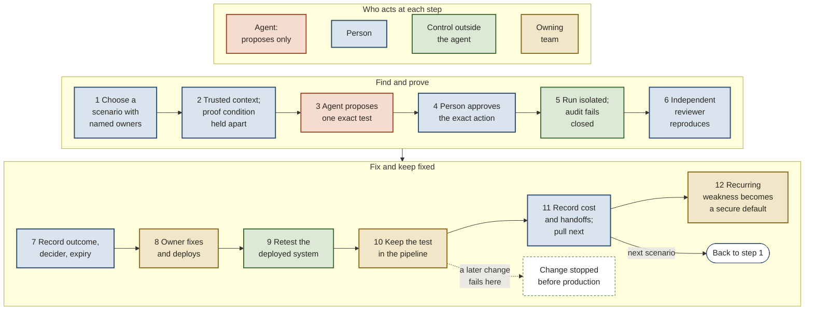

# The strategy, carried forward from the brief and the six-pager

*Ratchet: closed-loop security validation for AI-assisted engineering. Part 1 of 4. Edition 5.2.0, Thesis 1.4.3, 2026-10-31, build 5842e9bf+local.*

Security is one pillar of software quality, alongside reliability, availability, usability and safety. Its job is to help the organization deliver continuously. Security helps fix the weaknesses it finds and owns shared ways to prevent whole kinds of defect. These include secure templates and libraries, called paved roads, and checks that enforce safe choices, called guardrails. Product teams can then focus on business logic. Ratchet is the loop that finds a weakness, verifies the fix and keeps a test to catch its return.

Three terms carry the rest of this part. An **escape** is a security weakness that reaches production, where an attacker can reach it through the running system. A **phase** is a stretch of the work that ends on a test written in advance; there are five, and phase 1 closes the loop once, on one weakness. And Ratchet's design is itself written as a machine-readable model, the **design model**: its parts, the roles people hold, the connections between parts and the records each connection may carry. Automated checks, called design checks here, test it, and the reference parts are generated from it.

The same loop validates mitigating and compensating controls in the running system. A weakness that a tested control stops is **held**: it remains open, and a test with a named owner keeps checking that the control still stops it. Only a weakness confirmed through the running production system is escalated as a right-now problem. Missing or stale control evidence leaves the finding unresolved.

The aim is to make routine human approvals rare as evidence earns autonomy. The business risk owner sets a consequence line: at or above that level of potential harm, a person still approves every exact action. Below it, a reviewed test can later earn a **standing permission** to run without a fresh approval each time, and that permission never waives the checks a result must pass before it is accepted. A separate written grant that expires, the **autonomy grant** (explained under the fourth rule below), can let one kind of judgment, meaning one kind of validation verdict, skip independent reproduction. It never waives the two human sign-offs that close a finding, one accepting the review and one accepting the retest.

The shipped default is under ten minutes of security test time at every delivery stage, including pull request, merge and deploy. The organization can change it in its **profile**, the file where it records its own tools, owners, settings and choices, and the measures report time at each stage. This is a design default, not a measured result.

Ratchet applies vulnerability management across all five stewardship domains in [SF²](https://sf2framework.com/02-stewardship/overview/), a published framework for software security. Each domain feeds the same find, fix and keep discipline. The mapping below describes where the loop applies, rather than claiming proven coverage of every defect class.

| SF² domain | What Ratchet finds and keeps fixed |
|---|---|
| Supply chain | Weaknesses in dependencies and build inputs enter as leads: labeled hints that help choose what to test and never count as evidence. Verified fixes and kept checks guard the affected class. |
| Third party | Weaknesses in delegated services and handoffs enter the loop. Retests check the affected boundary and any control holding it. |
| Process | Gaps in how software is built become reproducible findings and checks in paved roads and guardrails. |
| Runtime | Reachable weaknesses are reproduced through the running system. Deployed fixes and compensating controls are retested. |
| Adaptive capacity | Exercises expose detection and recovery gaps. Their kept tests check whether the system still absorbs the tested surprise. |

A **proof condition** states what would establish or refute the weakness. It stays outside the testing agent's reach. The table below connects the strategy brief and the six-pager to the sections of this part that argue them and to the graded claims behind them in the evidence ledger.

## Each choice in the brief and each truth in the six-pager is argued at full depth in one place

Sections are this part's unless another part is named. Claim codes lead to the evidence ledger in Annex A1, where each claim has its grade, its sources and what would prove it wrong. The brief follows the *Playing to Win* cascade of choices; each row below names the brief's section and, in brackets, the step of the cascade it carries.

| In the brief or the six-pager | Argued at full depth in | Claims that carry it |
|---|---|---|
| **Brief, "Measure escapes and verified fixes" (what winning means):** fewer security escapes per deployment and fixes that stay fixed | *Whether fixes land fast, hold, and rest on trusted evidence decides the outcome at any backlog size* | CL-12, CL-31, CL-48 |
| **Brief, "Widen only on evidence" (where to play):** where the owning teams deliver, ruling out three tempting moves | *Guiding policy: close the loop first, prove each step, then widen*; part 2, *Each of three choices had real alternatives* | CL-17, CL-28 |
| **Brief, "Tests keep fixes and agents hold no authority" (how to win):** one loop, a test holding each fix, authority outside the agent | *Ratchet is one loop of twelve steps, governed by four rules*; *The crux is how fast the loop closes* | CL-02, CL-05, CL-08, CL-28, CL-40, CL-47 |
| **Brief, "Keep control and book fix capacity" (capabilities and management systems):** keeping the parts that enforce the rules, booking fix capacity before any run | *Each part is bought or built case by case*; *The crux is how fast the loop closes* | CL-05, CL-18, CL-49 |
| **Brief, "Fund only phase 1" (the phases):** five phases toward just-in-time fixing, asking only for the first | *Two phases settle the most*; part 2, *Work ships in small units* | CL-13, CL-17, CL-27 |
| **Six-pager, claim 1:** AI grows more capable of finding and exploiting weaknesses | *Finding weaknesses is getting cheaper while fixing and verifying cost as much as ever* | CL-33, CL-34 |
| **Six-pager, claim 2:** an agent's finding is valid locally and unproven end to end | *Finding weaknesses is getting cheaper while fixing and verifying cost as much as ever* | CL-02, CL-24 |
| **Six-pager, claim 3:** authority must sit outside the model | *Ratchet is one loop of twelve steps, governed by four rules*; part 4, *The design limits what each agent can touch* | CL-05, CL-06 |
| **Six-pager, claim 4:** a fix must hold in the running system, and a fixed weakness can return unnoticed; a tested compensating control can hold a weakness while it remains open | *A backlog or a fresh sweep puts the durability of fixes to the test* | CL-12, CL-31 |
| **Six-pager, claim 5:** approvers carry most of the safety load, and their attention erodes | *People at the gates are measured the way the agents are* | CL-09 |
| **Six-pager, claim 6:** fix capacity limits the outcome more than finding does | *The crux is how fast the loop closes* | CL-18, CL-49 |
| **Six-pager, claim 7:** agents find real weaknesses at a cost worth paying | *18 of 50 claims hold today, and the value case is a set of bets* | CL-01, CL-26 |

## Two phases settle the most, and every later phase widens only on what they measure

The outcome sought: fewer security weaknesses escaping into production per deployment, a shorter time to remediate the ones that do, and a measurement of both the organization can trust. Agent findings enter as leads. Reproduced weaknesses receive fixes verified in the deployed system or remain open under tested controls. Independent reproduction is the default, with self-validated findings labeled under the separate autonomy grant. The business risk owner sets a consequence line: the consequence tier, on the organization's ordered scale of potential harm, at or above which a person approves every exact action. An agent's standing permissions stay below it and inside its design limits. People approve any action outside the limits, and a clean record can widen what an agent may do up to those limits and no further.

**Ratchet** is that loop. Like the tool it is named for, it moves one way: each verified fix is held by a test so it cannot slip back, and each step up in trust is held by evidence before the next one is taken.

A **phase** is a stretch of the work that ends when the evidence lets Ratchet say something new, decided by a test written in advance. There are five, and each reports its status as green, yellow or red (part 2). The organization sets a review date before each phase starts. At that point the decision owner, the executive sponsor who approves the program, records whether to continue, change or stop, and sets the next review date for any continuing work. A review never substitutes for the result a phase must show to finish (its exit outcome), and it never extends an exception to a rule. The first two phases do most of the learning, and the plan widens only on what they measure.

### The plan at a glance

Each phase is built from **work units**, small pieces of work that each end in a check showing they landed; part 2 explains them.

- **Phase 1:** **The loop closes once.** A feasibility test: it proves the loop can close, and whether the loop works at scale is for later phases to show. three roles, existing tools only, 30 work units.

- **Phase 2:** **The evidence can be trusted.** Six more roles join, 111 work units.

- **Phase 3:** **Ratchet is measured against today's process and a no-agent baseline.** Organization estimates effort and sets a review date, 104 work units.

- **Phase 4:** **A second team runs it.** Organization estimates effort and sets a review date, 54 work units.

- **Phase 5:** **It works in production.** Organization estimates effort and sets a review date, 19 work units.

- **Cost:** Time from people in existing jobs, plus the shared services built in phase 2. Effort and expected waits are estimates set by the organization.

- **Getting started:** The decision owner names the three phase 1 roles and fills in the first profile sections before phase 1 starts, with its exit outcome, review date and stops recorded.

- **Entry to phase 2:** The decision owner accepts the phase 1 report against the criteria written before it began. Phase 2 starts only on that acceptance.

**Stop if any of these happens:**

- At each organization-set phase review point, work pauses until the decision owner records continue, change or stop and a next review date for continuing work. If phase 1 has not closed, the report names the unmet cross-team commitment (such as scope, approval or fix capacity) and its owner. Its exception to the rule that acceptance is independent ends at phase 1 exit or the risk owner's review date, whichever is first.
- Phase 2's exit test fails any condition, including the owning team's delivery measures leaving the tolerance it set. The work then stops until the causes are written down and the decision owner decides whether to continue.
- After closed cases exceed the organization’s minimum (five by default, so at least six cases; under that default it cannot fire in phase 1’s single case), agents stop if slower and costlier than the script on every case and finding nothing it missed. The scripted loop becomes the plan.

### What is known, what is a bet, and what stops the work

- **What holds:** Authorization enforced outside the model prevents unauthorized actions even when an agent is manipulated. The safety design rests on this, the strongest evidence in the review.
- **What is a bet:** That agents find real weaknesses at a cost worth paying once the estimated effort of verifying their output is counted. No published enterprise study measures it; phase 3 settles it in the organization's own data.
- **What stops the work:** A scripted comparison with no agent runs beside the agent from day one. Once more cases have closed than the organization's minimum (five by default), the agents stop if, on every case, they were slower and costlier than the script and found nothing the script missed; the scripted loop then becomes the plan. Phase 1 closes one case, so under the default minimum this stop cannot trigger there. The authors expect that outcome to be common, especially early: they judge it unlikely that an agent finds something a well-built script misses, and no study has tested it on an enterprise's own systems. 

Apply the early-stop rule whenever closed cases exceed the configured minimum. Until then, report the comparison case by case: each case carries a verdict of the agent against the script, scored by the scorer the decision owner named before phase 1, and no wider conclusion is drawn. The organization chooses which role sets that minimum and records the role beside it. The **dial register** is the profile's list of adjustable settings. Each entry states its allowed minimum and the role that may change it. 

Before phase 2 starts, the decision owner sets the other thresholds, those that stop the work and those that grant a step of trust, from phase 1's map of how the loop works today. The profile records each with who set it and when.

## Whether fixes land fast, hold, and rest on trusted evidence decides the outcome at any backlog size

The diagnosis follows the kernel of strategy in *Good Strategy Bad Strategy*: name the situation, find the crux that decides the outcome, then set a guiding policy and actions that reinforce each other.

### A backlog or a fresh sweep puts the durability of fixes to the test

For years most organizations carried a backlog of security weaknesses that discovery outran, and many still do. Teams work the criticals and highs, sometimes not even those, and findings from a bug bounty program or an internal red team jump the queue because someone outside is watching. Much of the rest is noise, and the engineers who own the code learned to treat security's tickets that way: false positives and low-value work arriving on top of the releases the business is counting on.

AI raises the noise, because agents produce findings at a volume no human team matches. It also raises the stakes. AI is growing more capable of finding software weaknesses and, in controlled tests, of exploiting them, and the pace is accelerating; one campaign, reported by the model's own vendor in 2025, used it in real intrusions. That is one vendor report, graded weak. In the authors' reading, leaders now worry about the whole backlog at once, in a way they did not before. Many have acted on that worry: they have swept their code with a frontier model and pushed engineering to fix what it found. In the authors' observation, those organizations now carry a known backlog smaller than they carried a year earlier.

The authors' working diagnosis is that either starting point can leave fixes vulnerable to later changes unless tests or secure defaults hold them. A sweep delivers fixes in a batch. The authors expect later changes and more capable models to expose further weaknesses, but sweep decay is an untested bet. Phase 1 maps what already keeps fixes in place. A deployed fix reduces exposure when it holds. A tested compensating control can also hold a weakness while it remains open.

Whatever the starting point, the North Star is the same: find and fix each weakness just in time, close to the moment it is introduced. In a backlog organization, the aim is to stop the queue growing. Near zero, it is to keep the count there. Ratchet optimizes the time from a weakness's introduction to a verified fix that stays fixed. Where it can, it catches the weakness where the code is written or when its pull request is reviewed; where it cannot, it proves the weakness through the running system, at its boundary. Two measures track it: the escape rate counts the weaknesses that got past the early catches into production, and time to remediate measures how long each stays open once it is reproduced.

Security's share of high-quality delivery can be measured the way delivery teams already measure quality. DORA's delivery metrics count **change fail rate**: the share of deployments that cause a failure in production. Security's counterpart is the **escape rate**: security weaknesses that reach production per deployment, the same denominator, counted by weakness class and read against a fixed comparison, the organization's own measured rate before Ratchet (its baseline). An escape is a weakness that reached production where an attacker can reach it through the running system; one that a test stops before it ships is a catch. The figure below follows one weakness, a view-only role that can approve invoices, both ways.

<figure class="diagram figure-svg" id="fig-escape-versus-catch"><svg xmlns="http://www.w3.org/2000/svg" viewBox="0 0 720 350" role="img" aria-label="Illustrative timelines of one weakness, a view-only role that can approve invoices. Today: the report waits, the fix merges weeks later, the ticket closes with no retest, and months later an unrelated change reopens the gap, which ships and reaches production again: an escape. With Ratchet: the finding is reproduced independently, the fix is verified in the running system, the test is kept in the owning team's pipeline, and when the same unrelated change arrives, the kept test fails it before it ships: a catch." style="display:block;width:100%;min-width:520px;max-width:720px;height:auto;margin:0 auto;font-family:var(--f-body,Georgia,serif)" font-family="Georgia, serif"><defs><marker id="ev-i" viewBox="0 0 10 10" refX="9" refY="5" markerWidth="7" markerHeight="7" orient="auto-start-reverse"><path d="M0,0 L10,5 L0,10 z" fill="#5A5047" style="fill:var(--ink-2,#5A5047)"/></marker></defs><text x="14" y="16" font-size="11" fill="#5A5047" style="fill:var(--ink-2,#5A5047)" text-anchor="start" letter-spacing="1.2">ILLUSTRATIVE: THE SHAPE OF THE ARGUMENT, WITH NO DATA BEHIND IT</text><text x="14" y="52" font-size="14" fill="#A04A2C" style="fill:var(--tierra,#A04A2C)" text-anchor="start" font-weight="700">Today</text><polyline points="14,70 704,70" stroke="#5A5047" fill="none" stroke-width="1.2" style="stroke:var(--ink-2,#5A5047)" stroke-linejoin="round" marker-end="url(#ev-i)"/><circle cx="84" cy="70" r="5" stroke="none" fill="#5A5047" style="fill:var(--ink-2,#5A5047)"/><text x="84" y="96" font-size="11.5" fill="#2A2520" style="fill:var(--ink,#2A2520)" text-anchor="middle">A tester finds a<tspan x="84" dy="14">view-only role that</tspan><tspan x="84" dy="14">can approve</tspan><tspan x="84" dy="14">invoices</tspan></text><circle cx="218" cy="70" r="5" stroke="none" fill="#5A5047" style="fill:var(--ink-2,#5A5047)"/><text x="218" y="96" font-size="11.5" fill="#2A2520" style="fill:var(--ink,#2A2520)" text-anchor="middle">It waits in the<tspan x="218" dy="14">queue; the fix</tspan><tspan x="218" dy="14">merges weeks later</tspan></text><circle cx="352" cy="70" r="5" stroke="none" fill="#5A5047" style="fill:var(--ink-2,#5A5047)"/><text x="352" y="96" font-size="11.5" fill="#2A2520" style="fill:var(--ink,#2A2520)" text-anchor="middle">The ticket closes<tspan x="352" dy="14">on the merge;</tspan><tspan x="352" dy="14">nobody retests</tspan></text><circle cx="486" cy="70" r="5" stroke="none" fill="#5A5047" style="fill:var(--ink-2,#5A5047)"/><text x="486" y="96" font-size="11.5" fill="#2A2520" style="fill:var(--ink,#2A2520)" text-anchor="middle">Months later, an<tspan x="486" dy="14">unrelated change</tspan><tspan x="486" dy="14">reopens the gap</tspan></text><circle cx="626" cy="70" r="9" stroke="none" fill="#A04A2C" style="fill:var(--tierra,#A04A2C)"/><text x="626" y="96" font-size="11.5" fill="#A04A2C" style="fill:var(--tierra,#A04A2C)" text-anchor="middle" font-weight="700">It ships: the gap<tspan x="626" dy="14">reaches production</tspan><tspan x="626" dy="14">again</tspan></text><text x="626" y="142" font-size="13" fill="#A04A2C" style="fill:var(--tierra,#A04A2C)" text-anchor="middle" font-weight="700">An escape</text><text x="14" y="204" font-size="14" fill="#2C4A6B" style="fill:var(--azul,#2C4A6B)" text-anchor="start" font-weight="700">With Ratchet</text><polyline points="14,222 704,222" stroke="#5A5047" fill="none" stroke-width="1.2" style="stroke:var(--ink-2,#5A5047)" stroke-linejoin="round" marker-end="url(#ev-i)"/><circle cx="84" cy="222" r="5" stroke="none" fill="#5A5047" style="fill:var(--ink-2,#5A5047)"/><text x="84" y="248" font-size="11.5" fill="#2A2520" style="fill:var(--ink,#2A2520)" text-anchor="middle">An independent<tspan x="84" dy="14">reviewer reproduces</tspan><tspan x="84" dy="14">the finding</tspan></text><circle cx="218" cy="222" r="5" stroke="none" fill="#5A5047" style="fill:var(--ink-2,#5A5047)"/><text x="218" y="248" font-size="11.5" fill="#2A2520" style="fill:var(--ink,#2A2520)" text-anchor="middle">The fix is verified<tspan x="218" dy="14">in the running</tspan><tspan x="218" dy="14">system</tspan></text><circle cx="352" cy="222" r="5" stroke="none" fill="#5A5047" style="fill:var(--ink-2,#5A5047)"/><text x="352" y="248" font-size="11.5" fill="#2A2520" style="fill:var(--ink,#2A2520)" text-anchor="middle">The test is kept in<tspan x="352" dy="14">the invoicing</tspan><tspan x="352" dy="14">team's pipeline</tspan></text><circle cx="486" cy="222" r="5" stroke="none" fill="#5A5047" style="fill:var(--ink-2,#5A5047)"/><text x="486" y="248" font-size="11.5" fill="#2A2520" style="fill:var(--ink,#2A2520)" text-anchor="middle">Months later, the<tspan x="486" dy="14">same unrelated</tspan><tspan x="486" dy="14">change</tspan></text><circle cx="626" cy="222" r="9" stroke="none" fill="#2C4A6B" style="fill:var(--azul,#2C4A6B)"/><text x="626" y="248" font-size="11.5" fill="#2C4A6B" style="fill:var(--azul,#2C4A6B)" text-anchor="middle" font-weight="700">The kept test fails<tspan x="626" dy="14">the change before</tspan><tspan x="626" dy="14">it ships</tspan></text><text x="626" y="294" font-size="13" fill="#2C4A6B" style="fill:var(--azul,#2C4A6B)" text-anchor="middle" font-weight="700">A catch</text><text x="704" y="340" font-size="11" fill="#5A5047" style="fill:var(--ink-2,#5A5047)" text-anchor="end" font-style="italic">time</text></svg><figcaption>FIG-ESCAPE-CATCH. Illustrative: the invoice example on two timelines. Without a kept test, the reopened gap ships, and it counts as an escape. With one, the test fails the change before it ships, and it counts as a catch.</figcaption></figure>

An escape counts once three things are on record:

1. the source and role that detected it, such as incident response, a bug bounty or monitoring in production;
2. the deployment that shipped it, with the detection inside a window the organization sets after that deployment;
3. confirmation by someone whose role differs from whoever detected it.

Each escape also records what it cost: its blast radius, given as the consequence tiers of the assets it reached and the services it affected; how long recovery took; and whether the fix removed the whole weakness class or one instance. Escapes detected after the window, and those no deployment shipped, such as configuration drift, are reported apart, and the rate is shown with late escapes both left out and included. The escape rate is compared with change fail rate only once both are collected the same way over enough deployments.

Beside the escape rate sits **time to remediate**, security's analogue of DORA's failed deployment recovery time: the time from a reproduced finding to a fix verified in the deployed system. What matters is lowering the first and shortening the second without stalling the work that keeps the business competitive. Product engineering has to ship at the speed the business needs, and that is sustainable only if checking, fixing and holding a fix in place are fast, and automated wherever the four rules allow. Security then arrives as a precise, fix-ready contribution to product engineering's value stream, where today it often arrives as a tax.

The escape rate and time to remediate are outcome measures: they show whether weaknesses reach production and how long they stay open. Whether an agent is worth its cost is a separate question of efficiency, whether an agent beats a script per finding, and a separate instrument answers it: phase 3's matched comparison of Ratchet against today's process and against a no-agent baseline, over comparable cases. A falling escape rate cannot show that agents earn their cost, and an agent arm that wins the comparison cannot show that fewer weaknesses escape, so each result is read against its own question.

### Finding weaknesses is getting cheaper while fixing and verifying cost as much as ever

AI-assisted engineering produces more code, and AI agents can now draft security tests at a volume no human team matches. Every finding still has to be checked, prioritized, fixed, deployed and kept fixed, and those steps run on people who already have full jobs.

- **Findings already outrun fixes.** In monitored open-source systems, 20 to 30% of findings are never fixed, and work queues run at or above capacity. Enterprise vendor data points the same way; see security debt below.
- **Fixes do not always hold.** In 82% of 53 JavaScript projects, some fix for a known weakness introduced a new one; in those projects an average 18% of fix commits did (2020 study, detected by static analysis, Annex A1, CL-11).
- **Severity alone is a weak priority signal.** In one case-control study, patching vulnerabilities rated high or medium reduced risk by a median of 3.54%. Restricting that patching to vulnerabilities already sold in exploit kits reduced it by 61.72% (Annex A1, CL-14). Ratchet orders findings by consequence and exploitation, as current public decision trees such as SSVC do. Whether that ordering improves Ratchet's outcomes remains to be measured.
- **Agent findings are valid locally and unproven end to end.** An agent can show that code is flawed without showing that anyone can reach the flaw through the running system, and a security operations team checks each finding by hand today. In the one live-network study of an agent penetration tester, 82% of 11 submitted findings were valid, so nearly one in five was not.

### The crux is how fast the loop closes, whether its fixes hold, and trust

A finding reduces exposure when the loop verifies a deployed fix or a control that holds the weakness. The held weakness remains open. Adding agents to today's process adds findings to a saturated queue where a backlog persists, repeats the surge where a sweep has cleared it, and in both asks people to trust results that nobody independent checked. Volume and doubt together also damage the measurement: agents add findings faster than anyone can confirm them, and the authors judge an escape rate counted from unconfirmed findings at that volume worse than none, because it looks precise and says nothing true about what reached production. The crux is whether the organization can shorten the time from a weakness's introduction to a verified fix that stays fixed, with evidence it trusts, at a cost it can see.

The pressure on fix capacity would remain even if every finding were real. Findings left open are **security debt**, the established term for flaws that stay unfixed. One vendor's 2024 scan data found it in 42% of applications and 71% of organizations (Veracode, 2024). Like other technical debt, it charges interest in engineering time: developers surveyed repeatedly in one longitudinal study reported losing 23% of their working time to technical debt (longitudinal technical-debt study, 2019, Annex A1, CL-49).

Teams answer for reliability, availability, usability, security and safety. Each pillar makes claims that need continuous verification, and the unfixed flaws in each are its share of **quality debt**, paid from one pool of engineers. Security debt is the security share of quality debt. Ratchet's loop is how the security dimension keeps its claims verified and its share of quality debt from growing.

A sudden flow of validated risk lands on the engineers who owe the business its next release. The authors' weak, untested bet is that validating more findings than a team can fix increases time lost to security debt without reducing exposure. Phase 3 tests it. Fixing is debt service. A team's **debt-service capacity** is finite, and the fix cap below, set with security, is security's agreed share of it: the number of open validated findings the team takes on at once. Published data on capacity points the same way: across nearly 300 organizations, a typical one had the capacity to remediate about one in ten of its open vulnerabilities a month, whatever its size (Cyentia Institute, 2019).

Security, the engineer who owns the code and an agent develop the fix together in one pull request. They include a regression test for the affected component. It fails if that weakness returns. The owning team reviews the change and owns the test in its suite. The coding agent can see the local test and its results. Before the finding enters the team's work queue, the record holds the test that reproduces it, evidence that legitimate use still works, the drafted fix or the reason none is possible, and the check the team owns that will block the weakness's return. The team may take, edit or decline the draft with a recorded reason.

Security automatically records which kept tests still run and pass. This read-only inventory is the **kept-test mirror**. It can report a removed, skipped or failing test as a new finding. It cannot change the team's code, pull request or tests. Missing, old or mismatched observations mean protection is unknown. Before a risk decision, the reviewer checks for a recent passing run at the code revision, configuration and set of dependencies being assessed. A pass from another version or environment does not establish protection here. A local pass alone cannot establish that the whole attack path is closed. The mirror also reports how many contributed local tests still run and pass, and how many contribute to an accepted guardrail for a whole class. Each rate names the group of tests it follows and the period observed, and gives the count that qualifies, the total, and the share of the group that was observed.

Security separately checks whether weaknesses can combine into a complete attack path. This is **aggregate validation**, the independent layer. Its proof conditions state what would establish or refute a weakness. Those conditions and the checks of connected attack steps never reach a coding agent. They can expose a remaining path even when the team's visible test passes. Ratchet keeps no separate, hidden set of tests for variants of a weakness: a newly found variant enters the normal loop as a new finding. Nobody quietly changes the team's pull request. Security also owns tests for whole weakness classes in shared defaults and guardrails. Agents see checks derived from those tests, which return pass or fail without exposing the protected test details.

Where no build-level test can reproduce the weakness, as with many identity, network and configuration findings, a reproduction through the running system serves both as the test and as the gate, the check that blocks a change that brings the weakness back, and where no fix can be drafted, the reason is recorded and the finding goes to the team's lead and the security risk owner. The authors expect that path to cost the team less than its queue does.

Part 2, under the risk that fix capacity saturates, sets out the cap, which findings bypass it and how often the findings above it are reviewed. The cap paces security's output to the fix path security helps fund. The six-pager's tailoring guide lists the questions to settle with the team that owns developer experience. The loop's safety case does not depend on the capacity bet.

### Guiding policy: close the loop first, prove each step, then widen

Ratchet's guiding policy rules out three tempting moves. It does not grow discovery before the loop closes. It does not let an agent act or judge on its own authority. It does not commit to scale before the phases report. The coherent actions are the five phases in the plan (part 2), each building on what the previous one proved.

### As AI scales, finding and fixing may pass through three regimes

This is forward-looking. Each statement here is a premise the authors expect, graded as having no evidence yet, and their best guess. Read as security debt, the regimes are its course: the debt and its interest grow in the backlog regime, are paid down as fast as they accrue in the balanced regime, and near zero come mostly from new changes, fixes among them. 

In the **backlog** regime, discovery outruns verified fixes, and many organizations may still be there; the lever is fixing whole weakness classes through secure defaults, and the fix cap each owning team sets with security already governs it. 

In the **balanced** regime, verified fixes keep pace with arrivals, and discovery moves toward surface no kept test covers yet. 

In the **near zero** regime, novel findings become rare and costly, AI discovery drifts toward noise, and remediation may become the main stream of security changes and may become the main source of new weaknesses. The floor, the low rate of novel findings this regime approaches, resets for a weakness class whenever new technology brings new classes. 

A sweep with a capable model can make an organization look near zero at once: its known backlog drops close to nothing. The authors expect that state to decay. Escapes return through weaknesses that later changes reintroduce and through classes the next model finds, so an organization that stops at the sweep drifts back toward a backlog, and the authors expect a loop that keeps each fix in place to hold it near zero.

<figure class="diagram figure-svg" id="fig-sweep-versus-loop"><svg xmlns="http://www.w3.org/2000/svg" viewBox="0 0 720 336" role="img" aria-label="Illustrative chart with no values. Known open weaknesses over time, across model releases. A backlog left alone keeps rising. A sweep drops the count at once, then it climbs back as later changes reintroduce weaknesses, and each new model brings a fresh surge, so repeated sweeps make a sawtooth. The same sweep followed by the loop stays near the floor: each new model adds a small tooth that the loop fixes and holds." style="display:block;width:100%;min-width:520px;max-width:720px;height:auto;margin:0 auto;font-family:var(--f-body,Georgia,serif)" font-family="Georgia, serif"><defs><marker id="sw-i" viewBox="0 0 10 10" refX="9" refY="5" markerWidth="7" markerHeight="7" orient="auto-start-reverse"><path d="M0,0 L10,5 L0,10 z" fill="#5A5047" style="fill:var(--ink-2,#5A5047)"/></marker></defs><text x="70" y="22" font-size="11" fill="#5A5047" style="fill:var(--ink-2,#5A5047)" text-anchor="start" letter-spacing="1.2">ILLUSTRATIVE: THE SHAPE OF THE ARGUMENT, WITH NO DATA BEHIND IT</text><polyline points="70,38 70,270 530,270" stroke="#5A5047" fill="none" stroke-width="1.2" style="stroke:var(--ink-2,#5A5047)" stroke-linejoin="round"/><polyline points="524,266 530,270 524,274" stroke="#5A5047" fill="none" stroke-width="1.2" style="stroke:var(--ink-2,#5A5047)"/><text x="30" y="157" font-size="12" fill="#5A5047" style="fill:var(--ink-2,#5A5047)" text-anchor="middle" transform="rotate(-90 30 157)">Known open weaknesses</text><text x="295" y="318" font-size="12" fill="#5A5047" style="fill:var(--ink-2,#5A5047)" text-anchor="middle">Time, across model releases</text><polyline points="210,44 210,270" stroke="#DCD2C2" fill="none" stroke-width="1" stroke-dasharray="3 4" style="stroke:var(--rule,#DCD2C2)" stroke-linejoin="round"/><text x="210" y="288" font-size="11" fill="#5A5047" style="fill:var(--ink-2,#5A5047)" text-anchor="middle">new model</text><polyline points="320,44 320,270" stroke="#DCD2C2" fill="none" stroke-width="1" stroke-dasharray="3 4" style="stroke:var(--rule,#DCD2C2)" stroke-linejoin="round"/><text x="320" y="288" font-size="11" fill="#5A5047" style="fill:var(--ink-2,#5A5047)" text-anchor="middle">new model</text><polyline points="430,44 430,270" stroke="#DCD2C2" fill="none" stroke-width="1" stroke-dasharray="3 4" style="stroke:var(--rule,#DCD2C2)" stroke-linejoin="round"/><text x="430" y="288" font-size="11" fill="#5A5047" style="fill:var(--ink-2,#5A5047)" text-anchor="middle">new model</text><text x="116" y="288" font-size="11" fill="#5A5047" style="fill:var(--ink-2,#5A5047)" text-anchor="middle">first sweep</text><polyline points="70,150 520,62" stroke="#5A5047" fill="none" stroke-width="2" stroke-dasharray="6 5" style="stroke:var(--ink-2,#5A5047)" stroke-linejoin="round"/><polyline points="70,150 112,150 118,244 208,204 210,150 224,150 230,244 318,204 320,150 334,150 340,244 428,204 430,150 444,150 450,244 520,212" stroke="#A04A2C" fill="none" stroke-width="2.5" style="stroke:var(--tierra,#A04A2C)" stroke-linejoin="round"/><polyline points="70,150 112,150 118,248 210,248 212,230 222,230 224,239 234,239 236,248 320,248 322,230 332,230 334,239 344,239 346,248 430,248 432,230 442,230 444,239 454,239 456,248 520,248" stroke="#2C4A6B" fill="none" stroke-width="3" style="stroke:var(--azul,#2C4A6B)" stroke-linejoin="round"/><text x="532" y="66" font-size="12" fill="#5A5047" style="fill:var(--ink-2,#5A5047)" text-anchor="start">Backlog,<tspan x="532" dy="15">left alone</tspan></text><text x="532" y="196" font-size="12" fill="#A04A2C" style="fill:var(--tierra,#A04A2C)" text-anchor="start" font-weight="700">A sweep with each<tspan x="532" dy="15">new model: it climbs</tspan><tspan x="532" dy="15">back between sweeps</tspan></text><text x="532" y="252" font-size="12" fill="#2C4A6B" style="fill:var(--azul,#2C4A6B)" text-anchor="start" font-weight="700">The sweep plus the loop:<tspan x="532" dy="15">each fix held by a test</tspan></text></svg><figcaption>FIG-SWEEP-LOOP. Illustrative, with no values on either axis. A sweep drops the known count at once and then decays: later changes reintroduce weaknesses, and each new model finds classes the last one missed. The loop holds each fix with a test, so the count stays near the floor.</figcaption></figure>

Arrivals against verified fixes, per weakness class, tell backlog from balanced. Two measures beside DORA's mark the approach to near zero: the **remediation change fail rate** (change fail rate counted on security fixes alone) and the **cost per validated novel finding**. Queue age, the novel share of findings and classes retired fill in the picture. Apart from the regimes, AI works on three sides of the loop. On the red (attack) side it finds and proves. In the **purple team**, the joint attack-and-defense function, it turns findings into detections and kept tests, re-proves kept tests on a schedule and plants known-bad proposals at the gates to test the people who approve. In remediation it drafts fixes for the owning team. The four rules hold in each: AI proposes, and an independent, separately owned check decides. How this plays out depends on the organization, so Ratchet ships the measures and the signals for each regime, and the organization sets every threshold.

## Ratchet is one loop of twelve steps, governed by four rules that should never be broken without a recorded decision

This is the loop that matters: finding and validating continuously improve fixing.

Three roles recur: the test operator, the service owner and an independent reviewer. The **test operator** runs the loop, prepares context and submits the agent's proposed tests. The **service owner** is the engineering team that owns the application under test. An **independent reviewer** reproduces each result by default. The separate autonomy grant described below can waive that reproduction for labeled findings. Beside them, a **test-drafting agent** is an AI agent or tool that drafts a proposed test and carries no authority to run it.

**Find and prove**

1. Choose a material scenario, one significant to the business, with named owners for scope, fix and acceptance. [STEP-1: Choose a material scenario]
2. Assemble trusted context about the target and hold the proof condition apart. [STEP-2: Assemble trusted context and the protected proof condition]
3. A test-drafting agent proposes one exact test. [STEP-3: Propose a test]
4. A person approves that exact action, outside the agent. [STEP-4: Authorize the exact action]
5. Run it in an isolated environment with fail-closed audit and verified cleanup. [STEP-5: Execute in a bounded cell]
6. An independent reviewer reproduces the result against the proof condition. [STEP-6: Verify the evidence independently]

**Fix and keep fixed**

7. Record the outcome with who decided it and when it expires. [STEP-7: Dispose and accept]
8. The service owner fixes and deploys through its normal release path. [STEP-8: Fix and deploy]
9. Retest in the deployed system and confirm legitimate users still succeed. [STEP-9: Retest in the deployed state]
10. Keep the test as a regression in the owning team's pipeline. [STEP-10: Keep the regression]
11. Record cost, handoffs and outcomes, and decide what to pull next. [STEP-11: Learn and expand]
12. Turn a weakness that keeps recurring into a vetted secure default. [STEP-12: Harden the road]

*The twelve steps. The first six turn a proposal into a verified finding; the last six turn it into a fix that a test keeps in place. Each step's code and name in brackets are the ones the reference parts use.*

*FIG-LOOP, the loop. Every arrow that changes the system passes through a person or a control outside the agent. Color shows who acts at each step: the agent acts only at step 3, and only to propose. The dashed arrow is the ratchet's tooth: a later change that reopens the weakness fails at the kept test.*

The scenario owner writes the proof condition, often starting from a draft by a language model. The agent that proposes the test never sees that condition. In the invoice example, the weakness is real if a role meant only to view invoices can approve one. The fix passes when the request is refused and the invoice stays unchanged. A **regression test** is a reviewed test kept in the owning team's pipeline that fails if the weakness returns.

**The agent cannot give itself permission to run a test.**

A proposal is never permission. An agent can suggest trying to approve an invoice as the view-only role. A person must approve that exact action before it runs. Agents plan and propose. The design limits what the agent can touch, and those limits always stop below a consequence line the business risk owner sets. People approve any action outside the limits, and a clean record can widen what an agent may do up to those limits and no further. 

A limit is set for each agent and each kind of judgment: the highest consequence tier it may touch, the environments, and the kinds of action (read-only, reversible or state-changing), with the role that set it. Inside its limit, and below the consequence line the organization sets, a reviewed test may run on a standing permission alone once its record of clean runs holds; outside the limit, or at or above that line, a person approves each exact action. In phase 1 a person approves every action. 

An authorization service outside every agent checks the exact target, identity, action, environment and time window immediately before anything runs, and stops on any gap.

These controls bound what any part may do, but they cannot say whether the authority model an application enforces is right. A view-only role that can approve invoices breaks no boundary; finding it takes verification against what the role was meant to allow, and that is the loop's work.

**The testing agent cannot read the answer it will be judged against.**

Proof conditions stay out of the testing agent's reach. In the invoice example, the reviewer keeps that condition apart from the instructions the agent receives. The proof condition lives with its owner. The testing agent sees only a reference, so it can pass a test only by doing the work. A model that helps the owner draft the condition runs on a separate **route** (a connection to a model, with its own permissions) that holds no tools, and nothing it sees reaches the testing agent.

**The agent's report alone cannot establish a finding.**

Findings require validated **intake**, a check of each report on arrival that it must pass, and independent reproduction. Intake checks the report, and a reviewer reproduces whether the view-only role can approve an invoice. An agent's output becomes evidence after those checks. An agent's rejection or "not applicable" never counts as coverage. A reproduction that fails leaves the finding unresolved and never refutes it, because reports often leave out a condition the path needed.

An exploitable weakness has a counterpart: the held finding. When the reproduction runs with the system's real controls in place and a control stops it short of the proof condition, and the run's **receipt**, its signed evidence record, shows that control refusing the step, the weakness is held by that control. 

The record names the weakness, the control and the path, and a kept test, owned by the team that owns the control, runs that path against the control at an interval the owner sets. A held finding is neither exploitable nor closed. 

The moment the kept test shows the control no longer stops the path, the finding is exploitable. Its reach is what that run showed, its consequence tier stays as already confirmed, and nobody triages it again. 

A held finding whose test is missing, unowned or past its interval reads as unresolved. A control that no reproduction observed holds nothing. Crediting it would close a finding on a defense nobody tested.

**Acceptance is independent. The human test operator submitting the agent's proposal cannot accept its result.**

The person who proposes a test, the person who holds its proof condition and the person who decides the result are three different people, except in phase 1, where the independent reviewer both holds the proof condition and decides. The invoice test's proposer cannot decide that it succeeded. Closure needs two distinct human acceptances, one of the review and one of the retest, plus a machine record of the deployment.

Phase 1 makes no assurance claim and runs with three roles, so its independent reviewer both holds the proof condition and decides the outcome. That is phase 1's exception to this rule, and it ends at phase 1's exit or the risk owner's recorded review date, whichever is first. Reaching that date without the exit outcome stops work under the exception until full separation is in place or the named risk owners accept a standard exception: the usual recorded, expiring exception that part 3 describes. The full separation of proposer, proof-condition holder and decider is required from phase 2, whose exit test checks it.

A separate exception to the rules on validation and independent acceptance allows **earned autonomy** through the autonomy grant: written permission to accept one kind of validation without independent reproduction, while separate checks keep testing its honesty and correctness. Ratchet starts by learning only from what people confirm. The control plane is the part of the system that checks permissions and keeps protected evidence, outside the agents' control. Two records must earn the grant. The honesty record compares what Ratchet reported with what the control plane recorded it doing. The correctness record checks whether its verdicts hold up. Both use samples Ratchet cannot predict and a different checking method. For example, a runner with no model can replay the agent's reproduction step by step.

The business risk owner may issue an autonomy grant, which also lets Ratchet learn from the validations it covers, with the security risk owner's agreement, one kind of judgment at a time. The grant is written, expires, and lapses the moment either record slips. Every finding validated under a grant stays labeled, so each measure reads with and without them. 

What it learns keeps its provenance, including any **outsider label** on the inputs (the mark carried by text that outsiders wrote, and by what is derived from it) and who cleared it, and the provenance is checked again each time an item is read back into an agent's context. The part that proposes a test never judges it. A grant lets the system learn from its own verdicts and never gives an agent authority to act. Each grant also sits inside a limit the design sets for that kind of judgment, and a clean record can widen what a grant covers only up to that limit. 

Whether trust should follow the agent's accuracy or the size of the damage its errors can do is still open. Before each agent action in phase 2, the record notes the recent accuracy of that agent's route and how far its limit reaches; afterwards, each wrong action's cost is measured on its own, and phase 2 reports which of the two better forecast that cost, or that it has too few wrong actions to tell. The answer informs the thresholds and never widens a limit on its own. The aim is fewer human gates over time, in line with continuous delivery. Each kind of judgment earns that autonomy through the honesty and correctness records. The two human closure acceptances remain required.

*The four rules. They decide who may act and who may judge, and an organization keeps them whatever it buys. The first limits unauthorized effects. The other three keep its measurement honest, so an escape counted or a fix closed means what it says. Each is a strong default: an exception to one is possible only as a recorded, expiring decision by named risk owners (part 3).*

**Asymmetric suspicion:** human approvers can drift toward approval. The design tests each human gate with seeded known-bad items to measure whether that gate still catches them.

Asymmetric suspicion is a duty to keep measuring, separate from the four rules. The evidence that approvers drift is moderate and comes from open-source code review, security operations and a lab study, so each organization treats it as a hypothesis to test in its own approval data. Part 3's profile check verifies each gate's seeding setup. Whether seeded items measure gate health is weak and untested, to be settled in phase 3.

### Six kinds of exception relax a rule, each with its own acceptor and end

"Exception" covers several mechanisms in this edition, and each relaxes something different. The table names them side by side; parts 3 and 4 give the records each one needs.

| Kind | What it relaxes | Who accepts it | When it ends |
|---|---|---|---|
| **Standard exception** | One should-never rule, with at least one compensating control | The business risk owner, with the security risk owner concurring, after the roles named on the rule's trade-off card discuss it | Within 180 days (part 3) |
| **Phase 1 reviewer exception** | The rule that acceptance is independent: phase 1's independent reviewer both holds the proof condition and decides | Part of phase 1's design; its record names its risk owner and review date | At phase 1's exit or that review date, whichever is first; a continue decision cannot renew it |
| **Phase 1 test-environment exception** | Separation and intake rules whose effects stay inside the test environment, such as one small team both writing a fix and accepting its closure | The decision owner, with the independent reviewer concurring | At phase 1's exit or the risk owner's review date, whichever is first; once both risk owners are named, it lapses unless they accept it again as a standard exception |
| **Strictness exception** | Lets an undeclared crossing at a seam be flagged as a warning instead of refused; never covers what the seam lists as never crossing. The edition ships one on the seam where Jig plugs in, which part 3 calls the boundary exception | A named acceptor; for the shipped one, a person or team accepting for the security risk owner role, among the first-run records (part 3) | At a set end; the shipped one has none, so each adopter supplies a calendar date |
| **Audience exception** | Who may read a contract whose readers the design restricts | A named risk acceptor | At a set end |
| **Autonomy grant** | Independent reproduction, for one kind of judgment | The business risk owner, with the security risk owner's agreement | At its written expiry, or at once when its honesty or correctness record slips |

### Jig checks code as it is written and learns from Ratchet's verified results

Ratchet has a sibling design called **Jig**. It works where code is written: it steers developers and their coding agents toward secure patterns and catches defects between the first edit and merge. Jig is broad and fast, and noisier, because it sees less context than Ratchet does. Ratchet is the precision side: the weakness classes it proves, and pass-or-fail checks derived from the tests that hold them closed, are meant to flow back into Jig's rules, so Jig's aim should improve as Ratchet's record grows. Where its tools allow, Jig in turn records who and what wrote each change: the person and the tool or agent. Changes it cannot label still count, so both designs are measured on the same record. Both keep the same four rules.

Jig ships as an edition line of its own, with its own version, its own changelog and its own five stages: attribute, one check in many places, agent fixes first, focus the humans, and pave the road. Its first edition holds design files only, and Ratchet's tools check them. Jig's prose argument is still in draft. Ratchet runs alone. Run without Ratchet, Jig starts by listing its assumptions about how code is created and which coding-agent environments (harnesses) its checks already cover. Its stages cannot claim their exit tests until their waits on Ratchet are met; they wait chiefly for checks derived from kept tests and a record of which layer should have caught each defect. The full list of those waits sits in the **shared layer**, the records both designs reference (part 4). When an organization runs both, Jig plugs into Ratchet as a module (part 3) at a seam where every crossing carries a contract, and the shared layer belongs to neither one.

### Each part is bought or built case by case, and the rules stay with the organization

Ratchet is a core platform with pluggable modules. The core is the loop, its four rules and its record, and every organization runs it. A **module** connects an existing practice to the core at declared points. The design calls that boundary a **seam**. Each crossing states what may pass and who may receive it. The same design checks apply to every module, so an organization can add modules of its own (part 4). Most enterprises already run some version of several modules, usually disconnected from one another, so a module is mainly how Ratchet wires an existing practice in.

<figure class="diagram figure-svg" id="fig-core-and-modules"><svg xmlns="http://www.w3.org/2000/svg" viewBox="0 0 720 420" role="img" aria-label="Illustrative diagram. The core, a ring holding the loop, its four rules and the record, which every organization runs. Four plug points on the ring take modules: signals in (Existing security tools as leads), stakes (Consequence-informed gates beyond tiers), reach (Production effects) and prevention out (Paved road, Secure creation (Jig)). Each module switches on only when its entry evidence exists." style="display:block;width:100%;min-width:520px;max-width:720px;height:auto;margin:0 auto;font-family:var(--f-body,Georgia,serif)" font-family="Georgia, serif"><defs><marker id="co-a" viewBox="0 0 10 10" refX="9" refY="5" markerWidth="7" markerHeight="7" orient="auto-start-reverse"><path d="M0,0 L10,5 L0,10 z" fill="#2C4A6B" style="fill:var(--azul,#2C4A6B)"/></marker></defs><circle cx="360" cy="210" r="84" stroke="#2C4A6B" fill="#2C4A6B" stroke-width="6" fill-opacity="0.08" style="stroke:var(--azul,#2C4A6B);fill:var(--azul,#2C4A6B)"/><text x="360" y="184" font-size="18" fill="#2C4A6B" style="fill:var(--azul,#2C4A6B)" text-anchor="middle" font-weight="700">Core</text><text x="360" y="206" font-size="12" fill="#2A2520" style="fill:var(--ink,#2A2520)" text-anchor="middle">the loop, its four<tspan x="360" dy="15">rules and the record</tspan></text><text x="360" y="248" font-size="11" fill="#5A5047" style="fill:var(--ink-2,#5A5047)" text-anchor="middle" font-style="italic">every organization<tspan x="360" dy="13">runs it</tspan></text><rect x="10" y="150" width="196" height="89" rx="6" stroke="#DCD2C2" fill="#FFFDF8" stroke-width="1.2" style="stroke:var(--rule,#DCD2C2);fill:var(--sheet,#FFFDF8)"/><text x="20" y="169" font-size="11" fill="#A04A2C" style="fill:var(--tierra,#A04A2C)" text-anchor="start" font-weight="700" letter-spacing="1.2">SIGNALS IN</text><text x="20" y="184" font-size="12.5" fill="#2A2520" style="fill:var(--ink,#2A2520)" text-anchor="start" font-weight="700">Existing security tools as</text><text x="20" y="199" font-size="12.5" fill="#2A2520" style="fill:var(--ink,#2A2520)" text-anchor="start" font-weight="700">leads</text><text x="20" y="214" font-size="11.5" fill="#5A5047" style="fill:var(--ink-2,#5A5047)" text-anchor="start">On when closed cases record</text><text x="20" y="229" font-size="11.5" fill="#5A5047" style="fill:var(--ink-2,#5A5047)" text-anchor="start">which leads pointed at them</text><rect x="270" y="204" width="12" height="12" rx="2" stroke="#2C4A6B" fill="#FFFDF8" stroke-width="2" style="stroke:var(--azul,#2C4A6B);fill:var(--sheet,#FFFDF8)"/><polyline points="206,210 268,210" stroke="#2C4A6B" fill="none" stroke-width="2" style="stroke:var(--azul,#2C4A6B)" stroke-linejoin="round" marker-end="url(#co-a)"/><rect x="210" y="8" width="300" height="74" rx="6" stroke="#DCD2C2" fill="#FFFDF8" stroke-width="1.2" style="stroke:var(--rule,#DCD2C2);fill:var(--sheet,#FFFDF8)"/><text x="220" y="27" font-size="11" fill="#A04A2C" style="fill:var(--tierra,#A04A2C)" text-anchor="start" font-weight="700" letter-spacing="1.2">STAKES</text><text x="220" y="42" font-size="12.5" fill="#2A2520" style="fill:var(--ink,#2A2520)" text-anchor="start" font-weight="700">Consequence-informed gates beyond tiers</text><text x="220" y="57" font-size="11.5" fill="#5A5047" style="fill:var(--ink-2,#5A5047)" text-anchor="start">On when accepted findings record the assets</text><text x="220" y="72" font-size="11.5" fill="#5A5047" style="fill:var(--ink-2,#5A5047)" text-anchor="start">they reach</text><rect x="354" y="120" width="12" height="12" rx="2" stroke="#2C4A6B" fill="#FFFDF8" stroke-width="2" style="stroke:var(--azul,#2C4A6B);fill:var(--sheet,#FFFDF8)"/><polyline points="360,82 360,118" stroke="#2C4A6B" fill="none" stroke-width="2" style="stroke:var(--azul,#2C4A6B)" stroke-linejoin="round" marker-end="url(#co-a)"/><rect x="210" y="340" width="300" height="74" rx="6" stroke="#DCD2C2" fill="#FFFDF8" stroke-width="1.2" style="stroke:var(--rule,#DCD2C2);fill:var(--sheet,#FFFDF8)"/><text x="220" y="359" font-size="11" fill="#A04A2C" style="fill:var(--tierra,#A04A2C)" text-anchor="start" font-weight="700" letter-spacing="1.2">REACH</text><text x="220" y="374" font-size="12.5" fill="#2A2520" style="fill:var(--ink,#2A2520)" text-anchor="start" font-weight="700">Production effects</text><text x="220" y="389" font-size="11.5" fill="#5A5047" style="fill:var(--ink-2,#5A5047)" text-anchor="start">On when phase 3 decides to continue and a</text><text x="220" y="404" font-size="11.5" fill="#5A5047" style="fill:var(--ink-2,#5A5047)" text-anchor="start">production profile is approved</text><rect x="354" y="288" width="12" height="12" rx="2" stroke="#2C4A6B" fill="#FFFDF8" stroke-width="2" style="stroke:var(--azul,#2C4A6B);fill:var(--sheet,#FFFDF8)"/><polyline points="360,302 360,340" stroke="#2C4A6B" fill="none" stroke-width="2" style="stroke:var(--azul,#2C4A6B)" stroke-linejoin="round" marker-end="url(#co-a)"/><rect x="514" y="112" width="196" height="134" rx="6" stroke="#DCD2C2" fill="#FFFDF8" stroke-width="1.2" style="stroke:var(--rule,#DCD2C2);fill:var(--sheet,#FFFDF8)"/><text x="524" y="131" font-size="11" fill="#A04A2C" style="fill:var(--tierra,#A04A2C)" text-anchor="start" font-weight="700" letter-spacing="1.2">PREVENTION OUT</text><text x="524" y="146" font-size="12.5" fill="#2A2520" style="fill:var(--ink,#2A2520)" text-anchor="start" font-weight="700">Paved road</text><text x="524" y="161" font-size="11.5" fill="#5A5047" style="fill:var(--ink-2,#5A5047)" text-anchor="start">On when weakness classes recur</text><text x="524" y="176" font-size="11.5" fill="#5A5047" style="fill:var(--ink-2,#5A5047)" text-anchor="start">across reproduced findings</text><text x="524" y="191" font-size="12.5" fill="#2A2520" style="fill:var(--ink,#2A2520)" text-anchor="start" font-weight="700">Secure creation (Jig)</text><text x="524" y="206" font-size="11.5" fill="#5A5047" style="fill:var(--ink-2,#5A5047)" text-anchor="start">On when provenance stamps</text><text x="524" y="221" font-size="11.5" fill="#5A5047" style="fill:var(--ink-2,#5A5047)" text-anchor="start">reach the share the</text><text x="524" y="236" font-size="11.5" fill="#5A5047" style="fill:var(--ink-2,#5A5047)" text-anchor="start">organization sets</text><rect x="438" y="204" width="12" height="12" rx="2" stroke="#2C4A6B" fill="#FFFDF8" stroke-width="2" style="stroke:var(--azul,#2C4A6B);fill:var(--sheet,#FFFDF8)"/><polyline points="452,210 514,210" stroke="#2C4A6B" fill="none" stroke-width="2" style="stroke:var(--azul,#2C4A6B)" stroke-linejoin="round" marker-end="url(#co-a)"/></svg><figcaption>FIG-CORE-MODULES. The core and its four plug points. Each module plugs in at one point and switches on only when its entry evidence exists, condensed here from its switch-on test.</figcaption></figure>

Appetite for building varies. Large enterprises often have the scale to build parts of this, and the choice is made one part at a time. Counting Jig and the shared layer, the design has 135 parts. 69 of them start with a tool the organization already runs, and 47 are marked as places where one product can replace another behind a stable contract. The parts reference (R2) lists them all, including the 28 that come from Jig, and the 15 roles people hold, which are not counted as parts. The profile (part 3) records what is bought, built or reused for each part.

Whatever is bought, the organization keeps control of the parts that enforce the four rules: approval of exact actions, the proof condition, intake, and independent acceptance. A vendor can supply agents, scanners or execution environments. The gate stays the organization's. Part 4 shows this for AWS: candidate services for every part, and what the organization keeps under its own control where AWS runs a part that enforces a rule.

Each edition includes **ratchet-tools**, runnable code for checking and tailoring the design. It needs Bun and no npm packages. The edition's manifest lists a hash for every file in the bundle, and each bundled tool must pass the edition's test cases before release. The specifications and test cases remain the design documents behind the tools. Part 4 explains the bundle and an optional check that rebuilds the tools from those documents alone.

### People at the gates are measured the way the agents are

The four rules guard against the agents. A structured attack on the design from four directions found the opposite blind spot in the research the design drew on, which this design calls **asymmetric suspicion**: zero trust for the agents and full trust for the people and organization around them. People at the gates carry most of the safety load, and approvers drift toward approving. People at the gates are part of the measurement, so their drift shows up as error in every rate the loop reports. Ratchet therefore measures its human gates as it checks its agents, with approval rates per approver, seeded known-bad proposals and rotation on drift (see the risks in part 2).

## 18 of 50 claims hold today, and the value case is a set of bets the phases settle

A diligence review graded every **claim** the design rests on. A claim is a statement with its evidence, its strength and what would prove it wrong. The review drew on literature reviews, engineering practice and a structured debate. Of 50 claims, 18 hold, 27 are honest bets, 4 were reworded to match their evidence, and 1 was dropped.

**The design's own assessment:** the safety half of the design rests on the strongest evidence in the review. The value half rests on bets, and nothing has yet run end to end inside an enterprise. That is why the plan commits to the phases that settle the bets before it widens.

| What holds today | Strength | Rechecked at | Sources | Claim |
|---|---|---|---|---|
| Authorization enforced outside the model prevents unauthorized effects even when the agent is manipulated (a proposal is never permission). | strong | Phase 1 | [Bounded Agents: Delegation Security for Multi-Agent AI Systems](https://arxiv.org/abs/2608.15888); [Taming Various Privilege Escalation in LLM-Based Agent Systems: A Mandatory Access Control Framework](https://arxiv.org/abs/2601.11893); [A First Look at the Security Issues in the Model Context Protocol Ecosystem](https://arxiv.org/abs/2510.16558) | CL-05 |
| Model-level defenses (alignment, instruction hierarchy, detectors) cannot be the primary control for agents that read hostile content. | strong | outside the phases | [RL Is a Hammer and LLMs Are Nails: A Simple Reinforcement Learning Recipe for Strong Prompt Injection](https://arxiv.org/abs/2510.04885); [Adaptive Attacks Break Defenses Against Indirect Prompt Injection Attacks on LLM Agents](https://arxiv.org/abs/2503.00061) | CL-06 |
| An auditor or assurance reviewer relies on a record Ratchet generates, such as a closure record, a freshness report or figures computed from the finding ledger, when its accuracy and completeness can be tested, usually through the controls over the system that produces it. | strong | outside the phases | literature synthesis (2026), not published | CL-50 |
| Agent findings are noisy and unstable, so no candidate counts until someone independent reproduces it. | moderate | Phase 1 | [Comparing AI Agents to Cybersecurity Professionals in Real-World Penetration Testing](https://arxiv.org/abs/2512.09882); [Snyk VulnBench JS 1.0: Can LLMs Find the Same Bugs Twice?](https://arxiv.org/abs/2606.15762); [APT-Agent: Automated Penetration Testing using Large Language Models](https://arxiv.org/abs/2605.24949) | CL-02 |
| Source (whitebox) access improves detection far more than how the agents are orchestrated, so the first test-drafting agents should spend on source access before orchestration. | moderate | Phase 3 | [Towards Optimal Agentic Architectures for Offensive Security Tasks](https://arxiv.org/abs/2604.18718) | CL-03 |
| Isolation protects actions but not judgments, so model-made negative calls (reject, dedup, not applicable) never count as coverage. | moderate | Phase 2 | [Defeating Prompt Injections by Design](https://arxiv.org/abs/2503.18813); [Cybersecurity AI: Hacking the AI Hackers via Prompt Injection](https://arxiv.org/abs/2508.21669); literature synthesis (2026), not published | CL-07 |
| Human approval gates erode with familiarity and volume, so their health has to be measured. | moderate | Phase 3 | [Habituation at the Gate: Rising Approval and Declining Scrutiny in Human Review of AI Agent Code](https://arxiv.org/abs/2606.22721); [The vigilance paradox: automation reliance inside the modern SOC](https://doi.org/10.1108/ics-08-2025-0318); [On the acceptance by code reviewers of candidate security patches suggested by Automated Program Repair tools](https://doi.org/10.1007/s10664-024-10506-z) | CL-09 |
| Fixing one demonstrated path often fails to close the weakness, so closure needs varied-path verification of the constraint. | moderate | Phase 4 | [A Large-Scale Empirical Study of Security Patches](https://www.icir.org/vern/papers/patch-study.ccs17.pdf); [Fix that Fix Commit: A real-world remediation analysis of JavaScript projects](https://conferences.computer.org/icsme/pdfs/SCAM2020-CdP3rS7mSlqVWzF3cXW7H/924800a187/924800a187.pdf); [Zero-Trust Authorization and Discovery for Enterprise MCP](https://arxiv.org/abs/2609.22573) | CL-11 |
| Exploitability scores are a weak basis for priority. Ordering by consequence, demonstrated paths and attacker-side signals should work better, which is inference until it is measured. | moderate | Phase 2 | [Comparing Vulnerability Severity and Exploits Using Case-Control Studies](https://doi.org/10.1145/2630069); [Exploit Prediction Scoring System (EPSS)](https://arxiv.org/abs/1908.04856); [Conflicting Scores, Confusing Signals: An Empirical Study of Vulnerability Scoring Systems](https://arxiv.org/abs/2508.13644); [Common Vulnerability Scoring System v3.1: User Guide](https://www.first.org/cvss/v3.1/user-guide); literature synthesis (2026), not published | CL-14 |
| Scanner output given to agents mainly improves false-positive filtering, and improves discovery on benchmarks; it stays unreliable as evidence. | moderate | Phase 2 | [Decoupling Reconnaissance and Exploitation: Measuring the Capability Boundaries of LLM-Based Web Penetration Testing](https://arxiv.org/abs/2606.25332); literature synthesis (2026), not published | CL-24 |
| Independent assurance needs separation between people and teams as well as between agents, because checks run by one team fail together. | moderate | Phase 1 | source research synthesis (2026), not published; [An experimental evaluation of the assumption of independence in multiversion programming](https://doi.org/10.1109/TSE.1986.6312924); [LLMail-Inject: A Dataset from a Realistic Adaptive Prompt Injection Challenge](https://arxiv.org/abs/2506.09956) | CL-28 |
| Model and tool changes can silently change control behavior, so routes need requalification on change. | moderate | Phase 3 | [MCPShield: A Security Cognition Layer for Adaptive Trust Calibration in Model Context Protocol Agents](https://arxiv.org/abs/2602.14281); [MCP Pitfall Lab: Exposing Developer Pitfalls in MCP Tool Server Security under Multi-Vector Attacks](https://arxiv.org/abs/2604.21477) | CL-30 |
| Frontier AI models are measurably improving at finding and exploiting weaknesses in controlled cyber evaluations, and the rate of improvement has itself increased since late 2024. | moderate-strong | outside the phases | [How fast is autonomous AI cyber capability advancing?](https://aisi.gov.uk/blog/how-fast-is-autonomous-ai-cyber-capability-advancing); [Frontier AI Trends Report](https://aisi.gov.uk/frontier-ai-trends-report); [LLM Agents can Autonomously Exploit One-day Vulnerabilities](https://arxiv.org/abs/2404.08144) | CL-33 |
| AI systems now find previously unknown, real vulnerabilities in widely used software, though reproduction and exploitation from scratch remain unreliable. | moderate | outside the phases | [From Naptime to Big Sleep: Using Large Language Models To Catch Vulnerabilities In Real-World Code](https://googleprojectzero.blogspot.com/2024/10/from-naptime-to-big-sleep.html); [AI Cyber Challenge marks pivotal inflection point for cyber defense](https://www.darpa.mil/news/2025/aixcc-results); [CyberGym: Evaluating AI Agents' Real-World Cybersecurity Capabilities at Scale](https://arxiv.org/abs/2506.02548); [The Road to Top 1: How XBOW Did It](https://xbow.com/blog/top-1-how-xbow-did-it/) | CL-34 |
| Keeping expected answers out of the agent's reach stops the system from grading itself. | weak | Phase 1 | [XBOW docs - Validate results with canary tokens](https://docs.xbow.com/console/how-to/validate-with-canaries/) | CL-08 |
| A reviewed regression test kept in the owning team's pipeline stops a fixed defect from coming back. | weak | Phase 1 | | CL-12 |
| One manual loop, end to end on existing tools, reveals the binding constraints (agreements, handoffs) faster than building components first. | weak | Phase 1 | source research synthesis (2026), not published; structured adversarial review of the design (2026), not published | CL-17 |
| Closure must be retested in the deployed state, because a merged fix or closed ticket is not a deployed fix. | weak | Phase 1 | structured design review (2026), not published | CL-31 |

*The claims that hold. Three claims are graded strong: external authorization, the limits of model-level defenses and conditional reliance on generated records.*

| What will be measured | Strength | Settled in | Sources | Claim |
|---|---|---|---|---|
| Bounded LLM agents find real, validated security defects in enterprise systems at a rate worth paying for. | weak; untested | Phase 3 | systematic literature search synthesis (2026), not published; [Comparing AI Agents to Cybersecurity Professionals in Real-World Penetration Testing](https://arxiv.org/abs/2512.09882); [LLM-Based Agents for Cybersecurity: A Systematic Review of Architectures, Applications, and Open Challenges](https://doi.org/10.3390/jcp6050159) | CL-01 |
| Seeding gates with known-bad proposals measures gate health. | weak; untested | Phase 3 | | CL-10 |
| A security regression stage in the deploy path will not materially slow delivery. | weak; untested | Phase 2 | | CL-13 |
| Business owners will attest consequence tiers at low effort when the testing team drafts them from existing material. | none; untested | Phase 2 | | CL-15 |
| Holding only deploys that touch a regression's declared dependencies keeps a gate outage's blast radius small. | none; untested | Phase 3 | | CL-16 |
| Remediation throughput is the binding constraint, ahead of validation capability, so validation must be gated on fix capacity. | moderate | Phase 1 | structured adversarial review of the design (2026), not published; [Prioritization to Prediction, Volume 3: Winning the Remediation Race](https://www.cyentia.com/wp-content/uploads/2026/05/Kenna-Prioritization_to_Prediction-v3.pdf); [Veracode Reveals Critical Security Debt can be Reduced by 75% with Speed of Remediation](https://www.veracode.com/press-release/veracode-reveals-critical-security-debt-can-be-reduced-by-75percent-with-speed-of-remediation) | CL-18 |
| Coverage that follows cooperation misses where losses concentrate, and reconciling scenarios against incident and loss history corrects it. | weak; untested | Phase 2 | literature synthesis (2026), not published; structured adversarial review of the design (2026), not published | CL-19 |
| Asking 'what would have caught this first' in every incident review improves scenario selection. | weak; untested | Phase 2 | literature synthesis (2026), not published | CL-20 |
| A bounded STPA-Sec pass over Ratchet's own control structure finds hazards that component-level tests miss. | weak; untested | outside the phases | [Cybersafety Approach to Cybersecurity Analysis and Mitigation for Mobility-as-a-Service and Internet of Vehicles](https://doi.org/10.3390/electronics10101220); Cybersafety: A System-Theoretic Approach to Identify Cyber-Vulnerabilities & Mitigation Requirements in Industrial Control Systems | CL-21 |
| Enforced paved-road abstractions sharply reduce the classes they target for code that provably uses them; residual risk sits at the boundary with off-road code. | moderate | Phase 4 | source research synthesis (2026), not published; literature synthesis (2026), not published | CL-22 |
| Per-call-site conformance plus a tested sample makes analysis tailoring safe, with no blind spot where the road is bypassed. | none; untested | Phase 4 | [Zero-Trust Authorization and Discovery for Enterprise MCP](https://arxiv.org/abs/2609.22573) | CL-23 |
| Yield and miss rate measured per rule or class on the organization's own code justify integrate, migrate or deprecate decisions. | weak; untested | Phase 3 | [Predicting Exploitation of Disclosed Software Vulnerabilities Using Open-source Data](https://arxiv.org/abs/1707.08015) | CL-25 |
| Agent-assisted validation is cheaper per accepted closure than the current process once full costs are counted. | weak; untested | Phase 3 | [Comparing AI Agents to Cybersecurity Professionals in Real-World Penetration Testing](https://arxiv.org/abs/2512.09882); [Multi-Agent Penetration Testing AI for the Web](https://arxiv.org/abs/2508.20816) | CL-26 |
| Enough closures accrue within about two quarters to read a comparison. | weak; untested | Phase 3 | structured adversarial review of the design (2026), not published | CL-27 |
| Tests can earn continuous cadence through a trust gate without raising the rate of harmful runs. | none; untested | Phase 2 | | CL-29 |
| Sending developers only demonstrated findings and high-confidence leads cuts triage toil without letting more defects through. | moderate (toil) / none (safety); untested | Phase 3 | [Vulnerability Management Chaining: An Integrated Framework for Efficient Cybersecurity Risk Prioritization](https://arxiv.org/abs/2506.01220) | CL-32 |
| AI agents have exploited real vulnerabilities in live intrusion campaigns, with heavy autonomy but unreliable output. | weak; untested | outside the phases | [Disrupting the first reported AI-orchestrated cyber espionage campaign](https://assets.anthropic.com/m/ec212e6566a0d47/original/Disrupting-the-first-reported-AI-orchestrated-cyber-espionage-campaign.pdf) | CL-35 |
| The record (the evidence store and the finding ledger) keeps up with run volume on the organization's own infrastructure. | none; untested | outside the phases | | CL-36 |
| Kept regression tests fit the pipeline's time budget as they accumulate. | none; untested | outside the phases | | CL-37 |
| Model access cost and rate limits fit the volume of runs the organization intends. | none; untested | outside the phases | | CL-38 |
| Reviewers' capacity for independent reproduction grows with finding volume. | none; untested | outside the phases | | CL-39 |
| While discovery outruns fixes, fixes aimed at a whole weakness class reduce escapes faster than fixes aimed at single findings. | none; untested | outside the phases | | CL-40 |
| Once fixes keep pace with discovery, steering discovery toward untested surface finds more novel weaknesses than re-mining weakness classes already covered. | none; untested | outside the phases | | CL-41 |
| As novel findings near zero, AI discovery drifts toward noise, so the cost per validated novel finding rises and independent reproduction matters more. | none; untested | outside the phases | | CL-42 |
| As novel findings near zero, security fixes become the main stream of security changes and the main source of new defects, so the change fail rate of security fixes becomes the key safety measure; the floor resets for a weakness class whenever new technology brings new classes. | none; untested | outside the phases | | CL-43 |
| A cheaper kept check that covers a weakness class (a paved-road entry or a secure-creation check) protects as well as the kept regression test it retires. | none; untested | Phase 2 | | CL-44 |
| Re-proving a kept regression test against its fix reverted finds tests that no longer detect their weakness. | none; untested | Phase 3 | | CL-45 |
| Bounding what an agent may touch limits what its errors cost better than its accuracy record does. | none; untested | Phase 2 | | CL-46 |
| A finding that arrives with a reproducing test, a drafted fix and an owned gate costs the owning team less than one that arrives as a ticket. | none; untested | Phase 3 | | CL-47 |
| A one-time sweep with a capable model decays: escapes return through weaknesses that later changes reintroduce and through classes that the next, more capable model finds. | none; untested | Phase 3 | | CL-48 |
| Security debt is the security share of quality debt, which every quality draws from one engineering pool, so findings validated beyond an owning team's fix capacity add interest, in team time lost, without reducing risk. | weak; untested | Phase 3 | [Software developer productivity loss due to technical debt: A replication and extension study examining developers' development work](https://doi.org/10.1016/j.jss.2019.06.004); [The Pricey Bill of Technical Debt: When and by Whom will it be Paid?](https://doi.org/10.1109/ICSME.2017.42); [How Regulations of Safety-Critical Software Affect Technical Debt](https://doi.org/10.1109/SEAA.2019.00020); [Managing Security in Software: Or: How I Learned to Stop Worrying and Manage the Security Technical Debt](https://doi.org/10.1145/3339252.3340338); [Security Debt in Practice: Nuanced Insights from Practitioners](https://arxiv.org/abs/2507.11362); [Leveraging Research to Inform Structural Technical Debt Management](https://conf.researchr.org/attending/TechDebt-2025/keynotes) | CL-49 |

*The bets and reworded claims. Each names the phase whose data settles it in the organization's own systems.*

**Dropped:** Independent agents beat centrally coordinated ones, and by analogy an organization should not centralize validation in one team. The study's results overlapped, and the comparison with human teams was an extrapolation. Separating teams still holds on its own evidence (the first table above).
