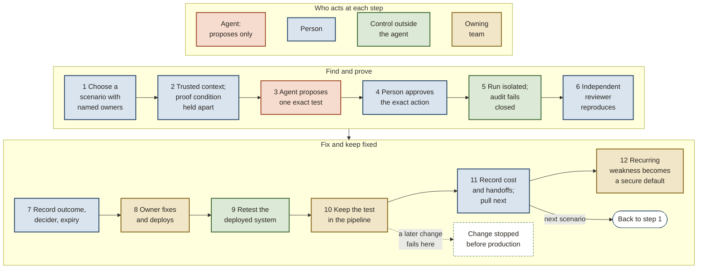

# Security helps continuous delivery by fixing what it finds and keeping it fixed

*Ratchet: closed-loop security validation for AI-assisted engineering. Strategy brief. Edition 5.2.0, Thesis 1.4.3, 2026-10-31, build 5842e9bf+local.*

This is the generic brief. Before work starts, the executive sponsor approves the organization’s tailored version, which fills in effort per role, setup and calendar estimates, the review date, the people named to each duty, whether phase 1 uses a practice target (a target the team wrote for practice) or a real finding, which existing tools meet each control, and the owning team’s fix capacity.

**Fund phase 1, the first of five phases: map today’s loop, fix one weakness, independently verify the deployed fix and keep a regression test. Write pass checks and stop conditions first. Compare an AI agent with a no-agent script on the same case.**

Security supports continuous delivery alongside reliability, availability, usability and safety. It owns secure templates, libraries and checks for recurring defects. Ratchet is the loop that finds a weakness, fixes it and keeps it fixed.

## Check whether fixes stay fixed

AI can supply findings faster than teams fix them. Noise leaves real findings waiting. Our diagnosis: later changes can undo fixes unless tests or secure defaults hold them. **Sweep decay** means escapes (weaknesses in production that an attacker can reach through the running system) return after a model-driven sweep, a one-pass AI scan of the code. They return through reintroduced weaknesses or classes of weakness a newer model finds. This is untested; phase 1 maps one case and cannot establish decay.

## Measure escapes and verified fixes

An **escape** is a weakness an attacker can reach in production. Compare escapes per deployment and time from reproduction to verified deployed fix against the starting point.

## Widen only on evidence

Teams catch weaknesses during coding or review. Reviewers outside the owning team prove the rest in approved test environments; urgent escalation requires confirmation through running production. We will not grow discovery before closure, let an agent act or judge on its own authority, or commit to scale before phases report.

## Tests keep fixes and agents hold no authority

An agent's report is a lead. Reproduced weaknesses get verified fixes or remain open under tested controls, with residual risk accepted by the business risk owner.

Take an invoice service where a view-only role can approve payments. Security, the owning engineer and an agent co-create the fix and team-owned local test. Security's read-only **kept-test mirror** flags removed, skipped or failing tests. Missing or stale observations mean unknown protection.

Security's independent **aggregate validation** checks complete attack paths against hidden proof conditions: what would establish or refute a weakness. A local pass can leave a wider path open. Variants become new findings. Exhibit 1 details roles, tools and checks.

1. **The agent cannot give itself permission to run a test.** It proposes the invoice test. The service owner approves that exact action in phase 1.
2. **The testing agent cannot read the answer it will be judged against.** The independent reviewer holds the invoice proof condition out of reach.
3. **The agent's report alone cannot establish a finding.** The independent reviewer checks the report and reproduces the result. A skipped check means untested.
4. **The human test operator who submits the agent’s proposal cannot accept its result.** The person who proposes a test, the person who holds its proof condition and the person who decides the result are three different people, except in phase 1, where the independent reviewer both holds the proof condition and decides. Closure needs two distinct human acceptances, one of the review and one of the retest, plus a machine record of the deployment.

Phase 1’s independent reviewer holds proof and decides; this demonstrates feasibility without assurance. The exception ends at exit or the risk owner's review date, whichever comes first. Work then stops under it unless full separation or an accepted standard exception covers continuation. Phase 2 requires full separation.

People approve every phase 1 action. From phase 2, the access approver grants reviewed tests standing permission after clean runs, within environment, action and consequence limits. People approve actions outside those limits or at or above the business risk owner's **consequence line**, the harm threshold requiring exact approval.

*What we will not do:* give agents their own authority. Under a later, expiring autonomy grant from both risk owners, after honesty and correctness checks pass, self-validated findings stay labeled; measures report with and without them. Both human closure acceptances remain required.

**Asymmetric suspicion:** human approvers can drift toward approval. The design tests each human gate with seeded known-bad items to measure whether that gate still catches them. A preprint reports human approval rates rising from 30.1% to 36.8% over seven months. Evidence for drift is moderate. Seeded gate-health measurement is a separate, weak and untested bet until phase 3.

The adjustable test-time target is under ten minutes per delivery stage, unmeasured. Exceeding it prompts review; gate timeouts and whether failures block stay unchanged.

## Keep control and book fix capacity

Keep approvals, proof conditions, report checks and independent acceptance. Teams agree open-finding caps with security or use the default set by the decision owner, the executive sponsor. Security paces discovery to fixing. Whether validation beyond capacity wastes time without reducing exposure is a weak, untested bet. Above-cap findings get monthly review. Consequence, sourced exploitation and disclosure deadlines bypass the cap through security's intake checks.

Of 50 reviewed claims, 18 hold, 27 are honest bets, 4 were reworded and 1 was dropped. The reworded claims are retained: three graded weak, one moderate. Each retained claim says what would disprove it ([Exhibit 2](#exhibit-2)).

## Fund only phase 1

| Phase 1 (decision today) | Phase 2 | Phase 3 | Phase 4 | Phase 5 | North Star |
|---|---|---|---|---|---|
| The loop closes once | The evidence can be trusted | Ratchet is measured against today's process and a no-agent baseline | A second team runs it | It works in production | Found and fixed where introduced, kept fixed |

Phases end on passed exit tests and completed work. Phase 2 needs the accepted phase 1 report: case evidence, limits and gaps, without assurance or scale claims.

## Set the outcome, people and review date first

- **Decision owner:** the sponsor writes closure, independent verification and regression checks. Names a scorer distinct from the test operator.
- **People and effort:** three working roles, sponsor and risk duties (Exhibit 1). Estimate setup and role time before starting; record attempts and waits. Estimate phase 2 at review, labeled a bet.

**Stops, written before work begins:**

- At each organization-set phase review point, work pauses until the decision owner records continue, change or stop and a next review date for continuing work. If phase 1 has not closed, the report names the unmet cross-team commitment (such as scope, approval or fix capacity) and its owner. Its exception to the rule that acceptance is independent ends at phase 1 exit or the risk owner's review date, whichever is first.
- Phase 2's exit test fails any condition, including the owning team's delivery measures leaving the tolerance it set. The work then stops until the causes are written down and the decision owner decides whether to continue.
- After closed cases exceed the organization’s minimum (five by default, so at least six cases; under that default it cannot fire in phase 1’s single case), agents stop if slower and costlier than the script on every case and finding nothing it missed. The scripted loop becomes the plan.

---

## Exhibit 1: the loop carries a finding to a fix that a test keeps in place

Independent reproduction uses the approved environment, including an isolated or staging target. Tests may run in isolation or staging; urgent escalation requires independent confirmation through running production. A staging result alone does not qualify. The independent reviewer records a finding as held only when reproduction observes a control stopping the path and an owned, current dependency test keeps checking it. The business risk owner accepts residual risk. Security's fix-cap gate checks recorded consequence, sourced exploitation and external disclosure deadlines. Qualifying findings bypass only the open-finding cap and still follow approval, proof and acceptance.

The first six steps turn a proposal into a verified finding. The last six turn it into a fix that a test keeps in place, and step 11 pulls the next scenario, so the loop starts again. Every arrow that changes the system passes through a person or a control outside the agent. Color shows who acts at each step: the agent acts only at step 3, and only to propose. The dashed arrow is where the ratchet holds: a later change that reopens the weakness fails at the kept test. The six-pager, the longer companion document, shows the same diagram in its Appendix A.

### Name the people behind every phase 1 duty

The generic design names roles. Before starting, the sponsor records the named people holding them in the profile, the organization's record of its Ratchet settings, owners and choices, and in phase 1's written criteria. Three working roles carry the loop, which can require more than three people. The sponsor is additional. Name the risk duties, scorer and retest acceptor too. One person can hold several duties where separation permits. The role table in part 3 of the complete edition supplies these assignments.

| Phase 1 person or named duty | Responsibility |
|---|---|
| Test operator, usually a security engineer | Runs the loop and submits the agent's proposed action. This human is the proposer, who cannot accept the result. The agent drafts the proposal. |
| Service owner | Approves each action against the service before it runs. Fixes and deploys the correction and keeps the local test. Does not accept its own closure. |
| Independent reviewer outside the service owner's team | Checks the agent's report, independently reproduces it, holds the proof condition the agent cannot read and decides the outcome. A named person on the independent reviewer’s team signs review acceptance. A different named person accepts retest. Neither can be an agent or service account. |
| Retest acceptor | A second named person, distinct from the review acceptor and fix author. The design assigns no further job title. |
| Scenario owner, named in the profile | Chooses the scenario and drafts its proof condition. The profile records the drafter. The independent reviewer holds it in phase 1. |
| Decision owner, the executive sponsor | Names people, criteria, scorer and review date. Accepts the phase 1 report and records continue, change or stop. Accepts the departures from the separation rules listed below, which apply only inside the test environment, with the independent reviewer concurring. |
| Security risk owner | Named before the organization first runs the loop, to accept the records of how it adopted the design. Sets thresholds. The exception record names its risk owner and review date. Must never be the proposer. |
| Business risk owner | Accepts residual risk. Both risk owners accept standard exceptions and later autonomy grants. A phase 1 exception touching real assets, data or outsider text (text written by people outside the organization) needs both. The business risk owner cannot be the proposer, discoverer or verifier. |
| Comparison scorer | Named by the sponsor before phase 1, with a scoring scale. Must be someone other than the test operator. The design fixes no other assignment or overlap. |

The rule that acceptance is independent normally separates the human proposer, proof-condition holder and decider. Phase 1 combines only proof holding and deciding in the independent reviewer. A named person on the independent reviewer’s team signs review acceptance. A different named person accepts retest; neither can be an agent or service account. The retest acceptor cannot author the fix. The phase 1 exception does not merge those acceptances.

If the exception's review date arrives before exit, work stops under that exception. Full separation or a standard exception accepted by the named risk owners must cover continued work. A continue decision cannot renew the phase 1 exception. The exception record names its risk owner and review date. Phase 2's exit test requires full separation.

The narrow phase 1 exception path covers only six departures inside the test environment:

1. the team that runs the agent also approves actions;
2. that team also owns proof conditions;
3. that team also verifies results;
4. one tool both proposes and authorizes;
5. the team that writes the fix accepts closure;
6. findings enter the finding ledger, the record of findings, directly.
 The sponsor accepts each recorded departure, with the independent reviewer concurring, until phase 1 exit at the latest. Once both risk owners are named, they must accept it again as a standard exception. Real assets, data or outsider text always need both risk owners. This acceptance path is separate from phase 1's exception to the rule that acceptance is independent, which combines only proof holding and deciding and can end earlier at its review date. It never merges the two human closure acceptances.

### Phase 1 needs operational controls that Ratchet's published design and tools do not supply

The design prescribes no tool products. It does not establish which tools an adopter has. Before starting, name the existing tracker, pipeline, sign-in and change-approval tools and what each provides. The tracker records scope, owners, exact-action approvals, evidence, handoff waits and closure. The pipeline runs an isolated, network-allowlisted job with a short-lived scoped credential, records cleanup and the deployed version, and keeps the regression test. Its audit log must record each action before it happens, and the job must stop before acting if the log is unavailable. The reviewer's proof conditions and evidence need access controls the test operator and agent cannot override.

The profile records whether the runner uses a scoped cloud role or an existing mechanism bound to the exact approved action. A scoped role leaves a phase 1 control gap: it is neither bound to the approved action nor used up after one use. The profile checker in ratchet-tools, the checking tools shipped with each edition (below), reports that gap. Phase 2 builds the exact-action authorization service and shared execution controls. With a synthetic practice target, the agent sees no real data or outsider text. With a real finding, the agent drafts without tools, can send data only to the approved model route, and people execute approved actions. The independent reviewer confirms this boundary before starting.

The pipeline and test catalog must supply kept-test identities and run results for security's read-only inventory. Phase 1 records the local test and observes its runs. The automatic kept-test mirror is phase 2 work. If an existing tool is missing, record the manual stand-in, its control gap and a revised effort and wait estimate. A stand-in must still meet the required control or have an accepted exception. Setup effort must be estimated; the design assumes no new tool deployment.

### The report supports a bounded account of the case

The sponsor can say which weakness was tested, in which environment and deployed version, what the independent reproduction and retest observed, whether legitimate behavior still worked, and which local regression test was kept. The report includes the map of how findings are handled today, handoff waits, agent-versus-script results and per-case verdict, deviations from the plan, control gaps and phase 2 effort estimates. A verdict against the agent does not fail phase 1.

Because phase 1 combines proof holding and deciding, it makes no assurance claim. The report cannot establish independent assurance, production-wide risk reduction, a lower escape rate, durability across later changes, scale or agent value. A staging result establishes only that environment's result. Historical findings and incidents supply the starting escape rate. One case cannot measure sweep decay or trigger the default early stop, which needs at least six closed cases. The agent-against-script comparison only describes what happened until its stop conditions can be met, and phase 3 tests the full value case.

### Teams own the local tests and security checks the complete path

Consider an invoice service where a role meant only to view invoices can approve them. Security, the engineer who owns the code and an agent develop the fix together in one pull request. They include a local regression test that fails if the view-only role can approve again. The invoicing team owns that test in its suite. The coding agent can see it. Security co-authors through the team's normal pull request review; the mirror has read-only access.

Security keeps the **kept-test mirror**, an automatic read-only inventory of every kept test and its run results. Removed, skipped or failing tests become findings. Missing or stale observations mean protection is unknown. The mirror helps a reviewer check protection at the code version, configuration and dependencies being assessed. It cannot edit the team's pull request or tests.

Security also checks whether weaknesses combine into a complete attack path. This is **aggregate validation**, the independent layer. Its proof conditions state what would establish or refute a weakness. Those conditions and the checks of connected attack steps never reach the coding agent. A local test can pass while this layer finds a remaining path. Any variant becomes a new finding through the normal loop. Nobody quietly changes the team's pull request.

Security owns tests for whole weakness classes in shared defaults and guardrails. Agents receive static or in-process checks derived from those tests. Their pattern is general to the weakness class and excludes the kept test’s inputs and fixtures (its test data and setup). They return pass or fail with a fixed message that states no expected boundary behavior or outcome. They carry no proof condition, expected-outcome hash or outsider text. Runtime replays, tests rerun against a running system, never yield a derived check; protected regression and connected-path checks stay on security's side. This restricted output keeps the proof condition hidden from the agent. We measure how many contributed tests still run and pass, and how many contribute to a guardrail for a whole class. The cost advantage and class-level returns remain untested bets.

The default budget is under ten minutes of security test time at each delivery stage, including pull request, merge and deploy. The organization can change it in the profile. This is unmeasured. Stage-time trends prompt review of which tests block. Exceeding this target changes neither gate timeouts nor whether a failing check blocks. Movement beyond the service owner's delivery tolerance, the range its delivery measures may move, stops phase 2 for a recorded decision.

Each edition includes **ratchet-tools**, runnable code for checking and tailoring the design. The bundle needs Bun and no npm packages. Every file has a hash in the edition manifest, and every bundled tool must pass its edition's test cases before release. These tools support adoption. Phase 1 still uses the organization's existing operational tools.

## Exhibit 2: each value bet has a test and a fallback

The agent-assisted value case depends on these bets. If agents fail their comparison, the scripted loop and kept tests remain the plan. The loop's safety case does not depend on a discovery or capacity advantage. Each row is one of the honest bets, claims acted on before the evidence settles them, from the six-pager's evidence appendix (Appendix C), quoted as that appendix states it, with the grade it carries there and the phase whose data settles it in our own systems. None is graded higher here than there.

| What would have to be true | Grade | What would prove it wrong | Settled in |
|---|---|---|---|
| Bounded LLM agents find real, validated security defects in enterprise systems at a rate worth paying for. | honest bet, weak; untested | Over a pre-registered cohort, the agent arm yields no more validated findings per unit cost than the scripted comparator or the current process. | Phase 3 |
| Agent-assisted validation is cheaper per accepted closure than the current process once full costs are counted. | honest bet, weak; untested | Phase 3 reports the agent arm's cost per accepted closure, with failures in the denominator, at or above the current process. | Phase 3 |
| A finding that arrives with a reproducing test, a drafted fix and an owned gate costs the owning team less than one that arrives as a ticket. | honest bet, none; untested | Owning teams spend as many hours per accepted finding that arrived with a fix path as they did per finding before, or decline most drafted fixes. | Phase 3 |
| A security regression stage in the deploy path will not materially slow delivery. | honest bet, weak; untested | Lead time for changes or deploy frequency on services under test moves outside the pre-agreed tolerance. | Phase 2 |
| Remediation throughput is the binding constraint, ahead of validation capability, so validation must be gated on fix capacity. | honest bet, moderate | The phase 1 and phase 2 flow ledgers show fix queue time is a small share of loop time. | Phase 1 |
| Security debt is the security share of quality debt, which every quality draws from one engineering pool, so findings validated beyond an owning team's fix capacity add interest, in team time lost, without reducing risk. | honest bet, weak; untested | Owning teams' reported time lost to security debt does not rise while validated findings arrive above their fix cap, or findings above the cap close as fast as those below it without taking time from other quality work. | Phase 3 |

---

## Appendix: tailoring this brief to one organization

This appendix is for an agent preparing the brief for one organization's sponsor. Work from the same sources as the six-pager's tailoring: the map of current practice, the profile, and the premise ledger the organization keeps for the six-pager. The six-pager's field guide (its Appendix E) sets the premise register; this guide adds what is particular to the brief. Names in code font are fields in the organization's profile.

### Replace these with the organization's own figures

| Passage | Replace with |
|---|---|
| The diagnosis, by starting point | Premise 1 of the six-pager's register says which starting point applies. A backlog organization: its own backlog and escapes, from the past findings and incidents gathered in the map of current practice. A swept organization: when the sweep ran, its scope, what it found and closed, and what has been reintroduced or newly found since, taken from the map's notes and the premise ledger, since the profile has no field for a sweep. No fixed size makes a backlog small: treat the organization as swept when a sweep ran and its open backlog fell after it, and say so with its own figures. After the generic-edition notice, keep the bounded phase 1 recommendation first. In the sponsor’s tailored brief, replace that notice with the filled-in effort, dates, named duties, target, tools and fix capacity. Use only the organization’s own figures in the diagnosis that follows. |
| The diagnosis bullets | Keep the bullet for the organization's starting point and drop the other one. Where the premise ledger validates or contradicts that bullet's cause, replace it with the organization's own; where it does not, keep the bullet as written, marked as not yet validated here. The swept bullet's decay usually stays marked this way for a while, because only later escapes can show it. |
| Where we play | The services and teams phase 1 and the next phases reach, the starting point, and the team structure the profile's `ownership` and `separation` record. Where to play is the most organization-specific choice: name them from the current-practice map and the profile. |
| What we keep | What the organization buys and what it already runs at each part that enforces a rule, from the current-practice map's gaps; where phase 1 stands in by hand, say so. |
| The fix caps | The owning team’s agreed open-finding cap and allocated fix time, or the decision owner’s default cap if no team cap is agreed. |
| Phase 1 | The weakness chosen and whether it is a practice target or real finding, as the profile’s `phase_1_boundary` records it; the review date; and every duty’s named holder, including the three working roles, sponsor, risk owners, scenario owner, review and retest acceptors and scorer, preserving Exhibit 1’s separations. If the sweep supplies a better first weakness, the profile changes first, then the brief. |
| Cost and ownership | Setup effort, estimated hours per role and calendar span beside the review date, allocated fix capacity and the pipeline keeping the test. Name existing tracker, pipeline, sign-in and change-approval tools against each required control; record missing controls, stand-ins and accepted exceptions, then revise the estimate. The sponsor approves this filled-in brief before work starts. |
| Thresholds | The numbers the decision owner sets from the map before phase 2, once they exist. Until then, say they are not set yet. |
| Exhibit 2 | Each bet's local status from the premise ledger beside its published grade, attributed. Never raise a grade; the organization's own evidence sits beside it. |

### Keep these in every telling

- **The stop conditions**, all of them, with the organization's figures filled in. A tighter condition is fine. A looser one, or a missing one, is an exception: name it, who accepted it and when it expires.
- **The "what we will not do" line and the three ruled-out moves** (the three things we will not do, under "Widen only on evidence"), word for word in meaning.
- **The four rules**, with the same meaning as the six-pager: the agent cannot authorize its test, read its protected answer or establish a finding by report alone; the human test operator cannot accept the result they proposed. Keep the invoice explanation beside each, and the phase 1 proof-holder/decider qualifier in the independent-acceptance rule’s own line. Explain every exception with its acceptor and expiry.
- **The asymmetric suspicion sentence**, word for word, right after the rules. Explain that it tests human approvers, with the drift evidence separate from the untested measurement bet.
- **The honest bets.** The claim counts and grades stay as the ledger gives them, and the value case stays labeled a bet until the organization's own phase 3 settles it.

### Keep the form

- About two and a half pages of reading, then the exhibits. For the sponsor, the opening states the bounded phase 1 recommendation with filled-in commitments, then the situation and diagnosis.
- The middle follows the choice cascade, in this order: what winning means and how it is scored, where we play and what we rule out, how we win, what we keep and how we run it, then the phases.
- Every heading states a choice, as an assertion the section supports.
- The brief ends on the ask: who decides what, by when, and what stops the work.
- Write it as the presenting team's argument, and follow the organization's disclosure rules. A tailored brief usually stays inside the organization.
- Keep the set's three depths, headings and figures as the adopters' tailoring workflow describes, and record the thesis version the brief adapts in its front matter.

Hand back the tailored brief, each figure replaced with its source and who confirmed it, and the open questions with who must answer them.

The format follows *Playing to Win*: the middle is its cascade of choices, and Exhibit 2 is its test of what would have to be true. It also draws on *Good Strategy Bad Strategy*, *The Pyramid Principle* and *Working Backwards*.
